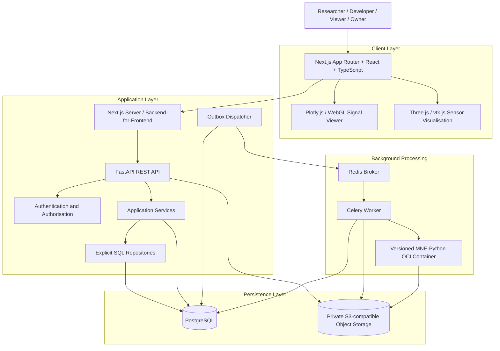
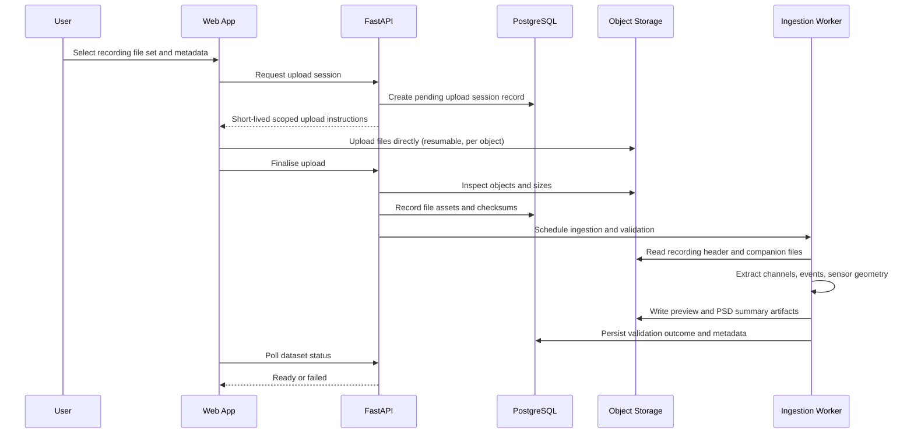

# MEG Lab — System Architecture

## 1. Purpose

This document describes the system architecture, component responsibilities, data flows, trust boundaries, and failure-recovery strategies for MEG Lab.

The architecture must support a secure computational-electrophysiology research workflow while remaining small enough for an independently developed portfolio project.

The primary architectural goals are:

- Clear separation of responsibilities between the interactive web application and scientific computation.
- Strong project-scoped data isolation.
- Reliable asynchronous experiment execution.
- Reproducible scientific computation using versioned OCI container images.
- Safe handling of large multichannel recordings, sensor geometry, and derived artifacts.
- An interactive signal viewer that never routes a full recording through API memory.
- Explicit, parameterised SQL with testable persistence boundaries.
- Observable failures and recoverable operations.
- Reproducible local development and deployment without requiring cloud infrastructure.

## 2. Architectural Overview

MEG Lab uses a modular monolith for its application API, with a separately deployed worker for background processing.

The frontend, API, worker, and supporting services have distinct responsibilities. The initial application must not be decomposed into many independent microservices, and must not require Kubernetes.

The main architectural rule is to separate interactive web requests from scientific computation. MEG signal processing must not run inside ordinary web request handlers. A second rule specific to this product is that the API must not stream whole recordings through its own memory to satisfy viewer requests.

### High-level architecture



The diagram shows logical responsibilities. The precise deployment topology may differ between local development and production. Metadata traffic flows through the API and PostgreSQL. Recording bytes and derived artifacts flow directly between the browser and object storage through short-lived signed URLs. Computation flows through the queue into an isolated container runtime.

The component architecture and detailed data-flow diagrams for system boundaries, recording upload, experiment processing, and CI/CD are indexed in [`diagrams/`](diagrams/README.md).

## 3. Architectural Style

### 3.1 Modular monolith

The FastAPI service contains the application's business logic, API endpoints, and persistence integration.

Organise modules around responsibilities and domain concepts (projects, datasets, recordings, channels, sensor configurations, event sets, pipelines, experiment runs, artifacts) rather than creating a separate network service for every feature.

Advantages:

- Straightforward local development.
- Easier transaction management.
- Fewer deployment dependencies.
- Clearer debugging.
- Strong integration testing.
- Lower operational overhead.

### 3.2 Separate worker process

Background computation runs in a separate worker process, and the scientific code runs inside a versioned OCI container launched by that worker.

This prevents expensive signal-processing operations from blocking the API event loop and allows the worker to have its own resource limits and scaling policy.

The worker shares domain and persistence modules with the API where appropriate, but it must not depend on API process memory.

### 3.3 Explicit boundaries

Keep the following boundaries clear:

- Presentation and client state.
- HTTP and API contracts.
- Application business rules.
- Persistence and SQL.
- Scientific computation and container runtime.
- External infrastructure.

A module should not need to know the implementation details of unrelated layers.

### 3.4 Why not microservices or Kubernetes

The product scope does not justify distributed complexity at this stage. A microservice fleet and Kubernetes control plane would add deployment, networking, observability, and security overhead before demand is established.

The modular monolith plus a single worker service keeps transactions local, makes cross-project isolation easier to reason about, and allows the entire stack to run through Docker Compose.

Cloud infrastructure (GCP or AWS, Terraform, Kubernetes, and split-out services) is explicitly deferred. The architecture must not require it to function, and any cloud deployment must remain an optional, documented evolution rather than a prerequisite.

If scaling or security requirements later justify splitting a component (for example notebook orchestration, a dedicated signal-summary service, or an OPM movement-tracking service), that split must be recorded as an Architecture Decision Record before implementation.

## 4. Component Responsibilities

| Component               | Responsibility                                                                                                                            |
| ----------------------- | ----------------------------------------------------------------------------------------------------------------------------------------- |
| Frontend application    | Authentication experience, project navigation, dataset upload, metadata presentation, viewer controls, run submission and monitoring.     |
| Signal viewer           | Multichannel trace rendering, time navigation, amplitude scaling, event markers, channel grouping, viewer-state persistence.              |
| Sensor visualisation    | Three-dimensional sensor layouts, positions, orientations, coordinate-frame display, and OPM movement inspection.                         |
| Backend-for-Frontend    | Resolves the session on the server, forwards authenticated REST calls, and keeps tokens out of browser storage.                           |
| API service             | Authenticates requests, resolves the user, verifies project membership, validates input, serves bounded signal windows, and creates runs. |
| Application services    | Coordinate complete business operations such as upload finalisation, ingestion, validation, run submission, and artifact recording.       |
| SQL repositories        | Encapsulate parameterised SQL, project-scoped filters, transactions, and row-to-domain mapping.                                           |
| Scientific module       | Deterministic MEG reading, validation, and signal operations used by workers and tests.                                                    |
| Background worker       | Executes queued experiment runs, applies limits, launches containers, persists outcomes, and records safe failures.                       |
| OCI runtime             | Runs versioned MNE-Python container images for a single run in isolation.                                                                  |
| PostgreSQL              | Authoritative source of truth for metadata, project membership, run state, artifacts, and audit events.                                   |
| Redis                   | Transports background task messages; never the authoritative source of run state.                                                         |
| Outbox dispatcher       | Publishes committed outbox events to Redis reliably, independent of the API request transaction.                                          |
| Object storage          | Holds source recordings, derived artifacts, and manifests behind private access and short-lived signed URLs.                              |

### 4.1 Frontend application

Technology: Next.js App Router, React, TypeScript.

Responsibilities:

- Authentication experience.
- Project selection and project management.
- Recording upload and metadata presentation.
- Channel browsing and signal exploration.
- Sensor geometry and acquisition metadata panels.
- Pipeline selection and run submission.
- Run status monitoring and log viewing.
- Artifact presentation and download.
- Accessible error, loading, and empty states.

The frontend is not trusted to enforce permissions or validate scientific data conclusively.

Browser code talks to the Python API only through the Next.js server (Backend-for-Frontend) that runs inside the Next.js process (see `08-tech-stack.md`). The BFF reads the HttpOnly session cookie, resolves the active project on the server, and forwards authenticated REST requests; it never weakens the checks performed by the API.

Client-side validation improves usability, but the API must repeat all security-relevant checks.

### 4.2 Signal viewer

Technology: Plotly.js for low-density work, with a custom WebGL/canvas renderer for high-density multichannel traces.

Responsibilities:

- Render multiple channels against a shared, navigable timeline.
- Apply display transforms (vertical scale, offset, gain, colour, filtering preview) that do not modify stored data.
- Request bounded signal windows and multiresolution summaries from the API rather than entire recordings.
- Render event markers and event channels alongside the traces.
- Search, select, hide, and group channels by type.
- Persist viewer state without treating display settings as analytical parameters.

The viewer distinguishes display transformations from analytical computations. What the user sees on screen must never be recorded as the scientific input to a run.

### 4.3 Sensor visualisation

Technology: Three.js or vtk.js for three-dimensional sensor layouts.

Responsibilities:

- Render sensor positions and orientations in a declared coordinate frame.
- Distinguish magnetometers, gradiometers, and OPM scalar/vector units visually.
- Present the coordinate frame (head, device, or OPM) explicitly alongside the geometry.
- Visualise time-varying OPM geometry when movement-tracking data is available.
- Never imply a shared coordinate space between recordings that declare different frames.

Sensor visualisation is a display concern. Analytical operations always consume the recorded `sensor_configuration` through the scientific module, not the screen state.

### 4.4 API service

Technology: FastAPI and Pydantic.

Responsibilities:

- Authenticate requests.
- Resolve the current user.
- Verify project membership and permissions.
- Validate API input.
- Apply business rules.
- Manage relational metadata.
- Coordinate upload sessions and finalisation.
- Serve bounded signal windows and multiresolution summaries.
- Issue short-lived signed URLs for authorized recording and artifact access.
- Create experiment runs and outbox events.
- Emit structured logs.
- Expose health and readiness endpoints.

The API should remain stateless between requests, apart from appropriately managed external session mechanisms. It must not decode full recordings into memory to answer viewer requests.

### 4.5 Application services

Application services implement complete business operations, such as:

- Creating a project.
- Finalising a recording upload and its file set.
- Ingesting and validating a recording and extracting its metadata.
- Building a bounded signal window or resolving a cached summary.
- Submitting an experiment run.
- Claiming or completing a run.
- Persisting artifacts and the experiment manifest.

Services coordinate repositories and external integrations.

They should not contain presentation-specific logic or rely on implicit global state.

### 4.6 SQL repositories

Repositories encapsulate explicit SQL queries and transaction boundaries.

Responsibilities:

- Reading and writing domain records.
- Applying project-scoped filters.
- Handling concurrency.
- Enforcing expected state transitions.
- Retrieving paginated results.
- Mapping database rows to application structures.

Use parameterised SQL for all user-controlled values.

Repositories must not accept a project identifier from the client as proof of authorisation. They receive a project context already verified by the application layer.

### 4.7 Scientific module

Technology: Python, MNE-Python, NumPy, and SciPy, packaged inside versioned container images.

The scientific module is organised by responsibility:

- `format_adapters/` — per-format ingestion behind a common interface: FIF via `mne.io.read_raw_fif`, CTF `.ds` via `mne.io.read_raw_ctf`, KIT `.sqd`/`.con` via `mne.io.read_raw_kit`, UCL FIL OPM `.bin` via the FIL reader with companion metadata, and BIDS import via MNE-BIDS.
- `preprocessing.py` — filtering, resampling, referencing, bad-channel handling, ICA and SSP.
- `epochs.py` — epoching, baseline correction, rejection, and averaging to evoked responses.
- `spectral.py` — power spectral density, multitaper and Welch estimates, time-frequency operations.
- `opm.py` — OPM-specific preprocessing, background-field handling, and geometry-aware operations.

General responsibilities:

- Load supported recordings within configured limits using lazy, chunked reads where the format allows.
- Validate arrays, channel metadata, sampling rates, and coordinate conventions.
- Compute signal operations such as filtering, resampling, epoching, averaging, and spectral estimation.
- Return typed, serialisable results and artifact metadata.
- Apply documented numerical, time-base, and coordinate conventions.
- Avoid modifying source recordings in place.

Keep numerical functions as deterministic and independently testable as practical.

### 4.8 Background worker

Technology: Celery backed by Redis.

Responsibilities:

- Execute queued experiment runs.
- Load authorized run inputs.
- Launch the correct versioned container image by digest.
- Apply resource and time limits.
- Persist successful artifacts and the manifest.
- Record safe failure information.
- Retry eligible transient errors.
- Recover from interrupted execution.
- Generate precomputed previews, multiresolution summaries, and PSD summaries as artifacts.

A worker must verify the current run state before committing results. Receiving a duplicate message must not automatically mean the run can execute again.

### 4.9 PostgreSQL

PostgreSQL is the source of truth for application metadata and run state.

It stores relational records, ownership relationships, lifecycle state, channel inventories, sensor configuration metadata, event-set metadata, artifacts metadata, audit events, and experiment manifests. Raw signals and derived continuous data are never stored in relational rows; they live in object storage.

### 4.10 Redis

Redis transports background task messages.

It is not the authoritative source of run state. The application must be able to inspect run status from PostgreSQL even when Redis is temporarily unavailable.

### 4.11 Outbox dispatcher

The outbox dispatcher publishes committed `outbox_events` rows to Redis. It runs independently of the API request transaction so that a run can be committed to PostgreSQL even if queue publication is temporarily unavailable.

### 4.12 Object storage

Private S3-compatible object storage holds source recordings and processing artifacts. MinIO is used locally.

Store object keys and metadata in PostgreSQL. Do not store public URLs as a substitute for access control, and do not treat possession of an object key as authorisation.

Because some MEG formats are directory-based (CTF `.ds`) or require companion files (KIT, UCL FIL OPM), object storage keys are assigned per file, and the recording-level identity is reconstructed from the recorded file set.

## 5. Repository and Module Boundaries

MEG Lab is a pnpm workspace rooted at `@meg-lab/workspace`.

```text
meg-lab/
├── package.json               # @meg-lab/workspace (private root)
├── pnpm-workspace.yaml        # packages/*
├── docker-compose.yaml
├── packages/
│   ├── frontend/              # @meg-lab/web
│   └── backend/
└── docs/
```

The frontend package is published internally as `@meg-lab/web` and contains the Next.js application, the signal viewer, and the sensor visualisation.

A suggested backend structure:

```text
packages/backend/
├── app/
│   ├── api/
│   │   ├── dependencies.py
│   │   ├── errors.py
│   │   └── routes/
│   │       ├── auth.py
│   │       ├── projects.py
│   │       ├── datasets.py
│   │       ├── recordings.py
│   │       ├── channels.py
│   │       ├── events.py
│   │       ├── signals.py
│   │       ├── sensors.py
│   │       ├── pipelines.py
│   │       ├── runs.py
│   │       └── artifacts.py
│   ├── core/
│   │   ├── config.py
│   │   ├── logging.py
│   │   ├── security.py
│   │   └── exceptions.py
│   ├── db/
│   │   ├── connection.py
│   │   ├── session.py
│   │   └── migrations/
│   ├── models/
│   │   ├── project.py
│   │   ├── dataset.py
│   │   ├── recording.py
│   │   ├── channel.py
│   │   ├── sensor.py
│   │   ├── event.py
│   │   ├── pipeline.py
│   │   ├── run.py
│   │   └── artifact.py
│   ├── schemas/
│   │   ├── common.py
│   │   ├── project.py
│   │   ├── dataset.py
│   │   ├── recording.py
│   │   ├── channel.py
│   │   ├── sensor.py
│   │   ├── event.py
│   │   ├── pipeline.py
│   │   └── run.py
│   ├── repositories/
│   │   ├── projects.py
│   │   ├── datasets.py
│   │   ├── recordings.py
│   │   ├── channels.py
│   │   ├── sensors.py
│   │   ├── events.py
│   │   ├── pipelines.py
│   │   ├── runs.py
│   │   └── artifacts.py
│   ├── services/
│   │   ├── projects.py
│   │   ├── uploads.py
│   │   ├── ingestion.py
│   │   ├── validation.py
│   │   ├── signals.py
│   │   └── runs.py
│   ├── scientific/
│   │   ├── format_adapters/
│   │   │   ├── base.py
│   │   │   ├── fif.py
│   │   │   ├── ctf.py
│   │   │   ├── kit.py
│   │   │   ├── fil_opm.py
│   │   │   └── bids.py
│   │   ├── preprocessing.py
│   │   ├── epochs.py
│   │   ├── spectral.py
│   │   └── opm.py
│   ├── storage/
│   │   └── objects.py
│   └── main.py
├── workers/
│   ├── celery_app.py
│   ├── dispatcher.py
│   └── run_tasks.py
├── tests/
└── pyproject.toml
```

A suggested frontend structure:

```text
packages/frontend/
├── app/
│   ├── (auth)/
│   ├── projects/
│   ├── datasets/
│   ├── viewer/
│   ├── sensors/
│   ├── pipelines/
│   ├── runs/
│   ├── explore/
│   ├── settings/
│   └── api/                  # BFF route handlers
├── components/
├── lib/
├── public/
└── package.json              # @meg-lab/web
```

This is a proposed organisation. Keep the codebase simpler if a module does not yet justify its own file.

Avoid circular imports and avoid importing API route handlers into business logic.

## 6. Request Lifecycle

For a protected API request:

Browser-originated requests first reach the Next.js Backend-for-Frontend, which authenticates the caller from the HttpOnly session cookie and resolves the project context before forwarding a REST request to the Python API. The steps below describe the Python API that ultimately serves the data.

1. The frontend sends an HTTP request.
2. The API validates the request format.
3. Authentication identifies the caller.
4. The application resolves the relevant project context.
5. The server verifies membership and role permissions.
6. The application service executes the requested operation.
7. Repositories perform parameterised SQL operations as required.
8. External services are called only when needed.
9. The API constructs an explicit response model.
10. Structured logs capture the outcome and request identifier.

For state-changing requests, database transactions must protect the relevant invariants.

This synchronous path handles metadata, authorisation, and bounded signal reads. It must not perform MEG signal processing. Requests that would trigger computation create a durable run record and an outbox event instead, then return promptly.

## 7. Project Isolation and Multi-Tenancy

Project isolation is a fundamental security boundary. MEG Lab uses project-scoped tenancy: `projects` is the top-level workspace, and `project_members` defines who may act within it.

### 7.1 Trusted identity

The server obtains the user identity from the verified authentication mechanism.

It must not trust a client-supplied user ID as proof of identity.

### 7.2 Membership verification

Before accessing a project-scoped resource, the server verifies that the authenticated user has an appropriate `project_members` role.

### 7.3 Resource scoping

For a recording belonging to a project, the application must verify the relationship between:

- Authenticated user.
- Project membership.
- Project.
- Dataset and dataset version.
- Recording, channel inventory, sensor configuration, and event sets.
- File asset.
- Requested operation.

Checking only that the recording ID exists is insufficient.

### 7.4 Defence in depth

Use:

- Server-side authorisation.
- Explicit project-scoped queries.
- Database constraints on foreign keys and membership.
- Tests using multiple projects and users.
- Carefully controlled service credentials.
- Optional database row-level security if implemented and tested correctly.

### 7.5 Object-key possession is not authorisation

Object storage keys, signed URLs, and file names are not credentials. Every read, write, download, and job submission checks the caller's permissions against project membership, even when the caller already knows an object key.

Signed URLs are issued only after an authorisation check, are short-lived, are scoped to a single object, and do not grant listing or overwrite rights.

### 7.6 Cache isolation

Project-specific caches — including cached signal summaries, preview artifacts, and sensor geometry — must be keyed by the appropriate project and user context in addition to the immutable input identity.

When the active project changes, the frontend must invalidate relevant cached data.

A cache hit must never bypass a permission check that is required for the operation.

## 8. Dataset and Recording Upload Architecture

Large multichannel recordings should not routinely pass through several layers of application memory. Uploads use upload sessions and direct-to-object-storage transfer, and a recording may consist of a set of files rather than a single object.

### Recommended flow



This sequence is conceptual. The initial implementation may perform lightweight validation synchronously if the file limits make that safe, but large or expensive ingestion must use the worker.

### Upload invariants

- The user must be authorised to upload into the target project.
- Storage is private.
- The server validates the file set independently of browser checks.
- The dataset version is not ready before validation succeeds.
- Completion validation confirms every declared object exists, matches its declared size, and has the expected checksum.
- A directory-based format (CTF `.ds`) is only complete when all required companion files are present.
- Finalisation must be idempotent or protected against duplicate requests, using `idempotency_keys` where required.
- Interrupted uploads can be identified and cleaned up.
- A database failure after object upload must not create indefinitely invisible objects.
- Upload sessions and signed URLs must expire.
- File-size, total-recording-size, and parser limits must be enforced.

### Checksums and completion

When an upload session is created, the client declares the expected file set, sizes, and, where available, content checksums. On completion the server verifies:

1. Every object exists at its recorded key.
2. Each stored size matches its declared size.
3. Each checksum matches, or the server computes and records a SHA-256 checksum if the client did not supply one.
4. The objects are registered as `file_assets` rows linked to a draft `dataset_version`.

Only then is ingestion and validation scheduled and the dataset version marked ready.

### Upload recovery

Use an explicit lifecycle and reconciliation process.

For example, an object may exist while the database still records a pending upload session, or one companion file of a CTF `.ds` set may be missing. A scheduled cleanup or reconciliation task should detect abandoned sessions and unreferenced objects according to a documented retention policy.

Do not delete source recordings merely because a transient database operation failed.

## 9. Format Detection and Metadata Extraction

MEG ingestion cannot assume that a recording is a single file. Some formats are single files, some are directories, and some depend on companion files. MEG Lab uses format adapters behind a common ingestion interface.

The ingestion interface performs the same conceptual steps for every format:

1. Identify the recording format.
2. Validate the required file set.
3. Extract metadata through the appropriate reader.
4. Persist an immutable source reference.
5. Generate a metadata summary and preview artifacts.
6. Expose the dataset to compatible analysis workflows.

### Supported formats

| Format          | Shape                              | Reader                         | Notes                                                        |
| --------------- | ---------------------------------- | ------------------------------ | ------------------------------------------------------------ |
| FIF             | Single file (`.fif`)               | `mne.io.read_raw_fif`          | MNE-native; carries channels, events, and often forward data |
| CTF `.ds`       | Directory (`.ds/`)                 | `mne.io.read_raw_ctf`          | Requires the full directory file set                          |
| KIT             | Single file (`.sqd`, `.con`)       | `mne.io.read_raw_kit`          | May require companion marker files                            |
| UCL FIL OPM     | Single file (`.bin`) + companion   | FIL reader with metadata file  | OPM recordings; companion metadata is required                |
| BIDS            | Directory structure                | MNE-BIDS                       | `*_meg.fif`, `channels.tsv`, `events.tsv`, `coordsystem.json` |

The initial release must not promise universal MEG format support. Add adapters incrementally and validate them against exact file variants and companion files.

### Validation extracts and records

- Format and format variant.
- Recording duration and sampling frequency.
- Channel count, names, types, and units (with unit multipliers).
- Bad channels recorded by the acquisition system.
- Sensor configuration: sensor type, positions, orientations, coordinate frame, and units.
- Event definitions, event sample indices, and time-base conventions.
- Acquisition system class (SQUID or OPM).
- Device and acquisition metadata where available.
- File checksums and the exact source file set.

Validation rules:

1. Reject file sets that are not a supported format or that fail header parsing.
2. Enforce maximum channels, duration, sampling rate, file count, and total size to bound memory and time.
3. Guard against malformed headers and decompression-based resource exhaustion before reading signal data.
4. Verify that sensor geometry is finite and dimensionally consistent before relying on it.
5. Record checksums and provenance for reproducible reference.
6. Treat validation as read-only; never mutate the source recording.

Validation outcomes are persisted as structured metadata so the frontend can present duration, sampling frequency, channel inventory, and sensor geometry, and so experiment runs can record the exact time-base and coordinate conventions used.

## 10. Signal Viewer Data Path

The viewer needs interactive access to multichannel time-series data without routing entire recordings through the API event loop. This is the central data path of the product.

### Signal access strategy

- The API authorises the request and serves either a bounded signal window or a multiresolution summary, never the whole recording.
- Bounded windows are delivered through short-lived, single-object signed URLs with explicit byte ranges, or as compact range responses for read-only access.
- The browser fetches the data and renders it client-side using Plotly.js or the custom WebGL/canvas renderer.
- The API never streams a full recording through its own memory as a general-purpose path.

### Bounded windows and multiresolution summaries

- Bounded windows return a selected channel set over a selected sample interval at full or reduced resolution.
- Multiresolution summaries are precomputed peak and decimated representations for interactive navigation and zooming.
- Summaries are cached by immutable input identity (the recording's content checksum plus the processing configuration) so repeated navigation is fast and reproducible.
- Request parameters for channel selection, time interval, and output resolution are validated server-side, and responses are bounded.

### Precomputed worker artifacts

Where a derived representation is needed, the worker generates it asynchronously and stores it as an artifact:

- Preview windows and downsampled summaries for initial display.
- Peak/decimated summaries for waveform navigation.
- PSD summaries for spectral overviews.
- Filter previews where a configuration preview is requested.

These artifacts are delivered through the same signed-URL and bounded-window mechanism as source data.

### Slicing equivalent — time navigation

The viewer navigates the recording timeline, aligns multiple channels on a shared time axis, and keeps event markers linked to the signal traces. Display state includes visible time window, channel selection and grouping, vertical scale, offsets, and colour.

### Viewer-state persistence

Viewer state such as visible window, selected channels, channel grouping, amplitude scaling, and event filters may be persisted as user or project preferences.

Viewer-state persistence must not be treated as input to an experiment run. Only the recorded dataset version, pipeline version, and explicit parameters define a run.

### Events and auxiliary channels

Event markers, stimulus channels, and auxiliary channels (EOG, ECG, and similar) can be shown alongside the MEG channels. The viewer must state the sample convention and time base used to place events on the trace.

### Display transforms vs analytical computations

The architecture distinguishes:

- Display transforms, which affect rendering only.
- Analytical computations, which affect scientific results and must run in the worker inside a versioned container.

The same operation (for example a filter) may exist in both forms, but a display-only operation must never be presented as a recorded analysis.

## 11. Sensor Geometry and Coordinate Frames

MEG measurements are spatial. A recording carries a `sensor_configuration` that describes where and in which frame each sensor measured the field.

A `sensor_configuration` records:

- Sensor type (magnetometer or gradiometer for SQUID; scalar or vector units for OPM).
- Sensor positions and orientations, with explicit units (millimetres or metres).
- The coordinate frame (head, device, or a dedicated OPM frame).
- Per-channel calibration and units where available.
- A reference to movement-tracking data where it exists.

### Coordinate frames

Recordings must declare the frame in which their geometry is expressed:

- `head` — a head-based coordinate frame, typically from a digitised head shape or fiducials.
- `device` — the acquisition device frame, common for MEG systems that have not been transformed to a head frame.
- `opm` — a frame specific to an OPM array, which may not correspond to a conventional head frame.

The API and viewer must never infer or assume a frame. Analysis code consumes the recorded `coordinate_frame` explicitly.

### SQUID example

A Neuromag Vectorview recording carries 306 MEG channels (102 magnetometers and 204 gradiometers) plus 9 auxiliary channels, sampled at 1000 Hz, expressed in the head coordinate frame. Bad channels recorded by the acquisition system (for example `MEG 0131` and `MEG 2142`) are preserved as channel status rather than discarded.

### OPM example

A UCL FIL OPM recording may carry 64 channels with variable sensor geometry. Unlike a fixed SQUID array, OPM sensor geometry may vary between recordings and, when movement-tracking data is available, may vary over time within a recording.

### Variable geometry and movement

- Geometry is recorded per recording, not assumed to be constant across a project.
- When movement-tracking data is present, a time-varying geometry reference is recorded with the sensor configuration.
- Analysis of OPM data must state whether it uses a single representative geometry or a time-varying one.

### Display vs analytical treatment

Sensor visualisation renders geometry for inspection. Analytical operations always consume the recorded `sensor_configuration` and its declared frame and units. Displaying a sensor layout must not be treated as a valid geometry input to a run.

## 12. Experiment Run Architecture

### 12.1 Purpose and versioning

An experiment run executes a versioned pipeline against a versioned dataset.

- A `pipeline` is the logical analysis workflow.
- A `pipeline_version` holds the definition and the `image_digest` of the OCI container that implements it.
- An `experiment_run` references a `pipeline_version_id`, a `dataset_version_id`, validated `parameters`, and status.

Pinning `image_digest` ensures a run resolves to exact container contents rather than a mutable tag.

### 12.2 Job submission

The API validates the request and creates a durable run record.

The record includes:

- Run ID.
- Project ID.
- Dataset version ID.
- Pipeline version ID and image digest.
- Validated parameters.
- Requested-by user ID.
- A reference to the `sensor_configuration_id` used where geometry matters.
- Idempotency information where applicable.
- Current state.
- Timestamps.

The API returns the run resource without waiting for computation to finish. A non-null `idempotency_keys` entry prevents duplicate run creation from retried submissions.

### 12.3 Dispatch reliability

A naive sequence of committing a run to PostgreSQL and then publishing a Redis message has a failure window: the database transaction may succeed while queue publication fails.

Use a transactional outbox. Create the run and its `outbox_events` row in the same database transaction, commit both, then let the dispatcher publish pending events. This is described further in section 14.

### 12.4 Worker execution

The worker:

1. Receives a run identifier.
2. Loads the run from PostgreSQL.
3. Checks that its state permits execution.
4. Claims the run using a concurrency-safe transition.
5. Resolves the pipeline version and container `image_digest`.
6. Loads authorized input recordings via object storage.
7. Executes the container with the validated parameters inside the versioned environment.
8. Validates the output.
9. Persists artifacts (epochs, evoked responses, spectra, plots) and the experiment manifest.
10. Marks the run successful in the appropriate transaction.
11. Emits structured operational logs.

If a failure occurs, the worker records an appropriate state and classifies whether retry is safe.

### 12.5 Worker isolation and resource limits

- Each run executes inside an isolated OCI container launched by the worker.
- Containers run with no default access to application secrets, the database, or other users' recordings.
- CPU, memory, disk, wall-clock runtime, and egress are bounded.
- Worker egress is restricted; access to cloud metadata endpoints and internal services is blocked.
- Inputs are provided through a controlled, read-only mechanism; outputs are written to a controlled location and then stored as artifacts.
- Container images are pinned by digest so that a mutable tag cannot silently change a reproducible run.

### 12.6 Concurrency

Do not allow multiple workers to commit competing results for the same logical run.

Use a conditional state update, row locking, a lease, or another explicitly tested concurrency mechanism.

A worker that discovers the run has already completed should exit without changing its result.

### 12.7 Retries

Use bounded retries with exponential backoff and jitter for transient failures.

Do not automatically retry invalid input, unsupported formats, or deterministic scientific computation errors without a clear reason.

Define what happens when the retry limit is reached.

### 12.8 Stale runs

Implement a recovery strategy for runs left in `running` after a worker crash.

A lease or heartbeat can distinguish active processing from stale ownership.

Recovery must avoid restarting work that is still executing elsewhere.

### 12.9 Logs

Run logs are captured separately from application logs, are authorised like other project resources, and must not contain secrets, signed URLs, or unrelated users' data. Signal data must not be written to logs.

## 13. Result Persistence and Reproducibility

An experiment result must be linked to the exact input and computation that produced it.

Every successful run produces a machine-readable experiment manifest alongside its artifacts. The manifest records:

- Schema version.
- Run ID.
- Pipeline name, version, and `image_digest`.
- Input dataset versions and their checksums.
- Parameters, including filter settings, epoch boundaries, baseline choices, time-base and sample conventions, coordinate conventions, and relevant random seeds.
- Environment description and software versions (Python and MNE versions).
- The `sensor_configuration_id` used.
- Output artifact references and checksums.
- Status.

Persist the manifest, artifacts, and successful terminal run state consistently.

If artifact persistence fails, the run must not appear successful.

Artifacts are recorded in the `artifacts` table with `object_key`, `checksum`, `media_type`, and metadata. Record SHA-256 checksums for uploaded source recordings and derived artifacts so a run's outputs can be verified.

Artifact types include processed recordings, epochs, evoked responses, spectra, sensor topographies, plots, and machine-readable result tables.

If an artifact is stored in object storage, account for the lack of a shared transaction between PostgreSQL and object storage. Use a staged write and finalisation process, or another documented recovery mechanism.

Historical results should not be silently overwritten by later runs.

## 14. API and Worker Separation

The API and worker share domain logic and persistence modules, but run as separate processes.

### API process

Optimise for:

- Request latency.
- Network I/O.
- Bounded database access.
- Predictable concurrency.
- Fast validation.
- Bounded signal-window and summary reads.

### Worker process

Optimise for:

- CPU and memory limits.
- Numerical computation.
- Long-running container execution.
- Summary and preview generation.
- Retry and recovery behaviour.
- Processing throughput.

Do not start a Celery worker inside the FastAPI process or rely on background tasks that disappear when the API process restarts for work that must be durable.

### Transactional outbox

The API never publishes a queue message directly inside a request in a way that can diverge from committed database state.

With an outbox:

1. Create the run and an `outbox_events` row in the same database transaction.
2. Commit both.
3. A dispatcher publishes pending outbox events to Redis.
4. The dispatcher marks an event as published only after successful delivery.
5. Repeated publication remains safe because worker processing is idempotent.

The dispatcher may run as a dedicated component deployed alongside the worker. If it crashes, unpublished events remain in PostgreSQL and are retried. If Redis is unavailable, dispatch is delayed but accepted runs remain visible and correct.

## 15. Database Transactions and Integrity

Use PostgreSQL transactions for operations that must be atomic within the relational database.

Examples:

- Creating a project and related initial records.
- Creating a run and its outbox event.
- Persisting artifacts and marking the run successful.
- Updating membership and recording the corresponding audit event.
- Finalising an upload session and creating the file assets.

Use constraints for invariants that should remain true regardless of which application code path performs a write, including foreign keys from datasets to projects, from recordings to dataset versions, and from runs to dataset versions and pipeline versions.

Do not assume that a successful object-storage operation can be rolled back by a PostgreSQL transaction.

Use compensating operations and reconciliation where multiple services participate in a workflow.

Use Psycopg 3 with an async connection pool and explicit SQL. Repositories own transaction boundaries and must not leave implicit or long-lived transactions open across network calls.

## 16. Authentication Architecture

The authentication implementation must be chosen and documented before production deployment.

MEG Lab expects a managed OpenID Connect-compatible identity provider.

Acceptable approaches include:

- A managed OpenID Connect provider.
- A carefully implemented server-side session system.
- Another maintained authentication solution with clear security properties.

Do not build a custom password-management system merely to avoid selecting an authentication provider.

The architecture must document:

- Identity verification.
- Session lifecycle.
- Cookie or token storage.
- CSRF protection where applicable.
- CORS configuration.
- Logout behaviour.
- Membership revocation.
- Local development authentication.
- Production identity configuration.

Prefer secure, HttpOnly cookies for browser sessions when the chosen authentication architecture supports them appropriately. The BFF holds the session cookie and forwards authenticated REST requests; tokens are not exposed to client-side JavaScript.

Never store long-lived credentials in browser local storage.

Project membership revocation must take effect for new requests promptly and must not be bypassed by cached frontend state.

## 17. External Service Boundaries

Wrap external integrations behind small interfaces where this improves testability.

Examples:

- `ObjectStorage`: create upload sessions, inspect objects, issue signed URLs, read ranged bytes, and delete objects.
- `RunDispatcher`: publish or schedule a durable run.
- `AuthenticationProvider`: validate identity or resolve a session.
- `ContainerRuntime`: launch a versioned image with explicit limits.
- `FormatAdapter`: identify, validate, and parse a recording file set for one format.
- `Clock`: provide deterministic time in tests where useful.

Do not introduce a generic plugin framework or extensive dependency-injection system without a concrete need.

The goal is to make infrastructure replaceable and testable without hiding the important application behaviour. The object storage abstraction must allow a local MinIO deployment and an S3-compatible production service to be used interchangeably, and the format-adapter abstraction must allow new MEG formats to be added without changing ingestion orchestration.

## 18. Observability

### Structured logs

Include fields such as:

- Timestamp.
- Severity.
- Service name.
- Request or run ID.
- Operation.
- Outcome.
- Error classification.
- Duration.
- Project identifier where safe.

### Metrics

Track useful operational measurements:

- Request latency.
- API error rate.
- Signal-window and summary request latency.
- Database connection utilisation.
- Upload completion and failure rates.
- Queue depth.
- Run execution duration.
- Run retry count.
- Run failure rate.
- Stale run count.
- Container resource usage per run.
- Summary and preview generation counts.

### Error tracking

Unexpected errors are captured with enough context to investigate a failure without exposing secrets or raw signal data.

### Run status

Run status is readable from PostgreSQL at all times: `queued`, `running`, `succeeded`, `failed`, or `cancelled`. The frontend polls or subscribes to status and shows the failure reason and authorized logs.

### Correlation

A run should retain enough context to correlate its API submission, dispatch, worker execution, container invocation, and artifact persistence.

Do not put secrets, access tokens, signed URLs, or raw signal data in logs.

## 19. Deployment Architecture

### Local development

Use Docker Compose for PostgreSQL, Redis, MinIO (S3-compatible object storage), and any supporting local services.

Run the frontend, API, and worker using documented commands or containers.

The development setup must not require access to production credentials.

### CI

GitHub Actions runs the quality gate: frontend lint, typecheck, and tests; backend lint, typecheck, and tests; and container builds. Husky and lint-staged apply fast formatting and lint checks to staged backend and frontend source files locally; CI remains the authoritative full validation.

### Deployment evolution

Initial deployment is a single environment defined by `docker-compose.yaml`, running:

- Next.js frontend.
- FastAPI API.
- Celery worker.
- Outbox dispatcher.
- PostgreSQL.
- Redis.
- S3-compatible object storage.

Cloud infrastructure (GCP or AWS via Terraform, Kubernetes, and split-out microservices) is explicitly deferred and must not be required for the platform to build, test, or run. Any future cloud deployment is documented as an optional evolution and must preserve the security and isolation properties described here.

## 20. Failure Scenarios

| Failure                           | Expected behaviour                                                                 |
| --------------------------------- | ---------------------------------------------------------------------------------- |
| PostgreSQL unavailable            | Requests requiring database access fail safely; readiness reports unavailable      |
| Redis unavailable                 | Run dispatch is delayed or retried; accepted runs remain visible in PostgreSQL     |
| Outbox dispatcher crashes         | Unpublished events remain committed and are retried on restart                     |
| Worker crashes                    | Run recovery identifies stale execution and safely retries eligible work           |
| Container runtime unavailable     | Run fails with a clear terminal state; no partial result is marked successful      |
| Object storage unavailable        | Upload or retrieval fails clearly; metadata remains consistent                     |
| Upload interrupted                | Upload remains incomplete and can be resumed, retried, or cleaned up               |
| Incomplete CTF `.ds` set          | Ingestion rejects the recording; the dataset version is not made ready             |
| Checksum mismatch on completion   | Upload is rejected and the dataset version is not made ready                       |
| Artifact write fails              | Run is not marked successful and the manifest is not published as complete         |
| Duplicate task delivered          | Worker state checks prevent conflicting duplicate results                          |
| Summary cache miss                | A bounded window is served or a summary is generated on demand without blocking    |
| Session expires                   | User is asked to re-authenticate or renew the session                              |
| Project membership revoked        | Protected operations are denied after revocation takes effect                      |
| Malformed recording upload        | Ingestion rejects it with a structured, understandable error                       |
| Frontend request becomes obsolete | Cancellation or request identity prevents stale results replacing current state    |

## 21. Security Boundaries

Treat these as separate trust zones:

1. Browser and client-controlled state.
2. Authenticated API.
3. Relational database.
4. Object storage.
5. Message broker.
6. Background worker.
7. Isolated OCI container runtime.
8. Optional cloud control plane.

Security requirements:

- Validate all external input.
- Authenticate before protected access.
- Authorise each resource operation against project membership.
- Never treat an object key or signed URL as authorisation.
- Use least-privilege service identities and short-lived credentials.
- Restrict network access to internal services and block cloud metadata endpoints from containers.
- Use TLS for external service communication.
- Protect secrets and signing credentials.
- Bound CPU, memory, disk, file sizes, channel counts, recording duration, and execution time.
- Keep uploaded files non-executable and validate their headers with bounds.
- Never execute uploaded code outside the isolated container runtime.
- Avoid leaking data through logs, error responses, caches, or object URLs.
- Provide clear deletion semantics for source data, derived files, cached copies, and backups.

Uploaded research recordings and arbitrary analysis code are treated as separate threat models. Private-by-default applies to all datasets, sensor configurations, and artifacts. MEG recordings and their companion metadata may contain sensitive participant information and must be protected accordingly.

## 22. Architecture Decision Records

Document significant decisions under `docs/decisions/`.

At minimum:

- Authentication provider and session model.
- Datasets, recordings, and versions API (session-based, resumable, direct-to-object-storage uploads for single-file and directory-based formats).
- Format-adapter interface and the initial supported format set (FIF, CTF `.ds`, KIT, UCL FIL OPM `.bin`, BIDS).
- Upload validation strategy, checksums, and completion validation for file sets.
- Background job architecture (Celery, Redis, and transactional outbox).
- Signal viewer and rendering choice (Plotly.js with a WebGL/canvas renderer for high density).
- Sensor visualisation choice (Three.js or vtk.js) and coordinate-frame conventions.
- Signal summary and caching strategy keyed by immutable input identity.
- daisyUI component layer for the frontend design system.
- Object storage abstraction (MinIO locally, S3-compatible in production).
- Explicit SQL and repository boundaries.
- Worker hosting, container runtime, and image digest pinning.
- OPM geometry and movement-tracking handling.
- Project isolation strategy.
- Deployment topology and the deferred cloud evolution.

Each record should state the context, decision, alternatives, consequences, and criteria for reconsideration.

## 23. Architecture Definition of Done

The architecture is implemented when:

1. The API and worker run independently, and MEG signal processing never runs inside a web request handler.
2. The application has explicit module boundaries within the pnpm workspace (`@meg-lab/workspace`, `@meg-lab/web`, and `packages/backend`).
3. Project isolation is enforced and tested, and object-key possession is never treated as authorisation.
4. PostgreSQL is authoritative for metadata, run state, channel inventories, sensor configuration metadata, and results.
5. Background task dispatch has a documented reliability strategy using the transactional outbox.
6. Duplicate task delivery cannot corrupt results.
7. Large multichannel recordings, including directory-based and companion-file formats, are uploaded directly to object storage and validated with checksums and bounded header parsing.
8. Recording metadata (duration, sampling frequency, channel inventory, event sets, and sensor geometry with its coordinate frame and units) is extracted and preserved.
9. The API never streams a full recording through its own memory; signal viewer data is served as bounded windows or cached multiresolution summaries.
10. Runs execute inside versioned OCI containers pinned by `image_digest`, with explicit resource limits.
11. Viewer display transforms are distinguished from analytical computations.
12. Source data and result provenance are preserved through a machine-readable experiment manifest that records inputs, pipeline version, image digest, parameters, environment, and `sensor_configuration_id`.
13. Cross-service failure recovery is documented and tested.
14. Structured logging and run status support investigation without exposing secrets or raw signal data.
15. Secrets and private recordings are protected, and private-by-default sharing is enforced.
16. Local development and deployment follow documented architecture using Docker Compose and GitHub Actions, with cloud infrastructure explicitly optional.
