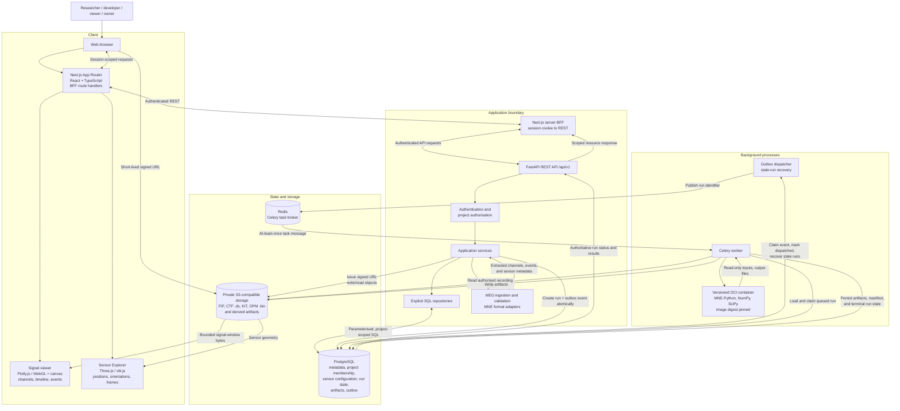

# MEG Lab Architecture

This logical architecture shows the application boundaries and runtime
dependencies. The API is a modular monolith; the Celery worker and outbox
dispatcher run as separate processes. PostgreSQL owns durable state, Redis
transports task messages, private S3-compatible object storage holds MEG
recordings and derived artifacts, and scientific computation runs inside a
versioned OCI container with MNE-Python, pinned by image digest.

## Boundary notes

- The browser can present project and resource identifiers, but the API derives
  the authenticated identity and verifies `project_members` role before
  authorising access.
- The browser talks to the Python API only through the Next.js BFF, which reads
  the HttpOnly session cookie, resolves the active project on the server, and
  forwards authenticated REST requests; it never bypasses API authorisation.
- Recording bytes and artifacts move directly between the browser and private
  object storage through short-lived, single-object signed URLs. The API never
  streams a full recording through its own memory as a general-purpose viewer
  path.
- The viewer requests bounded signal windows or precomputed multiresolution
  summaries, never an entire FIF, CTF `.ds`, KIT, or OPM `.bin` recording.
- A directory-based format such as CTF `.ds` (and KIT or UCL FIL OPM `.bin`
  companion files) is ingested per file, with the recording-level identity
  reconstructed from the recorded file set and its checksums.
- The dispatcher publishes only a run identifier; it never places signal data,
  artifacts, or secrets in Redis.
- The worker reloads run, dataset-version, sensor-configuration, and
  pipeline-version state from PostgreSQL and launches the versioned container by
  `image_digest`. Duplicate messages do not make Redis the source of truth.
- Scientific computation runs only inside the versioned OCI container launched
  by the worker, never inside an API request handler.
- Sensor geometry is rendered for inspection only; analytical runs consume the
  recorded `sensor_configuration` and its declared coordinate frame (`head`,
  `device`, or `opm`).
- PostgreSQL and object storage do not share a transaction; staged writes and
  reconciliation keep metadata and stored objects consistent.

## Related documents

- [MEG Lab overview](../00-overview.md)
- [MEG Lab architecture](../04-architecture/04-architecture.md)
- [MEG Lab data model](../05-data-model/05-data-model.md)
- [MEG Lab API specification](../06-api-specification/06-api-specification.md)
- [MEG Lab deployment](../11-deployment/11-deployment.md)
- [MEG Lab documentation index](../README.md)
