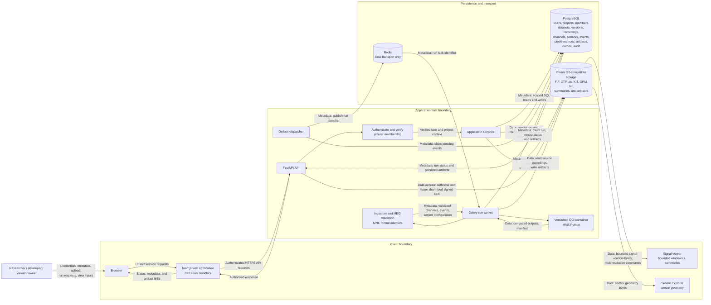

# System Data Flow

This Level 0/1 data-flow view separates **metadata flow** from **data flow** and
identifies the main actors, processes, data stores, and external transports.
Project membership and resource access are verified by the API; the browser is
not an authority for access. The browser talks to the Python API only through
the Next.js BFF, which forwards authenticated REST requests.

- **Metadata flow** covers users, projects, membership, datasets, dataset
  versions, recordings, channels, sensor configurations, event sets, pipelines,
  run state, artifacts, and audit events. It flows through the API into
  PostgreSQL.
- **Data flow** covers raw MEG recordings (FIF, CTF `.ds`, KIT, UCL FIL OPM
  `.bin`, BIDS) and derived artifacts (epochs, evoked responses, spectra,
  topographies, plots, manifests). It flows directly between the browser and
  private object storage through short-lived signed URLs, and between the worker
  and object storage during runs.

## Component legend

| Component            | Boundary          | Carries                                                             |
| -------------------- | ----------------- | ------------------------------------------------------------------- |
| Browser + Next.js BFF | Client            | Session requests; never authoritative for access                    |
| Signal viewer        | Client            | Bounded windows and summaries fetched via signed URL                |
| Sensor Explorer      | Client            | Sensor positions, orientations, and declared coordinate frame       |
| FastAPI API          | Application       | Authenticated metadata operations; bounded signal reads            |
| Ingestion and validation | Application   | MNE format adapters that extract channels, events, sensor geometry  |
| Outbox dispatcher    | Application       | Reliable publication of committed run events to Redis               |
| Celery worker        | Application       | Claims runs, launches the versioned container, persists outcomes    |
| OCI container        | Runtime           | MNE-Python computation with read-only inputs and bounded resources  |
| PostgreSQL           | Persistence       | Authoritative metadata and run lifecycle                            |
| Object storage       | Persistence       | Raw recordings, summaries, and derived artifacts                    |
| Redis                | Transport         | Task notifications only, never authoritative run state              |

## Flow explanation

Metadata moves exclusively through the API: authorisation, project scoping, and
parameter validation happen before any SQL statement executes. Data moves around
the API rather than through it. Recording bytes and derived artifacts stay in
private storage and are referenced by object key, checksum, and validated
metadata. The viewer receives only a bounded signal window or a precomputed
multiresolution summary, and sensor geometry is fetched as a separate, small
payload. Redis carries task notifications only and is never the authoritative
source of run state; the API can always read run status from PostgreSQL.
Scientific computation happens only inside the versioned MNE-Python container
launched by the worker, never inside a request handler.

## Related documents

- [MEG Lab overview](../00-overview.md)
- [MEG Lab architecture](../04-architecture/04-architecture.md)
- [MEG Lab data model](../05-data-model/05-data-model.md)
- [MEG Lab API specification](../06-api-specification/06-api-specification.md)
- [MEG Lab deployment](../11-deployment/11-deployment.md)
- [MEG Lab documentation index](../README.md)
