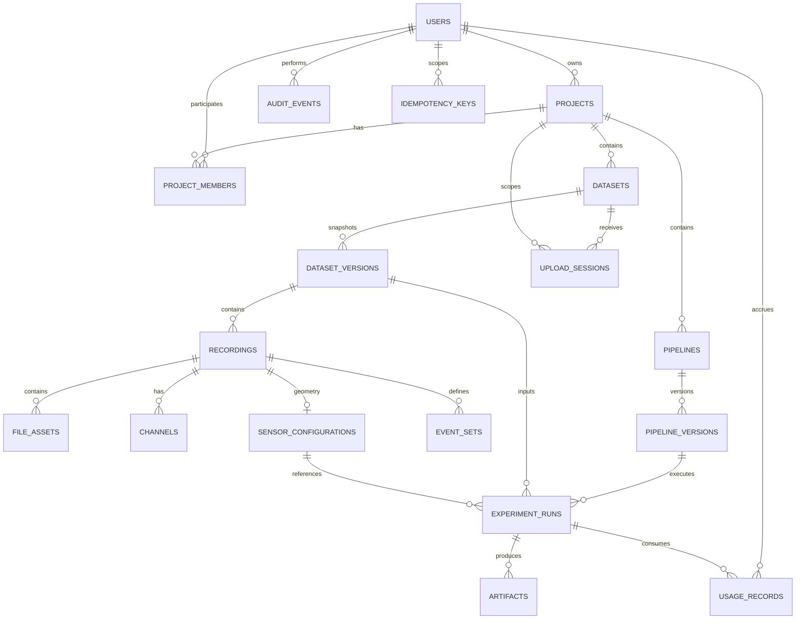
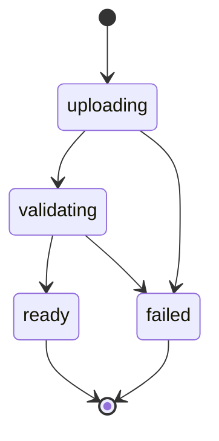
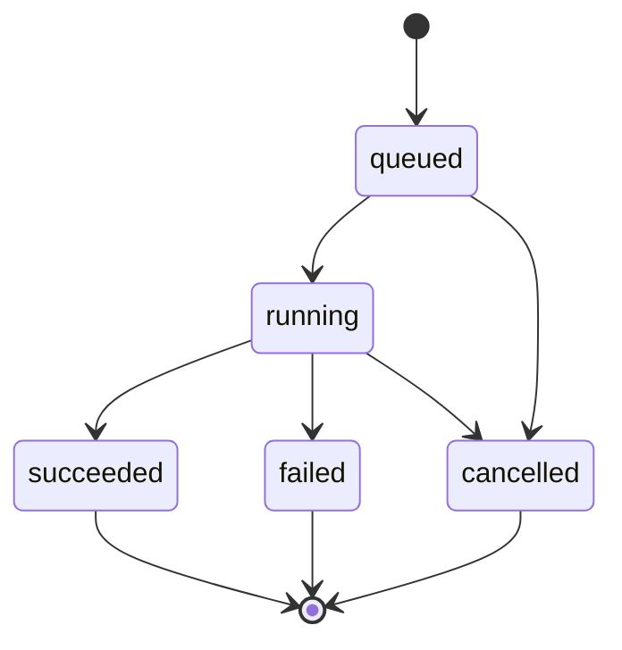

# MEG Lab — Data Model and Database Schema

## 1. Purpose

This document defines MEG Lab's relational data model, entity relationships, PostgreSQL constraints, indexes, lifecycle rules, and data-integrity requirements.

The data model must support:

- User identity and project-level access control.
- Project workspaces that own datasets, recordings, pipelines, and experiments.
- Logical datasets separated from immutable dataset versions.
- Recordings that carry acquisition metadata, channel inventories, sensor geometry, and event sets.
- Resumable upload sessions for single-file and directory-based MEG recordings.
- Asynchronous, reproducible electrophysiology runs.
- Versioned pipeline definitions and pinned container images.
- Output artifacts (epochs, evoked responses, spectra, topographies, and plots) with checksums and provenance.
- Usage accounting, audit events, idempotent operations, and reliable job dispatch.

PostgreSQL is the authoritative source for application metadata, job state, access control, and provenance. Large scientific payloads — raw recordings, derived continuous signals, epochs, and reports — are stored in private S3-compatible object storage. Raw signals and derived continuous data must never be stored in relational rows.

The canonical schema is defined by the versioned SQL migrations under `packages/backend/app/db/migrations/` and is mirrored in the entity-relationship diagram [`meg-lab.dbml`](../database/meg-lab.dbml).

## 2. Data Modelling Principles

1. Use UUID primary keys for externally exposed resources so identifiers are non-guessable.
2. Separate a dataset's logical identity from its immutable `dataset_versions`.
3. Store SHA-256 checksums for uploaded files and derived artifacts.
4. Version pipeline definitions and record the container `image_digest` for every run.
5. Store channel types and units explicitly; never assume a channel is a MEG sensor.
6. Store sensor positions and orientations with an explicit coordinate frame and units.
7. Store event times with an explicit time base and sample convention.
8. Use database transactions for state changes and idempotency keys for job submissions.
9. Enforce project access in both the API and the database layer.
10. Use foreign keys and database constraints for important invariants.
11. Persist times as UTC `TIMESTAMPTZ` values.
12. Store validated scientific metadata explicitly rather than inferring it from filenames.
13. Keep source recordings and dataset versions immutable after successful registration.
14. Preserve provenance for every completed run, including the software environment.
15. Avoid storing secrets, tokens, or unnecessary sensitive information.
16. Prefer explicit SQL and reviewed, versioned migrations.
17. Never rely solely on frontend validation for data integrity.

## 3. Entity Overview

The initial schema contains the following entities, grouped by concern.

### Identity and access

| Entity            | Purpose                                               |
| ----------------- | ----------------------------------------------------- |
| `users`           | Application user identities                           |
| `projects`        | Top-level workspaces that scope all owned resources   |
| `project_members` | Project-level roles for users (owner, editor, viewer) |

### Recording data

| Entity                  | Purpose                                                          |
| ----------------------- | ---------------------------------------------------------------- |
| `datasets`              | Logical dataset identity within a project                        |
| `dataset_versions`      | Immutable, checksummed snapshots of a dataset                    |
| `recordings`            | Recording-level acquisition metadata within a version            |
| `file_assets`           | Individual source and companion files belonging to a recording   |
| `channels`              | Channel inventory for a recording (name, type, unit, status)      |
| `sensor_configurations` | Sensor geometry, coordinate frame, units, and movement reference |
| `event_sets`            | Event definitions and their time-base conventions                |
| `upload_sessions`       | Upload lifecycle and finalisation state                          |

### Pipelines and runs

| Entity              | Purpose                                           |
| ------------------- | ------------------------------------------------- |
| `pipelines`         | Logical analysis workflow within a project        |
| `pipeline_versions` | Versioned workflow definition and runtime image   |
| `experiment_runs`   | Durable execution state for a pipeline submission |

### Outputs and provenance

| Entity          | Purpose                                         |
| --------------- | ----------------------------------------------- |
| `artifacts`     | Output files and reports produced by a run      |
| `usage_records` | Billing and quota accounting per user and run   |

### Platform

| Entity             | Purpose                                        |
| ------------------ | ---------------------------------------------- |
| `audit_events`     | Security and administrative audit trail        |
| `outbox_events`    | Reliable dispatch of background work           |
| `idempotency_keys` | Duplicate-request protection for state changes |

An external OIDC-compatible identity provider owns the authoritative identity record. The local `users` table maps to that identity rather than duplicating credentials.

## 4. Entity Relationship Diagram



Supporting relationships, such as the `project_id` carried by `upload_sessions` for access checks, are shown where they affect isolation. The canonical schema is defined by the versioned SQL migrations under `packages/backend/app/db/migrations/`.

## 5. Common Column Conventions

### Identifiers

Use PostgreSQL `UUID` columns for primary keys. Generate identifiers in the application with a single consistent approach (for example a UUIDv7 library) or through PostgreSQL's `gen_random_uuid()`. Use one approach across the codebase.

Externally addressable resources (`projects`, `datasets`, `recordings`, `experiment_runs`, and similar) must use non-guessable identifiers. Where a shorter opaque token is needed for sharing or signed links, derive a ULID or dedicated token rather than exposing sequential values.

### Timestamps

Use `TIMESTAMPTZ` for all timestamps. Common fields:

- `created_at` — row creation, not null, defaults to `now()`.
- `updated_at` — last mutation, only on mutable rows.
- `started_at` / `finished_at` — execution boundaries on `experiment_runs`.
- `expires_at` / `dispatched_at` — lifecycle fields on upload and outbox rows.
- `deleted_at` / `archived_at` — soft-delete or archival markers.

Use UTC for application-level handling and return ISO 8601 timestamps through the API.

### Statuses

Represent lifecycle states using constrained `TEXT` values with `CHECK` constraints. For an evolving schema, `TEXT` plus `CHECK` is easier to migrate than frequently changing enum types. Apply the same approach consistently.

### JSONB

Use `JSONB` for structured, validated metadata whose shape genuinely varies: dataset-version manifests, recording acquisition metadata, pipeline definitions, run parameters, sensor geometry, and artifact metadata.

Do not use unrestricted `JSONB` as a substitute for relational modelling of ownership, identity, status, or frequently queried relationships. Never store raw signal arrays, epochs, or spectra in `JSONB` or any relational column.

### Deletion

Prefer archival or explicit lifecycle transitions for scientific resources. Avoid cascading deletion from a project or dataset into irreplaceable scientific data unless permanent deletion is an explicit, authorised, and auditable workflow.

### Immutability

`dataset_versions`, `recordings`, `file_assets`, `channels`, `sensor_configurations`, `event_sets`, `pipeline_versions`, `artifacts`, `audit_events`, and `usage_records` are treated as append-only. They carry `created_at` but no `updated_at`, and application code must not mutate them after insertion.

## 6. Enumerations

Lifecycle and classification values are modelled as constrained `TEXT` values with `CHECK` constraints in PostgreSQL and mirrored as DBML enums in [`meg-lab.dbml`](../database/meg-lab.dbml).

### `visibility`

| Value     | Meaning                                                       |
| --------- | ------------------------------------------------------------- |
| `private` | Accessible only to project members (default)                  |
| `public`  | Listed on the public exploration surface                      |
| `link`    | Accessible to anyone holding a scoped, expiring share link    |

### `project_role`

| Value    | Meaning      |
| -------- | ------------ |
| `owner`  | Full control |
| `editor` | Write access |
| `viewer` | Read access  |

### `dataset_status`

Applied to `dataset_versions.status`.

| Value        | Meaning                                         |
| ------------ | ----------------------------------------------- |
| `uploading`  | Files are being transferred and registered      |
| `validating` | Ingestion and metadata extraction are running   |
| `ready`      | Validated and available as an analysis input    |
| `failed`     | Ingestion or validation failed; diagnostics kept |

### `recording_format`

| Value  | Meaning                                  |
| ------ | ---------------------------------------- |
| `fif`  | FIF single-file recording                |
| `ctf`  | CTF `.ds` directory-based recording      |
| `kit`  | KIT `.sqd` or `.con` recording           |
| `bin`  | UCL FIL OPM `.bin` recording             |
| `bids` | BIDS-organised recording                 |

### `channel_type`

| Value  | Meaning                                            |
| ------ | -------------------------------------------------- |
| `mag`  | Magnetometer (SQUID)                               |
| `grad` | Gradiometer (SQUID)                                |
| `opm`  | Optically pumped magnetometer channel              |
| `eeg`  | EEG channel                                        |
| `eog`  | Electro-oculogram channel                          |
| `ecg`  | Electrocardiogram channel                          |
| `stim` | Stimulus or trigger channel                        |
| `misc` | Other or unclassified channel                      |

### `channel_status`

| Value  | Meaning                                            |
| ------ | -------------------------------------------------- |
| `good` | Channel is usable                                  |
| `bad`  | Channel is marked bad by the acquisition or analyst |

### `coordinate_frame`

| Value    | Meaning                                                     |
| -------- | ----------------------------------------------------------- |
| `head`   | Head-based coordinate frame (digitised head shape/fiducials) |
| `device` | Acquisition device coordinate frame                         |
| `opm`    | OPM-array-specific coordinate frame                         |

### `pipeline_status`

| Value      | Meaning                              |
| ---------- | ------------------------------------ |
| `draft`    | Pipeline created but not yet in use  |
| `active`   | Pipeline has at least one usable version |
| `archived` | Pipeline is retired from use         |

### `run_status`

| Value       | Meaning                                  |
| ----------- | ---------------------------------------- |
| `queued`    | Accepted and awaiting execution          |
| `running`   | Claimed and executing                    |
| `succeeded` | Completed with persisted outputs         |
| `failed`    | Terminated with a recorded failure       |
| `cancelled` | Cancelled before completion              |

### `resource_type`

| Value            | Meaning                                             |
| ---------------- | --------------------------------------------------- |
| `core_hours`     | Compute consumption (compute resources × wall time) |
| `storage_bytes`  | Stored object bytes (the product spec abbreviates this as "storage") |

Supporting enumerations used by the schema include `source_type` (`upload`, `import`, `sample`) for datasets, `upload_session_status` (`pending`, `completed`, `expired`, `aborted`), `outbox_status` (`pending`, `dispatched`, `failed`), and `acquisition_system` (`squid`, `opm`).

## 7. `users`

Represents an application user.

| Column         | Type          | Nullability | Constraints / notes                            |
| -------------- | ------------- | ----------- | ---------------------------------------------- |
| `id`           | `uuid`        | NOT NULL    | Primary key                                    |
| `email`        | `text`        | NOT NULL    | Unique, case-insensitive lookup; login contact |
| `display_name` | `text`        | NULL        | User-facing name                               |
| `created_at`   | `timestamptz` | NOT NULL    | Default `now()`                                |

Constraints:

- Unique index on `lower(email)` or a `citext` column; do not treat raw-case email as a distinct identity.
- Email is contact information, not the permanent identity key. Map to the external identity provider's stable subject separately if that provider is introduced.
- Do not store passwords when authentication is delegated to an external provider.
- A local-development identity mechanism must be isolated from production authentication.

Indexes:

- Unique `(email)`.

## 8. `projects`

Represents a project workspace. All datasets, recordings, pipelines, and experiments are scoped to a project.

| Column        | Type          | Nullability | Constraints / notes                                   |
| ------------- | ------------- | ----------- | ----------------------------------------------------- |
| `id`          | `uuid`        | NOT NULL    | Primary key                                           |
| `owner_id`    | `uuid`        | NOT NULL    | FK `users(id)`, RESTRICT on delete                    |
| `name`        | `text`        | NOT NULL    | Required, non-empty                                   |
| `description` | `text`        | NULL        | Optional description                                  |
| `visibility`  | `text`        | NOT NULL    | `private`, `public`, or `link`; default `private`     |
| `created_at`  | `timestamptz` | NOT NULL    | Default `now()`                                       |
| `updated_at`  | `timestamptz` | NOT NULL    | Default `now()`, updated on mutation                  |
| `archived_at` | `timestamptz` | NULL        | Optional archive marker                               |

Constraints:

- `name` must not be blank (`CHECK (length(btrim(name)) > 0)`).
- `visibility` must be one of the supported values.
- `owner_id` must reference an existing user.
- Project names are not globally unique; several users may use the same name.

Indexes:

- `(owner_id, created_at DESC)`.
- `(visibility, created_at DESC)` for the public exploration surface.

The owner is also represented as an `owner` row in `project_members`. The last-owner invariant requires transactional application logic; a simple role check cannot guarantee that a project always has an owner.

## 9. `project_members`

Associates a user with a project and defines their role.

| Column       | Type          | Nullability | Constraints / notes                  |
| ------------ | ------------- | ----------- | ------------------------------------ |
| `project_id` | `uuid`        | NOT NULL    | FK `projects(id)`, ON DELETE CASCADE |
| `user_id`    | `uuid`        | NOT NULL    | FK `users(id)`, ON DELETE CASCADE    |
| `role`       | `text`        | NOT NULL    | `owner`, `editor`, or `viewer`       |
| `created_at` | `timestamptz` | NOT NULL    | Default `now()`                      |

Constraints:

- Primary key `(project_id, user_id)`.
- `role` must be one of the supported values.
- Both foreign keys must reference existing records.

Role semantics:

| Role     | Permitted operations                                                             |
| -------- | -------------------------------------------------------------------------------- |
| `owner`  | Full control, including membership and deletion                                  |
| `editor` | Create and modify datasets, recordings, pipelines, runs, and sensor metadata     |
| `viewer` | Read-only access to project resources and artifacts                              |

Role changes and membership removals must generate audit events.

## 10. `datasets`

Represents the logical identity of a MEG dataset within a project. It is deliberately separated from its immutable versions.

| Column        | Type          | Nullability | Constraints / notes                   |
| ------------- | ------------- | ----------- | ------------------------------------- |
| `id`          | `uuid`        | NOT NULL    | Primary key                           |
| `project_id`  | `uuid`        | NOT NULL    | FK `projects(id)`, RESTRICT on delete |
| `name`        | `text`        | NOT NULL    | Required, non-empty                   |
| `source_type` | `text`        | NOT NULL    | `upload`, `import`, or `sample`       |
| `created_at`  | `timestamptz` | NOT NULL    | Default `now()`                       |
| `updated_at`  | `timestamptz` | NOT NULL    | Default `now()`, updated on rename    |
| `archived_at` | `timestamptz` | NULL        | Optional archive marker               |

Constraints:

- `name` must not be blank.
- `source_type` must be one of the supported values.
- The dataset name need not be unique; multiple datasets may share a name within a project.

Indexes:

- `(project_id, created_at DESC)`.
- Unique `(project_id, id)` to support composite project-scoped foreign keys.

A dataset holds no recording data itself. Its content is defined entirely by its versions, their recordings, and their file assets. A single logical dataset may contain multiple recordings and multiple versions.

## 11. `dataset_versions`

Immutable snapshots of a dataset. Once a version reaches `ready`, its manifest and file assets must not change; further changes create a new version.

| Column       | Type          | Nullability | Constraints / notes                                     |
| ------------ | ------------- | ----------- | ------------------------------------------------------- |
| `id`         | `uuid`        | NOT NULL    | Primary key                                             |
| `dataset_id` | `uuid`        | NOT NULL    | FK `datasets(id)`, RESTRICT on delete                   |
| `version`    | `text`        | NOT NULL    | Monotonic version label, e.g. `"1"`, `"2"`              |
| `manifest`   | `jsonb`       | NOT NULL    | Validated snapshot manifest, default `'{}'`             |
| `status`     | `text`        | NOT NULL    | `uploading`, `validating`, `ready`, or `failed`         |
| `created_at` | `timestamptz` | NOT NULL    | Default `now()`                                         |

Constraints:

- Unique `(dataset_id, version)`.
- `version` must be non-empty.
- `status` must be one of the supported values.
- A version in `ready` status must reference at least one `recordings` row whose file assets carry valid SHA-256 checksums.
- `manifest` is validated against the documented manifest schema before a version may become `ready`.

Indexes:

- Unique `(dataset_id, version)`.
- `(dataset_id, created_at DESC)`.
- Unique `(dataset_id, id)` to support composite project-scoped foreign keys.

### Manifest

The `manifest` records the snapshot's scientific metadata: the contained recordings, their formats, duration, sampling frequency, channel counts and types, sensor configuration references, event-set references, and the roles of the contained files. It is validated on write. A compact example is given in section 24.

## 12. `recordings`

Recording-level acquisition metadata for a dataset version. A dataset version may contain multiple recordings.

| Column                   | Type               | Nullability | Constraints / notes                                 |
| ------------------------ | ------------------ | ----------- | --------------------------------------------------- |
| `id`                     | `uuid`             | NOT NULL    | Primary key                                         |
| `dataset_version_id`     | `uuid`             | NOT NULL    | FK `dataset_versions(id)`, RESTRICT on delete       |
| `name`                   | `text`             | NOT NULL    | Recording label within the version                  |
| `format`                 | `text`             | NOT NULL    | `fif`, `ctf`, `kit`, `bin`, or `bids`               |
| `acquisition_system`     | `text`             | NOT NULL    | `squid` or `opm`                                    |
| `device_name`            | `text`             | NULL        | Acquisition device or system name                   |
| `device_manufacturer`    | `text`             | NULL        | Manufacturer where known                            |
| `n_channels`             | `integer`          | NULL        | Total channel count when known                      |
| `sampling_frequency_hz`  | `double precision` | NULL        | Sampling frequency at acquisition                   |
| `duration_s`             | `double precision` | NULL        | Recording duration in seconds                       |
| `lowpass_hz`             | `double precision` | NULL        | Acquisition low-pass setting                        |
| `highpass_hz`            | `double precision` | NULL        | Acquisition high-pass setting                       |
| `line_frequency_hz`      | `double precision` | NULL        | Power-line frequency where recorded                 |
| `montage`                | `text`             | NULL        | Montage or channel-configuration label              |
| `metadata`               | `jsonb`            | NOT NULL    | Validated acquisition metadata, default `'{}'`      |
| `created_at`             | `timestamptz`      | NOT NULL    | Default `now()`                                     |

Constraints:

- `format` must be one of the supported values.
- `acquisition_system` must be one of the supported values (`squid` or `opm`).
- `sampling_frequency_hz`, `duration_s`, and `n_channels` must be positive when present.
- `metadata` must not contain raw signal arrays.
- A recording that has been registered in a `ready` dataset version is immutable.

Indexes:

- `(dataset_version_id, created_at DESC)`.
- `(acquisition_system)`.

A recording must retain its acquisition format and its source-file references (`file_assets`). It must not rely on filename conventions to encode format or acquisition system.

## 13. `file_assets`

Individual source and companion files belonging to a recording. Signal content lives in object storage; only metadata and the object key are stored here.

| Column        | Type          | Nullability | Constraints / notes                                 |
| ------------- | ------------- | ----------- | --------------------------------------------------- |
| `id`          | `uuid`        | NOT NULL    | Primary key                                         |
| `recording_id`| `uuid`        | NOT NULL    | FK `recordings(id)`, ON DELETE CASCADE              |
| `object_key`  | `text`        | NOT NULL    | Server-generated private object key, unique         |
| `checksum`    | `text`        | NOT NULL    | SHA-256, e.g. `sha256:...`                          |
| `size_bytes`  | `bigint`      | NOT NULL    | Must be non-negative                                |
| `media_type`  | `text`        | NOT NULL    | e.g. `application/octet-stream`, `text/plain`       |
| `role`        | `text`        | NOT NULL    | File role, e.g. `data`, `metadata`, `markers`, `channels`, `events` |
| `created_at`  | `timestamptz` | NOT NULL    | Default `now()`                                     |

Constraints:

- `object_key` must be globally unique.
- `size_bytes` must be non-negative.
- `checksum` must be non-null and match the documented `sha256:` representation.
- `role` must identify how the file participates in the recording (primary data, companion metadata, markers, channel descriptions, or event tables).
- `object_key` must never be stored as a permanent signed URL; signed URLs are short-lived and generated on demand.

Indexes:

- Unique `(object_key)`.
- `(recording_id)`.

The `role` column is what allows a directory-based recording (CTF `.ds`) or a companion-file recording (KIT, UCL FIL OPM `.bin`) to be treated as one logical recording composed of several assets.

## 14. `channels`

Channel inventory for a recording, stored per recording.

| Column         | Type          | Nullability | Constraints / notes                                       |
| -------------- | ------------- | ----------- | --------------------------------------------------------- |
| `id`           | `uuid`        | NOT NULL    | Primary key                                               |
| `recording_id` | `uuid`        | NOT NULL    | FK `recordings(id)`, ON DELETE CASCADE                    |
| `name`         | `text`        | NOT NULL    | Channel name, e.g. `MEG 0131`, `EEG 001`, `STI 001`       |
| `type`         | `text`        | NOT NULL    | `mag`, `grad`, `opm`, `eeg`, `eog`, `ecg`, `stim`, `misc` |
| `unit`         | `text`        | NOT NULL    | Physical unit, e.g. `T`, `T/m`, `V`, `unknown`            |
| `unit_mul`     | `double precision` | NOT NULL | Unit multiplier applied to stored values, default `0.0` (SI) |
| `status`       | `text`        | NOT NULL    | `good` or `bad`, default `good`                           |
| `created_at`   | `timestamptz` | NOT NULL    | Default `now()`                                           |

Constraints:

- `type` must be one of the supported values.
- `status` must be one of the supported values.
- Unique `(recording_id, name)`.
- Channel types and units are stored explicitly; the schema must not assume that every channel is a MEG sensor.

Indexes:

- Unique `(recording_id, name)`.
- `(recording_id, type)`.

Bad channels recorded by the acquisition system (for example `MEG 0131` and `MEG 2142`) are preserved with `status = 'bad'` rather than discarded, so that analyses and provenance reflect the original acquisition.

## 15. `sensor_configurations`

Sensor geometry, coordinate frame, units, calibration, and movement reference for a recording. A recording has at most one sensor configuration.

| Column                    | Type          | Nullability | Constraints / notes                                    |
| ------------------------- | ------------- | ----------- | ------------------------------------------------------ |
| `id`                      | `uuid`        | NOT NULL    | Primary key                                            |
| `recording_id`            | `uuid`        | NOT NULL    | FK `recordings(id)`, ON DELETE CASCADE; unique          |
| `sensor_type`             | `text`        | NOT NULL    | e.g. `mag`, `grad`, `opm_scalar`, `opm_vector`         |
| `coordinate_frame`        | `text`        | NOT NULL    | `head`, `device`, or `opm`                             |
| `geometry`                | `jsonb`       | NOT NULL    | Positions and orientations per channel, default `'{}'` |
| `units`                   | `text`        | NOT NULL    | Length unit for geometry, e.g. `mm` or `m`             |
| `calibration`             | `jsonb`       | NULL        | Per-channel calibration values where available         |
| `movement_data_object_key`| `text`        | NULL        | Reference to movement-tracking data, if any            |
| `movement_data_checksum`  | `text`        | NULL        | SHA-256 of the movement-tracking data                  |
| `created_at`              | `timestamptz` | NOT NULL    | Default `now()`                                        |

Constraints:

- Unique `(recording_id)` — a recording has at most one sensor configuration.
- `sensor_type` must be a documented value.
- `coordinate_frame` must be one of the supported values.
- `geometry` must include per-channel positions and orientations, expressed in `units`.
- Positions and orientations must identify their `coordinate_frame` and `units`; the frame must never be inferred.
- `movement_data_object_key` and `movement_data_checksum` are both present or both absent.
- `geometry` must not contain raw signal arrays.

Indexes:

- Unique `(recording_id)`.
- `(coordinate_frame)`.

### Variable geometry

OPM sensor geometry may vary between recordings and may vary over time when movement-tracking data is available. The `movement_data_object_key` reference records where time-varying geometry lives; `geometry` records the representative or initial layout.

### SQUID example

A Neuromag Vectorview recording carries 306 MEG channels (102 magnetometers and 204 gradiometers) plus 9 auxiliary channels, sampled at 1000 Hz, expressed in the `head` coordinate frame. Its `sensor_configuration` records 306 `mag`/`grad` sensor entries with positions and orientations in `mm`.

### OPM example

A UCL FIL OPM recording may carry 64 channels with variable geometry, expressed in the `opm` frame. Its positions and orientations are not assumed constant across recordings, and its `sensor_type` is an OPM scalar or vector variant rather than `mag` or `grad`.

## 16. `event_sets`

Event definitions and their time-base conventions for a recording. A recording may have several event sets (for example from an acquisition trigger channel and from a BIDS `events.tsv`).

| Column              | Type          | Nullability | Constraints / notes                                       |
| ------------------- | ------------- | ----------- | --------------------------------------------------------- |
| `id`                | `uuid`        | NOT NULL    | Primary key                                               |
| `recording_id`      | `uuid`        | NOT NULL    | FK `recordings(id)`, ON DELETE CASCADE                    |
| `source`            | `text`        | NOT NULL    | Event source, e.g. `stim_channel`, `bids_events`, `file`  |
| `metadata`          | `jsonb`       | NOT NULL    | Event definitions, sample indices, and labels, default `'{}'` |
| `sample_convention` | `text`        | NOT NULL    | e.g. `sample`, `second`, `first_samp_based`               |
| `time_base`         | `text`        | NOT NULL    | Time base the event times are relative to                 |
| `created_at`        | `timestamptz` | NOT NULL    | Default `now()`                                           |

Constraints:

- `source` and `sample_convention` must be documented values.
- `metadata` must record the event labels and their sample or time positions in the declared `sample_convention` and `time_base`.
- Event times must identify the relevant recording time base and sample conventions; never persist unlabelled event times.
- `metadata` must not contain raw signal arrays.

Indexes:

- `(recording_id, created_at DESC)`.
- `(source)`.

## 17. `upload_sessions`

Tracks resumable upload attempts and their finalisation. A session authorises a scoped upload of a file set; it does not by itself create a dataset version.

| Column                | Type          | Nullability | Constraints / notes                             |
| --------------------- | ------------- | ----------- | ----------------------------------------------- |
| `id`                  | `uuid`        | NOT NULL    | Primary key                                     |
| `dataset_id`          | `uuid`        | NOT NULL    | FK `datasets(id)`, RESTRICT on delete           |
| `project_id`          | `uuid`        | NOT NULL    | FK `projects(id)`, scopes access checks         |
| `status`              | `text`        | NOT NULL    | `pending`, `completed`, `expired`, or `aborted` |
| `expected_size_bytes` | `bigint`      | NULL        | Expected total upload size, non-negative when present |
| `expected_file_count` | `integer`     | NULL        | Expected number of files in the set, positive when present |
| `checksum_sha256`     | `text`        | NULL        | Client-declared SHA-256 for verification        |
| `declared_format`     | `text`        | NULL        | Format the client intends to upload             |
| `expires_at`          | `timestamptz` | NOT NULL    | Authorisation expiry                            |
| `created_at`          | `timestamptz` | NOT NULL    | Default `now()`                                 |

Constraints:

- `project_id` must match the owning project of `dataset_id`.
- `status` must be one of the supported values.
- `expected_size_bytes` and `expected_file_count` must be positive when present.
- A session past `expires_at` cannot be completed.
- Finalisation must be idempotent; only one dataset version may result from a completed session.
- For a directory-based format, completion requires the full declared file set.
- Temporary upload authorisations must expire; abandoned sessions must be discoverable for cleanup.

Indexes:

- `(dataset_id, created_at DESC)`.
- `(status, expires_at)` for cleanup workers.

## 18. `pipelines`

Represents the logical identity of an analysis workflow within a project.

| Column       | Type          | Nullability | Constraints / notes                        |
| ------------ | ------------- | ----------- | ------------------------------------------ |
| `id`         | `uuid`        | NOT NULL    | Primary key                                |
| `project_id` | `uuid`        | NOT NULL    | FK `projects(id)`, RESTRICT on delete      |
| `name`       | `text`        | NOT NULL    | Required, non-empty                        |
| `status`     | `text`        | NOT NULL    | `draft`, `active`, or `archived`; default `draft` |
| `created_at` | `timestamptz` | NOT NULL    | Default `now()`                            |
| `updated_at` | `timestamptz` | NOT NULL    | Default `now()`, updated on rename         |

Constraints:

- `name` must not be blank.
- `status` must be one of the supported values.
- Names need not be unique within a project.

Indexes:

- `(project_id, created_at DESC)`.
- Unique `(project_id, id)` for composite project-scoped foreign keys.

## 19. `pipeline_versions`

Immutable, versioned definitions of a pipeline and the container image that executes it.

| Column         | Type          | Nullability | Constraints / notes                                |
| -------------- | ------------- | ----------- | -------------------------------------------------- |
| `id`           | `uuid`        | NOT NULL    | Primary key                                        |
| `pipeline_id`  | `uuid`        | NOT NULL    | FK `pipelines(id)`, RESTRICT on delete             |
| `version`      | `text`        | NOT NULL    | Semantic version label, e.g. `1.0.0`               |
| `definition`   | `jsonb`       | NOT NULL    | Validated workflow definition and parameter schema |
| `image_digest` | `text`        | NOT NULL    | Immutable OCI image digest, e.g. `sha256:...`      |
| `created_at`   | `timestamptz` | NOT NULL    | Default `now()`                                    |

Constraints:

- Unique `(pipeline_id, version)`.
- `definition` must pass schema validation before insert.
- `image_digest` must be a digest, not a mutable tag.
- Versions are immutable; edits create a new version.

Indexes:

- Unique `(pipeline_id, version)`.

Runs reference pipeline versions by immutable digest so a published MNE-Python container change cannot silently alter an existing reproducible run.

## 20. `experiment_runs`

Durable execution state for a submitted pipeline version over a dataset version.

| Column                  | Type          | Nullability | Constraints / notes                                        |
| ----------------------- | ------------- | ----------- | ---------------------------------------------------------- |
| `id`                    | `uuid`        | NOT NULL    | Primary key                                                |
| `pipeline_version_id`   | `uuid`        | NOT NULL    | FK `pipeline_versions(id)`, RESTRICT on delete             |
| `dataset_version_id`    | `uuid`        | NOT NULL    | FK `dataset_versions(id)`, RESTRICT on delete              |
| `sensor_configuration_id` | `uuid`      | NULL        | FK `sensor_configurations(id)`, SET NULL on delete         |
| `status`                | `text`        | NOT NULL    | `queued`, `running`, `succeeded`, `failed`, or `cancelled` |
| `parameters`            | `jsonb`       | NOT NULL    | Validated run parameters, default `'{}'`                   |
| `error`                 | `text`        | NULL        | Sanitised failure summary                                  |
| `started_at`            | `timestamptz` | NULL        | Execution start                                            |
| `finished_at`           | `timestamptz` | NULL        | Terminal time                                              |
| `created_at`            | `timestamptz` | NOT NULL    | Submission time, default `now()`                           |

Constraints:

- `status` must be one of the supported values.
- `parameters` must pass the pipeline version's parameter schema before submission.
- Pipeline version, dataset version, and the run's project must be consistent (see section 25).
- `finished_at` must be populated when a terminal state is reached.
- A run in a terminal state must not transition back to `running` without creating a new run record.
- Cancellation must be safe even if the worker has already started; the run must not be silently reopened by a duplicate message.
- `sensor_configuration_id`, when present, must belong to a recording within the referenced dataset version.

Indexes:

- `(status, created_at DESC)` for the work queue.
- `(dataset_version_id, created_at DESC)`.
- `(pipeline_version_id, created_at DESC)`.

### Idempotency

Job submission is deduplicated with `idempotency_keys`. The scope is the authenticated user plus an operation identifier and a client-provided key. Identical parameters do not imply identical intent: two deliberately separate runs may use the same parameters and must both be allowed when submitted with distinct keys.

## 21. `artifacts`

Output files and reports produced by a run. Like source files, artifact content lives in object storage. Artifact types include processed recordings, epochs, evoked responses, spectra, sensor topographies, plots, and machine-readable result tables.

| Column       | Type          | Nullability | Constraints / notes                                       |
| ------------ | ------------- | ----------- | --------------------------------------------------------- |
| `id`         | `uuid`        | NOT NULL    | Primary key                                               |
| `run_id`     | `uuid`        | NOT NULL    | FK `experiment_runs(id)`, ON DELETE CASCADE               |
| `object_key` | `text`        | NOT NULL    | Server-generated private object key, unique               |
| `checksum`   | `text`        | NOT NULL    | SHA-256 of the artifact                                   |
| `size_bytes` | `bigint`      | NOT NULL    | Must be non-negative                                      |
| `media_type` | `text`        | NOT NULL    | e.g. `application/x-fiff`, `text/csv`, `image/png`        |
| `metadata`   | `jsonb`       | NOT NULL    | Validated supplementary metadata, default `'{}'`          |
| `created_at` | `timestamptz` | NOT NULL    | Default `now()`                                           |

Constraints:

- `object_key` must be globally unique.
- `checksum` must match the documented `sha256:` representation.
- `metadata` must not contain raw signal arrays.
- Artifacts may only be committed as successful output after the producing run has validated them.

Indexes:

- Unique `(object_key)`.
- `(run_id)`.

## 22. `usage_records`

Append-only accounting of resource consumption for quota and cost reporting.

| Column          | Type          | Nullability | Constraints / notes                            |
| --------------- | ------------- | ----------- | ---------------------------------------------- |
| `id`            | `uuid`        | NOT NULL    | Primary key                                    |
| `user_id`       | `uuid`        | NOT NULL    | FK `users(id)`, RESTRICT on delete             |
| `run_id`        | `uuid`        | NULL        | FK `experiment_runs(id)`, nullable             |
| `resource_type` | `text`        | NOT NULL    | `core_hours` or `storage_bytes`                |
| `quantity`      | `bigint`      | NOT NULL    | Non-negative consumed quantity                 |
| `created_at`    | `timestamptz` | NOT NULL    | Default `now()`                                |

Constraints:

- `resource_type` must be one of the documented values.
- `quantity` must be non-negative.
- For `core_hours`, quantity is expressed in whole core-seconds or a documented unit; for `storage_bytes`, quantity is bytes.
- Rows are append-only.

Indexes:

- `(user_id, created_at DESC)`.
- `(run_id)`.

## 23. `audit_events`

Append-only history of security-relevant and operationally important actions.

| Column          | Type          | Nullability | Constraints / notes                         |
| --------------- | ------------- | ----------- | ------------------------------------------- |
| `id`            | `uuid`        | NOT NULL    | Primary key                                 |
| `actor_id`      | `uuid`        | NULL        | FK `users(id)`, nullable for system actions |
| `action`        | `text`        | NOT NULL    | Event action, e.g. `run.submitted`          |
| `resource_type` | `text`        | NOT NULL    | Affected resource type                      |
| `resource_id`   | `uuid`        | NULL        | Affected resource identifier                |
| `created_at`    | `timestamptz` | NOT NULL    | Default `now()`                             |

Example actions:

- `project.created`, `project.archived`
- `project_member.role_changed`, `project_member.removed`
- `dataset.version_ready`, `dataset.version_validation_failed`
- `recording.ingested`, `recording.ingestion_failed`
- `run.submitted`, `run.succeeded`, `run.failed`, `run.cancelled`
- `artifact.downloaded`

Rules:

- Audit records are append-only through normal application workflows.
- Public endpoints must not allow modification of audit history.
- Record only necessary metadata; do not store tokens, signed URLs, or raw signal data.
- Where an operation requires an audit event for integrity, persist the event in the same transaction as the related change.

Indexes:

- `(resource_type, resource_id, created_at DESC)`.
- `(actor_id, created_at DESC)`.

## 24. `outbox_events`

Supports reliable publication of background work such as run dispatch and ingestion.

| Column          | Type          | Nullability | Constraints / notes                  |
| --------------- | ------------- | ----------- | ------------------------------------ |
| `id`            | `uuid`        | NOT NULL    | Primary key                          |
| `event_type`    | `text`        | NOT NULL    | Event name                           |
| `payload`       | `jsonb`       | NOT NULL    | Minimal validated dispatch payload   |
| `status`        | `text`        | NOT NULL    | `pending`, `dispatched`, or `failed` |
| `created_at`    | `timestamptz` | NOT NULL    | Default `now()`                      |
| `dispatched_at` | `timestamptz` | NULL        | Publication time                     |

Constraints:

- `status` must be one of the supported values.
- `payload` must not contain secrets or raw signal arrays.
- `dispatched_at` is populated exactly when the event reaches `dispatched`.
- Duplicate delivery must be safe; consumers must be idempotent.
- Retries must be bounded or moved to an operationally visible failed state.

Indexes:

- `(status, created_at)` for the dispatcher.
- `(event_type, created_at DESC)`.

A dispatcher may claim rows with `FOR UPDATE SKIP LOCKED` so multiple dispatchers do not process the same event.

## 25. `idempotency_keys`

Durable record of state-changing API requests that require deduplication, especially run submission and upload finalisation.

| Column         | Type          | Nullability | Constraints / notes                          |
| -------------- | ------------- | ----------- | -------------------------------------------- |
| `key`          | `text`        | NOT NULL    | Primary key, client-provided idempotency key |
| `user_id`      | `uuid`        | NOT NULL    | FK `users(id)`, ON DELETE CASCADE            |
| `request_hash` | `text`        | NOT NULL    | Hash of canonicalised request data           |
| `response`     | `jsonb`       | NULL        | Safe stored response representation          |
| `created_at`   | `timestamptz` | NOT NULL    | Default `now()`                              |

Constraints:

- Primary key `(key)`.
- `request_hash` must be present and stable for equivalent requests.
- Reuse of a key with a different `request_hash` must be rejected.
- Concurrent requests using the same key must not create duplicate logical operations.
- Sensitive response fields must not be stored in `response`.
- Retention and cleanup behaviour must be documented.

Indexes:

- Unique `(user_id, key)` to scope keys per user and prevent cross-user collisions.

## 26. Worked Manifests

These compact examples show the shape of the `jsonb` manifests stored by the schema. They are illustrative; real values record the actual environment, software versions, coordinate conventions, event definitions, and random seeds that affect reproducibility.

### Dataset version manifest

Stored in `dataset_versions.manifest`. Here `recordings` mirrors the `recordings`, `channels`, `sensor_configurations`, and `event_sets` rows that belong to the version.

```json
{
  "schema_version": "1.0",
  "dataset_id": "5f0c0b7a-3f41-4a2e-9c2b-1f9f3a7d0001",
  "dataset_version_id": "9a1d2c3b-4e5f-4061-8273-9a0b1c2d3e4f",
  "version": "1",
  "status": "ready",
  "created_at": "2026-05-01T10:00:00Z",
  "source": {
    "source_type": "upload",
    "description": "MNE sample auditory-evoked-field subject, anonymised"
  },
  "recordings": [
    {
      "recording_id": "b1c2d3e4-f5a6-4078-9b0c-1d2e3f4a5b6c",
      "name": "sample-auditory",
      "format": "fif",
      "acquisition_system": "squid",
      "device_name": "Vectorview",
      "n_channels": 315,
      "sampling_frequency_hz": 1000.0,
      "duration_s": 3600.0,
      "files": [
        {
          "file_asset_id": "c1d2e3f4-a5b6-4078-9c0d-1e2f3a4b5c6d",
          "object_key": "projects/5f0c0b7a.../datasets/.../sample_audvis_raw.fif",
          "checksum_sha256": "sha256:3f79bb7b435b05321651daefd374cd8c1e1c9f5d5e2a6b0f1c8d4e7a9b2c3d4e",
          "size_bytes": 187402240,
          "media_type": "application/x-fiff",
          "role": "data"
        }
      ],
      "channels_summary": {
        "total": 315,
        "by_type": { "mag": 102, "grad": 204, "eeg": 0, "stim": 9 },
        "bad": ["MEG 0131", "MEG 2142"]
      },
      "sensor_configuration_id": "d2e3f4a5-b6c7-4089-9d0e-2f3a4b5c6d7e",
      "sensor_summary": {
        "sensor_type": "mag_grad",
        "coordinate_frame": "head",
        "units": "mm",
        "n_sensors": 306
      },
      "event_sets": [
        {
          "event_set_id": "e3f4a5b6-c7d8-4090-8e1f-3a4b5c6d7e8f",
          "source": "stim_channel",
          "sample_convention": "sample",
          "time_base": "first_samp"
        }
      ]
    }
  ]
}
```

### Experiment manifest

Emitted for every run, matching the schema in the product specification (section 8.4). `outputs` lists the `artifacts` rows produced.

```json
{
  "schema_version": "1.0",
  "run_id": "c1d2e3f4-a5b6-4078-9c0d-1e2f3a4b5c6d",
  "pipeline": {
    "name": "event-related-analysis",
    "version": "1.0.0",
    "image_digest": "sha256:9b2c3d4e5f60718293a4b5c6d7e8f90123456789abcdef0123456789abcdef01"
  },
  "inputs": [
    {
      "dataset_version_id": "9a1d2c3b-4e5f-4061-8273-9a0b1c2d3e4f",
      "checksum": "sha256:3f79bb7b435b05321651daefd374cd8c1e1c9f5d5e2a6b0f1c8d4e7a9b2c3d4e"
    }
  ],
  "pipeline_parameters": {
    "filter": {
      "l_freq_hz": 1.0,
      "h_freq_hz": 40.0
    },
    "epoch": {
      "tmin_s": -0.2,
      "tmax_s": 0.8,
      "baseline_s": [-0.2, 0.0]
    }
  },
  "environment": {
    "python_version": "3.15.0",
    "mne_version": "1.x"
  },
  "sensor_configuration_id": "d2e3f4a5-b6c7-4089-9d0e-2f3a4b5c6d7e",
  "outputs": [
    {
      "artifact_id": "f4a5b6c7-d8e9-40a1-9f2a-4b5c6d7e8f90",
      "object_key": "projects/5f0c0b7a.../runs/.../evoked-ave.fif",
      "checksum": "sha256:1a2b3c4d5e6f708192a3b4c5d6e7f8091a2b3c4d5e6f708192a3b4c5d6e7f809",
      "media_type": "application/x-fiff"
    }
  ],
  "status": "succeeded"
}
```

This is illustrative, not a universal analysis configuration. Filter settings, epoch boundaries, baseline choices, and event definitions must be user-configurable and scientifically justified for each experiment. The actual runtime populates version fields rather than relying on fixed placeholder values. The product specification's canonical manifest field names (`inputs`, `pipeline`, `parameters`, `environment`, `sensor_configuration_id`, `outputs`, `status`) are preserved.

## 27. Essential Data-Model Rules

These rules are authoritative for the schema and must hold regardless of which application code path performs a write.

1. A logical dataset may contain multiple recordings and multiple versions.
2. Every recording must retain its acquisition format and source-file references.
3. Store channel types and units explicitly; do not assume all channels represent MEG sensors.
4. Sensor positions and orientations must identify their coordinate frame and units.
5. OPM sensor geometry may vary between recordings and may vary over time if movement-tracking data is available.
6. Event times must identify the relevant recording time base and sample conventions.
7. Each experiment must reference exact input versions, pipeline versions, parameters, and software environments.
8. Raw inputs should remain immutable; preprocessing generates derived artifacts instead of silently overwriting source data.

## 28. Cross-Project Referential Integrity

Project isolation should be reflected in the relational schema, not only in application checks.

For project-owned entities, add a unique key on `(project_id, id)` and use composite foreign keys so a child cannot reference a parent in another project.

```sql
CREATE UNIQUE INDEX uq_datasets_project_id_id
    ON datasets (project_id, id);

CREATE UNIQUE INDEX uq_dataset_versions_dataset_id_id
    ON dataset_versions (dataset_id, id);

ALTER TABLE upload_sessions
    ADD CONSTRAINT fk_upload_sessions_dataset_same_project
    FOREIGN KEY (project_id, dataset_id)
    REFERENCES datasets (project_id, id);
```

The same pattern applies to:

- `upload_sessions.project_id` and `dataset_id` resolving through `datasets`.
- `pipelines.project_id`.
- `experiment_runs` resolving through both its pipeline and dataset versions.

For `experiment_runs`, enforce consistency by resolving the owning project through the referenced versions in the same transaction, or by carrying a `project_id` column with a composite foreign key to each parent, depending on the migration order selected.

Exact migration order must account for existing constraints and table creation order.

This is defence in depth. It does not replace permission checks; every read and write still authorises the caller against `project_members`.

## 29. Transactions

Use PostgreSQL transactions for operations that must be atomic within the relational database. The following workflows are transactional:

### Upload finalisation and file assets

Finalising an upload session, creating the draft `dataset_version`, and inserting the `file_assets` rows for the file set must occur in a single transaction. A partially registered file set must never be visible as a ready version. Completion validation (objects exist, sizes match, checksums match) runs before the transaction commits the ready transition.

### Run creation and outbox event

Creating an `experiment_run` and its `outbox_events` row must occur in the same transaction. This is the transactional-outbox pattern: the run is durably committed exactly when its dispatch event is, so queue publication can never diverge from committed database state.

### Artifact persistence and successful terminal state

Persisting `artifacts` rows and transitioning the run to a terminal `succeeded` state must occur together. If artifact persistence fails, the run must not appear successful.

### Membership and audit

Updating `project_members` and recording the corresponding `audit_events` row must occur in the same transaction where integrity requires it.

Use constraints for invariants that should remain true regardless of which application code path performs a write, including foreign keys from datasets to projects, recordings to dataset versions, and runs to dataset versions and pipeline versions.

Do not assume that a successful object-storage operation can be rolled back by a PostgreSQL transaction. Use compensating operations and reconciliation where multiple services participate in a workflow.

Use Psycopg 3 with an async connection pool and explicit SQL. Repositories own transaction boundaries and must not leave implicit or long-lived transactions open across network calls.

## 30. State Transitions

### Upload session lifecycle

```text
pending
   ├── completed
   ├── expired   (expires_at passed before finalisation)
   └── aborted   (initiator or cleanup cancelled the upload)
```

A completed session transitions to `completed` exactly once and yields at most one dataset version. Finalisation is idempotent.

### Dataset version lifecycle



Only `ready` versions are valid run inputs. `failed` versions retain their diagnostic manifest for inspection. A ready version is immutable; further changes create a new version.

### Experiment run lifecycle



`succeeded`, `failed`, and `cancelled` are terminal. A cancelled or successful run must not be silently reopened by a duplicate worker message. If retrying requires a fresh execution, create a new run record and preserve the original history. A run in `failed` may be retried only under a documented retry policy that creates a new run or uses a bounded backoff; the original terminal record is never reopened.

Define allowed transitions in application code and enforce critical invariants at the database boundary.

## 31. Reproducibility

Every successful run produces an experiment manifest that records everything needed to understand and reproduce the computation. The manifest contains:

- `schema_version` — the manifest schema version.
- `run_id` — the run identifier.
- `inputs` — the exact input dataset versions with their `dataset_version_id` and checksum.
- `pipeline` — the pipeline `name`, `version`, and `image_digest`.
- `parameters` — the validated run parameters, including filter settings, epoch boundaries, baselines, time-base conventions, and random seeds.
- `environment` — runtime `python_version` and `mne_version` populated at execution time.
- `sensor_configuration_id` — the sensor configuration used where geometry affects the result.
- `outputs` — the artifact references with checksums and media types.
- `status` — the terminal state of the run.

Reproducibility rules:

1. Inputs are referenced by immutable `dataset_version_id` and checksum, not by mutable name.
2. Pipelines are referenced by immutable `pipeline_version` and `image_digest`, not by mutable tag.
3. The environment records the exact Python and MNE versions used.
4. The sensor configuration and its coordinate frame are recorded when they affect the result.
5. Outputs carry SHA-256 checksums so results can be verified.
6. Historical results are never silently overwritten by later runs.

## 32. Deletion and Retention

Define retention rules before deploying real research data.

Recommended initial rules:

- Archive projects and datasets (`archived_at`) instead of permanently deleting them.
- Preserve completed `experiment_runs`, `artifacts`, and their provenance.
- Expire incomplete `upload_sessions` and clean up their temporary objects.
- Delete unreferenced object-storage keys only after the database no longer references them, using a safe delay.
- Keep `audit_events` and `usage_records` retention separate from ordinary resource lifecycle.
- Document how a user's removal affects ownership and attribution records.

Deletion semantics:

- Deleting a project is a guarded workflow, not an implicit cascade. It requires appropriate authorisation and an audit event.
- Deleting a dataset deletes its `dataset_versions`, `recordings`, `channels`, `sensor_configurations`, `event_sets`, and `file_assets` rows; the corresponding object-storage keys are removed by a coordinated cleanup job after the database transaction commits.
- Deleting a run removes its `artifacts` rows, and their objects are cleaned up by the same reconciliation process.
- Object deletion must be coordinated with database state; never delete a stored object while a live row still references it.

If permanent deletion is implemented, require authorisation, explicit confirmation, audit logging, and a reliable, retryable process for removing related object-storage data.

## 33. Migration Strategy

Store versioned PostgreSQL migrations under `packages/backend/app/db/migrations/`, each with a monotonic version identifier. Migrations are forward-only: every change is expressed as a new, additive migration, and reversible down-migrations are not relied upon in production.

Rules:

1. Every schema change is a new versioned migration file; never edit an applied migration.
2. Migrations run before the API or worker processes start, so application code only ever sees the schema it expects.
3. Migrations are applied automatically as a startup gate or by an explicit deployment step; either way, a failed migration blocks application start.
4. Do not make destructive changes (dropping columns or tables) in the same deployment as code that still depends on the old schema. Use expand-and-contract: add the new shape, migrate data and code, verify, then remove the old shape in a later migration.
5. Add required indexes and constraints in the migration that introduces the affected table.
6. Review each migration for locking behaviour on large tables and prefer online index creation where supported.

For each schema change:

1. Add the ordered SQL migration.
2. Review the SQL, constraints, and indexes.
3. Test applying migrations to an empty database.
4. Test applying migrations to a representative existing schema.
5. Run the relevant integration tests.
6. Document any compatibility requirements.
7. Apply migrations through the deployment pipeline.

Husky's pre-commit hook runs Ruff checks and formatting on staged Python source. Migration files are SQL and are validated by migration integration tests in CI.

## 34. Database Testing Requirements

Test at least:

- Unique `project_members` per project and user.
- Valid `project_members` roles.
- Valid `projects.visibility` values.
- Project consistency across `datasets`, `upload_sessions`, and `pipelines`.
- Valid `dataset_versions` states and required manifest data for `ready` versions.
- Valid `recordings.format` and `acquisition_system` values.
- Channel uniqueness per recording and valid channel types and statuses.
- Presence of an explicit `coordinate_frame` and `units` on sensor configurations.
- Presence of `sample_convention` and `time_base` on event sets.
- Valid `experiment_runs` states and required `finished_at` on terminal states.
- Run, pipeline version, and dataset version relationship integrity.
- `artifacts` and `file_assets` checksum and object-key uniqueness.
- Duplicate `idempotency_keys` behaviour and mismatched `request_hash` rejection.
- Transactional `outbox_events` creation and dispatch claiming.
- Last-owner protection for projects.
- `audit_events` persistence.
- Project-scoped reads and writes, including negative tests for cross-project access.
- Migration correctness.

Use a real PostgreSQL instance for tests that depend on PostgreSQL-specific constraints, SQL semantics, transactions, or locking.

## 35. Definition of Done

The data model is implemented when:

1. All core entities have versioned migrations.
2. Primary and foreign keys are defined for every entity.
3. Important invariants have database constraints where possible.
4. Project-owned relationships enforce project consistency, including composite foreign keys.
5. Query indexes support the primary workflows: project listing, upload and ingestion, bounded signal reads, run submission, and artifact retrieval.
6. Upload session, dataset version, and run states and transitions are documented and enforced.
7. Recordings retain format, acquisition system, channel inventory, sensor configuration, and event-set provenance.
8. Completed runs retain dataset version, pipeline version, image digest, parameters, environment, and sensor configuration provenance.
9. Upload and object-storage lifecycles are coordinated and recoverable.
10. Idempotency and outbox mechanisms are implemented and tested.
11. Audit and usage data avoid unnecessary sensitive information.
12. Migrations are forward-only and pass in CI.
13. Database integration tests cover critical integrity and isolation rules.
