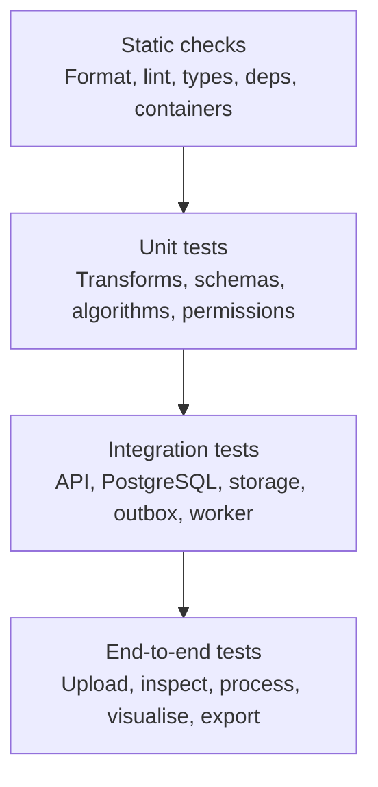

# Test Layers

## 3. Testing Pyramid

### Static checks (every PR)
- Formatting (Ruff format, Prettier)
- Linting (Ruff check, ESLint)
- Type checking (mypy, TypeScript)
- Dependency scanning (pip-audit, pnpm audit)
- Container/filesystem scanning (Trivy)

### Unit tests
- Pydantic request/parameter validation
- Permission/role decisions
- Experiment run/state transitions
- Time/sample conversions, epoch boundaries
- Metadata parsing (FIF/CTF `.ds`/KIT/UCL FIL OPM `.bin` headers/structure)
- Coordinate/frame handling and unit conversions
- Filter/epoch/PSD logic on tiny synthetic arrays
- Idempotency canonicalisation

### Integration tests
- FastAPI + real PostgreSQL
- Transactions/constraints/migrations
- Object storage upload/finalise/signed URLs
- Transactional outbox + dispatch claiming
- Celery worker lifecycle, retries, stale-run recovery
- Artifact/manifest persistence

### End-to-end tests
- Critical workflows via frontend+backend; reserved for high-value paths.

## 4. Testing Tools

### Frontend
| Tool | Purpose |
|---|---|
| Vitest | Unit/integration tests |
| React Testing Library | Component behaviour |
| Playwright | Browser E2E |
| TypeScript/ESLint/Prettier | Static checks |

### Backend/Worker
| Tool | Purpose |
|---|---|
| pytest (+pytest-cov) | Test runner/coverage |
| HTTPX | API testing (ASGI) |
| Pydantic | Validation |
| Psycopg 3 | DB integration |
| NumPy/SciPy | Fixtures/expected values |
| MNE-Python | Reference validation on synthetic/approved fixtures |
| pytest.approx | Floating point |
| Testcontainers or CI Postgres | Disposable DB |

### Security/Infra
- Trivy (fs/container, SARIF)
- pip-audit, pnpm audit
- Docker Compose for local Postgres/Redis/MinIO

