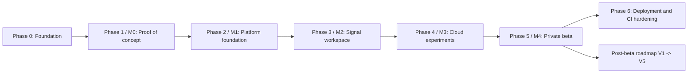

# Dependency Ordering

## 12. Dependency Ordering

The phase order is driven by technical dependency and risk, not visual appeal.

Ordering notes:

- The ingestion interface (Phase 1) must exist before upload validation (Phase 2), because validation is format-aware.
- Metadata and channel records (Phase 2) must exist before the Signal Viewer (Phase 3) can render anything meaningful.
- The viewer and result inspection (Phase 3) must exist before artifact review (Phase 4) is useful.
- Provenance and reproducibility (Phase 4) must be established before epoching and evoked results (Phase 5) can be described as reproducible.
- **OPM ingestion adds substantial work**: it spans format detection, companion metadata, sensor-geometry validation, and a distinct preprocessing template. Budget for it independently rather than treating it as a format-adapter variant.
- **Notebook isolation adds substantial work**: hosted Python execution requires an isolated runtime, restricted network egress, and least-privilege data access. It is deliberately deferred to the developer-workbench release (V2), not the beta, precisely because it is a security-sensitive subsystem.
- The private beta (Phase 5) is not complete until security, load, and scientific regression tests pass.

