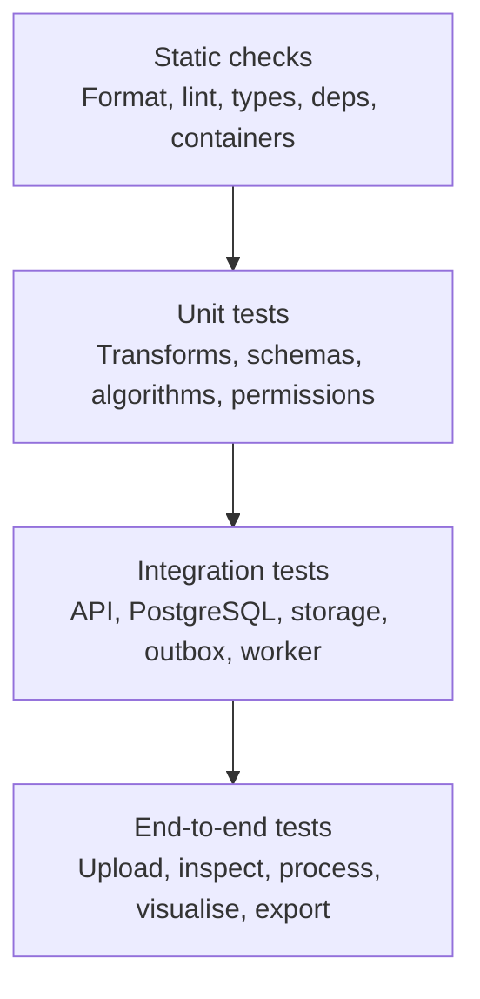

# MEG Lab — Testing Strategy

## 1. Purpose

This document defines the testing approach for MEG Lab, a cloud-based computational electrophysiology SaaS supporting both SQUID-MEG and OPM-MEG with an MNE-Python backbone.

MEG Lab combines a Next.js frontend, a FastAPI backend, PostgreSQL, S3-compatible object storage, a transactional outbox, a Redis-backed Celery worker, and versioned OCI containers that execute scientific MEG processing. Testing must verify not only individual functions, but also component interactions under normal operation, invalid input, concurrent requests, partial failures, duplicate task delivery, and cross-tenant isolation.

Goals:
- Protect scientific correctness (signal processing, event alignment, spatial/geometry metadata).
- Prevent cross-project/data access at every boundary.
- Verify DB integrity, transactions, constraints, and migrations.
- Validate untrusted MEG uploads safely with bounded resource use.
- Ensure reliable, idempotent asynchronous processing.
- Maintain API/frontend contracts.
- Preserve provenance and reproducibility for every completed run.
- Detect regressions in CI.
- Demonstrate professional engineering practices.

MEG Lab is educational/research software, not a medical device; no test asserts clinical validity.

## 2. Testing Principles

1. Test observable behaviour, not implementation details.
2. Test critical rules at appropriate system boundaries.
3. Use small, deterministic synthetic fixtures for scientific calculations; prefer generators over committed large binaries.
4. Use real PostgreSQL for DB-specific behaviour.
5. Test authorisation negatively (cross-project denial).
6. Assume worker execution may be duplicated, delayed, or restarted.
7. Test failure recovery as well as success.
8. Assert spatial/geometry metadata (sensor positions/orientations, coordinate frames, channel types, sampling, duration) for operations that affect geometry/metadata.
9. Keep unit tests fast; integration tests representative.
10. Avoid live cloud resources in ordinary tests.
11. Make failures reproducible and actionable.
12. Never commit large raw recordings unless strictly necessary with licence/terms; prefer synthetic/approved minimal fixtures.
13. High coverage ≠ scientific correctness.
14. Never commit secrets/keys.

## 3. Testing Pyramid



### Static checks (every PR)
- Formatting (Ruff format, Prettier)
- Linting (Ruff check, ESLint)
- Type checking (mypy, TypeScript)
- Dependency scanning (pip-audit, pnpm audit)
- Container/filesystem scanning (Trivy)

### Unit tests
- Pydantic request/parameter validation
- Permission/role decisions
- Experiment run/state transitions
- Time/sample conversions, epoch boundaries
- Metadata parsing (FIF/CTF `.ds`/KIT/UCL FIL OPM `.bin` headers/structure)
- Coordinate/frame handling and unit conversions
- Filter/epoch/PSD logic on tiny synthetic arrays
- Idempotency canonicalisation

### Integration tests
- FastAPI + real PostgreSQL
- Transactions/constraints/migrations
- Object storage upload/finalise/signed URLs
- Transactional outbox + dispatch claiming
- Celery worker lifecycle, retries, stale-run recovery
- Artifact/manifest persistence

### End-to-end tests
- Critical workflows via frontend+backend; reserved for high-value paths.

## 4. Testing Tools

### Frontend
| Tool | Purpose |
|---|---|
| Vitest | Unit/integration tests |
| React Testing Library | Component behaviour |
| Playwright | Browser E2E |
| TypeScript/ESLint/Prettier | Static checks |

### Backend/Worker
| Tool | Purpose |
|---|---|
| pytest (+pytest-cov) | Test runner/coverage |
| HTTPX | API testing (ASGI) |
| Pydantic | Validation |
| Psycopg 3 | DB integration |
| NumPy/SciPy | Fixtures/expected values |
| MNE-Python | Reference validation on synthetic/approved fixtures |
| pytest.approx | Floating point |
| Testcontainers or CI Postgres | Disposable DB |

### Security/Infra
- Trivy (fs/container, SARIF)
- pip-audit, pnpm audit
- Docker Compose for local Postgres/Redis/MinIO

## 5. Test Directory Structure

```
lab.meg/
├── packages/
│   ├── frontend/src/__tests__/ or colocated; e2e/
│   └── backend/app/... and tests/{unit,integration,api,security,fixtures}
├── workers/tests/{unit,integration,fixtures}
└── tests/e2e/
```

Shared MEG fixture generators live in importable modules to ensure consistency across API/worker/scientific tests.

## 6. Scientific Correctness Tests

### 6.1 MEG-specific coverage (from README §11)
- Unit: metadata parsing (FIF/CTF/KIT/OPM headers/structure, bounds), time/sample conversions, permissions, parameter validation, coordinate-frame and unit conversions.
- Scientific correctness: filter responses, event alignment, epoch boundaries, baseline correction, reject thresholds, units, evoked/PSD expected outputs, random seeds.
- Spatial correctness: sensor coordinates, orientations, coordinate frames, geometry transformations, head/device transforms explicit.
- Integration: upload/finalise, storage, metadata extraction, queue, worker, artifact retrieval, idempotency.
- Security: cross-tenant access, malicious/malformed files, decompression/resource exhaustion, isolated execution, expired/signed URLs, no false authorisation from object keys.
- End-to-end: upload → inspect → process → visualise → export.
- Reproducibility: same input + configuration resolves to same workflow/environment; rerun consistent.
- Performance: large recordings (~186 MB FIF, 300+ channels at 1000 Hz), many channels, concurrent users, dense signal plots.
- Recovery: worker crashes, retries, cancellation, duplicate submissions, partial uploads.

### 6.2 Geometry/metadata invariants
For operations affecting recording/geometry/metadata:
- Sensor positions/orientations present with declared coordinate frame and units.
- Channel inventory consistent with recording (types, counts, bad status).
- Sampling frequency (Hz), duration (s), n_times consistent.
- Event times aligned to recording time base; event sets preserved with provenance.
- Transforms between frames explicit; invalid/missing frames rejected or clearly flagged.

### 6.3 Time-series and event correctness
- Time/sample round-trips: `t = (i - i0)/sfreq` consistent.
- Epoching: boundaries `tmin/tmax` respected; baseline correction applied as specified; rejects applied only where criteria met.
- Event alignment preserves original event times/ids; markers rendered consistently with stored event sets.
- Filter responses match expected on tiny synthetic signals within documented tolerance (use `pytest.approx`).
- PSD/evoked expected outputs verified against MNE-Python reference on synthetic data.

### 6.4 Numerical edge cases
Constant signals, DC offsets, NaN/inf handling, integer overflow, empty/single-sample/single-channel, mismatched ranks, unsupported dtypes, thresholds outside range, anisotropic/oblique geometry cases, 4D-like selections where applicable. All operations must be non-mutating on inputs.

## 7. Synthetic MEG Fixtures

Generate deterministic fixtures (no large committed binaries). Include:
1. Tiny multichannel synthetic (few channels, short duration) with known events.
2. Known landmarks for time/sample checks.
3. Anisotropic sampling/frequency edge cases.
4. Oblique/varied geometry for round-trips.
5. Bad-channel markers and event sets.
6. `.fif`-style minimal synthetic (via MNE-Python) and compressed variants.
7. Malformed/truncated headers/structures.
8. Decompression-bomb-like small crafted cases (resource-bounded).
9. SQUID-like channel groups (grad/mag/aux).
10. OPM-like minimal geometry/metadata (positions/orientations, coordinate frame).
11. Event timing edge cases (overlaps, boundaries).

Fixture generator API: `make_meg_recording(...)` with fixed seed or no randomness. Document expected values alongside definitions.

## 8. API Tests

Cover: projects, datasets/upload sessions, recordings/metadata, channels/events/signals/sensors, pipelines/versions, runs (submit/status/logs/artifacts), shares. Validate idempotency keys (duplicate submission returns existing run; mismatched request_hash → 409). Ensure `ready` only after validation; non-ready datasets cannot be run inputs. Responses include stable error codes, safe messages, field details, request ID; no internal paths/keys/stack traces.

## 9. Multi-Tenancy and Authorisation

Two projects with separate owners/members. Deny cross-project access by substituting IDs (project/dataset/version/pipeline/run/artifact/annotation), reusing identifiers, finalising other project’s upload, requesting signed URLs for others’ objects. Role boundaries: owner/editor/viewer/anonymous/revoked. Last-owner invariant enforced. Query scoping before pagination/aggregation. DB composite constraints tested directly. All denials must not reveal resource existence.

## 10. Database and Transactions

Real Postgres: migrations (empty + previous + seeded), forward-only, constraints (FKs, composites), enum/state validity, terminal states require `finished_at`, checksums/object keys uniqueness, annotations require `coordinate_space`, idempotency keys, outbox atomicity with run creation. Concurrent updates/claiming with `FOR UPDATE SKIP LOCKED`. Rollback behaviour verified.

## 11. Background Worker Tests

Assume duplicates/delays/restarts. Transitions: queued→running→succeeded/failed/cancelled; terminal states immutable. Idempotent execution: duplicate delivery never overwrites succeeded with failure or reopens cancelled; artifacts not duplicated; state remains valid. Outbox: commit both run+event; rollback neither; dispatcher claims via SKIP LOCKED; marks dispatched after publish. Recovery: stale lease (`running` after crash), DB/outage, timeouts, retries bounded (transient vs permanent), cancellation races handled.

Note: Celery eager mode insufficient for delivery/retry/worker-lifecycle; use representative integration environment for critical cases.

## 12. Object Storage Tests

Server-generated keys only; private buckets; signed URL expiry/scoping (single object, no list/overwrite); checksum verification on finalise/retrieve; abandon/cleanup delayed; no secrets in logs; cross-project object attachment impossible. Mismatched checksums rejected.

## 13. Frontend Component Tests

Colocate with code. Test: sign-in, project membership, dataset upload/progress/validation panel, Signal Viewer controls (channel selection, filtering, amplitude scale), log viewer (grid layout rendering), run detail timeline/logs/artifacts, settings quota states, forms with validation, loading/empty/error/disabled/permission states. Keyboard accessible, labels present, no false success on API failure, viewer write controls hidden for viewers.

## 14. Visualisation/Signal Tests

Signal Viewer correctness:
- Channel grouping by type (grad/mag/bad/aux) matches metadata.
- Bad channels/segments rendered with `danger` styling; event markers rendered.
- Amplitude scaling is display-only.
- Time navigation bounded; window requests valid.
- Sensor Explorer shows geometry with declared coordinate frame; OPM geometry adapts when present.
- Display transforms never recorded as run inputs.
- Empty/validating/error states explicit; large recordings use bounded queries/multiresolution.

Log viewer: grid `88px 56px 1fr` applied; timestamps/level/message aligned; monospace, copy/download functional; no sensitive content leaked.

## 15. End-to-End Tests

Workflow A (primary): sign in → create/select project → upload synthetic MEG recording → finalise → wait for `ready` → inspect metadata/channels/events → open Signal Viewer → configure view → submit run (deterministic params) → wait for `succeeded` → inspect logs/artifacts/manifest → export manifest (verify input references).
Workflow B (permissions): viewer cannot access write actions; direct API calls denied.
Workflow C (failure): invalid/malformed upload → validation fails → never `ready` → UI safe message; cannot run.

Deterministic fixtures; run on PRs when practical and before release.

## 16. Contract and Type Consistency

Generate OpenAPI in CI; generate TypeScript types; fail on drift unless committed. Validate responses against schema; status values and error codes consistent across frontend/backend.

## 17. Performance and Resource Tests

Targeted (not every PR): bounded queries for signal windows, channel lists, run logs; concurrent uploads/runs; worker memory/time for supported sizes; header/structure parsing bounds (reject oversized without OOM); dense plotting remains responsive; DB pool behaviour; recovery after dependency outage. Define MVP limits; benchmark representative SQUID/OPM recordings.

## 18. Security Testing

Cover: cross-project/BOLA, SQL injection (parameterised), malformed MEG structures, decompression bombs, oversized uploads, JSON/metadata abuse, resource exhaustion, secret leakage (logs/errors/manifests), signed URL leakage/expiry, object-key ≠ auth, worker isolation (least privilege, no cross-tenant access), network egress restrictions, role/membership abuse, unsafe error responses, dependency/container vulns (pip-audit, pnpm audit, Trivy), private storage exposure, insecure defaults. Dynamic SQL identifiers from trusted allowlists only. Deletions never remove objects still referenced.

## 19. Continuous Integration Gates

Authoritative: `.github/workflows/ci.yml`.

### Backend (packages/backend, Python 3.15.0 via uv, Postgres 18)
| Step | Command |
|---|---|
| Install | `uv sync --all-groups` |
| Format | `ruff format --check .` |
| Lint | `ruff check .` |
| Typecheck | `python -m mypy .` |
| Migrations | `python -m app.db.migrations upgrade` |
| Tests | `pytest -q --cov=app --cov-report=term-missing` |
| Dependency audit | `pip-audit --desc --format=json --output=pip-audit.json` (non-blocking artifact) |

### Frontend (packages/frontend, pnpm 12, Node .nvmrc)
| Step | Command |
|---|---|
| Install | `pnpm install --frozen-lockfile` |
| Lint+format | `pnpm lint && pnpm format:check` |
| Typecheck | `pnpm typecheck` |
| Unit tests | `pnpm test` |
| Build | `pnpm build` |
| Dependency audit | `pnpm audit --json --output=npm-audit.json` (non-blocking artifact) |

### E2E (after frontend)
- Install, `pnpm exec playwright install --with-deps chromium`, `pnpm test:e2e`

### Security
- Trivy fs scan (CRITICAL,HIGH,MEDIUM, ignore-unfixed), SARIF to GitHub Security.

### Release
- Tauri desktop build on `master` only after all gates pass (not required per PR).

Local: Husky + lint-staged (Ruff, ESLint/Prettier) for fast feedback.

## 20. Test Data and Environment Management

Synthetic only for CI/dev. Tiny deterministic fixtures; larger only for resource tests and cleaned up. No large raw recordings committed; generators preferred. Isolated test DBs per session; temp storage/cleanup; no shared mutable fixtures; parallel tests isolated (unique keys). Keep auth isolated from prod. Real research data requires explicit approval/licensing/anonymisation.

## 21. Coverage and Quality Targets

Coverage is diagnostic, not a single percentage gate. Prioritise: coordinate/frame and time-sample edge cases; cross-project isolation; all run/dataset-version state transitions; worker idempotency/duplicate delivery/cancellation/recovery; primary upload→export E2E. Avoid testing trivial getters.

## 22. Defect Handling

Reproduce → identify boundary → add regression test → fix root cause → run relevant suites → check similar workflows → document impact (scientific/security/provenance/persisted data). If persisted scientific results affected, consider invalidation/recomputation/version marking.

## 23. Definition of Done

Feature/release complete when:
1. Behaviour tested at appropriate pyramid level.
2. Invalid/malformed MEG inputs handled safely (FIF/CTF/.ds/KIT/UCL FIL OPM/.bin/BIDS variants covered where supported).
3. Authorisation enforced server-side; cross-project negative tests pass.
4. DB constraints/transactions/migrations tested.
5. Scientific operations have known expected outputs and geometry/metadata invariants.
6. Time-sample/coordinate/frame consistency verified within tolerance (incl. MNE reference where applicable).
7. Worker idempotency, duplicate delivery, retry, cancellation, stale-run recovery covered.
8. Reproducibility verified (inputs + params + pipeline version/image_digest + environment recorded; numerical equivalence as appropriate).
9. Object storage privacy/expiry/checksums/cleanup tested.
10. Frontend states (loading/success/empty/error/partial/disabled/permission) implemented and tested; log viewer grid `88px 56px 1fr` correct.
11. API/frontend contracts drift-checked.
12. Required CI gates pass (backend/frontend/E2E/security as above).
13. No secrets/large raw binaries committed.
14. Docs/contracts updated.
15. No unsupported clinical/diagnostic claims introduced.
