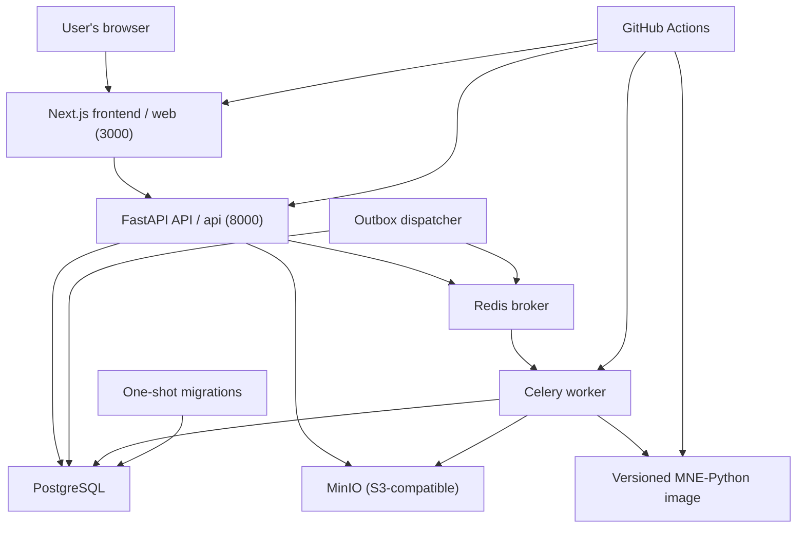

# MEG Lab — Deployment

## 1. Purpose

This document defines how to run, test, deploy, monitor, maintain, and safely tear down MEG Lab.

MEG Lab is an independent cloud-based computational electrophysiology SaaS portfolio project built with:

- Next.js (App Router), React, and TypeScript.
- Python 3.15.0, FastAPI, and Pydantic.
- PostgreSQL and Psycopg 3.
- Celery and Redis.
- MNE-Python, NumPy, SciPy, and Matplotlib for scientific I/O and analysis.
- MinIO (S3-compatible) object storage for local and self-hosted environments.
- Docker and Docker Compose.
- GitHub Actions.

The deployment strategy prioritises reproducibility, security, reasonable operating costs, and a clear path from local development to a publicly accessible demonstration.

The primary deployment target is a **CI-first, Docker-Compose-first self-hosted stack**. Cloud providers, Terraform, and Kubernetes are explicitly deferred and are documented only as a future evolution. The platform must build, test, and run without them.

The repository is a pnpm monorepo rooted at `@meg-lab/workspace` with `packages/frontend` (`@meg-lab/web`) and `packages/backend` (FastAPI API, Celery worker, outbox dispatcher, and migrations).


## 2. Deployment Principles

1. Keep local development straightforward.
2. Keep production credentials out of source control.
3. Separate frontend, API, background-worker, and dispatcher responsibilities.
4. Keep raw recordings, derivatives, and artifacts in private object storage.
5. Keep PostgreSQL inaccessible to unauthorised public clients.
6. Use least-privilege storage credentials and short-lived signed URLs.
7. Manage the environment as code through `docker-compose.yaml`.
8. Apply database migrations through a controlled, one-shot step.
9. Make deployments observable and recoverable.
10. Minimise always-on infrastructure for a portfolio project.
11. Document recurring costs and resource cleanup.
12. Never use real participant or clinical recordings in the demonstration without an appropriate data-governance process.
13. Do not introduce a cloud provider, Terraform, or Kubernetes until the Compose deployment is proven and a demonstrated requirement justifies the extra operational cost.


## 3. Environment Strategy

## 3. Environment Strategy

Use three logical environments.

| Environment            | Purpose                        | Data                        | Runtime                                       |
| ---------------------- | ------------------------------ | --------------------------- | --------------------------------------------- |
| Local                  | Daily development              | Synthetic data              | Docker Compose or host processes              |
| CI                     | Automated testing              | Isolated synthetic fixtures | GitHub Actions, pinned PostgreSQL service     |
| Self-hosted production | Public portfolio demonstration | Synthetic data only         | Docker Compose on a single hardened host      |

A separate staging environment may be introduced when the deployment complexity justifies it. Until then, the self-hosted stack is promoted only after CI passes on `master`.

### 3.1 Environment isolation

Each environment should have its own:

- Configuration (`.env` file or CI environment variables).
- Database (separate database or instance).
- Object-storage bucket and credentials.
- Scientific worker image digest.
- Authentication configuration.
- Secrets.
- Logging context.

Do not let CI or local development accidentally write to the production database or production storage bucket. CI uses an ephemeral, throwaway PostgreSQL service and does not require object-storage credentials for the default jobs. The worker image used by CI is built and pinned by digest within the workflow rather than pulled from production.


## 4. Local Development

See [`local-development.md`](local-development.md).

## 5. Containerisation

## 5. Containerisation

Containerise every runtime component so that configuration lives in the environment, not the image.

| Image                          | Dockerfile                              | Runtime command                                              | Port |
| ------------------------------ | --------------------------------------- | ------------------------------------------------------------ | ---- |
| Frontend (`@meg-lab/web`)      | `packages/frontend/Dockerfile`          | Next.js standalone server (`node server.js`)                 | 3000 |
| Backend API (`api`)            | `packages/backend/Dockerfile`           | `uv`-managed FastAPI ASGI server                             | 8000 |
| Celery worker (`worker`)       | `packages/backend/Dockerfile.worker`    | `celery -A app.workers.celery worker`                        | —    |
| Outbox dispatcher              | `packages/backend/Dockerfile.dispatcher`| `python -m app.workers.outbox_dispatcher` (looped)           | —    |
| Migrations (one-shot)          | `packages/backend/Dockerfile`           | `python -m app.db.migrations upgrade`                        | —    |
| Scientific worker (`mne-worker-image`) | `packages/backend/Dockerfile.mne`| Loaded by the worker to execute runs                         | —    |

The API, worker, dispatcher, and migration runner share a Python dependency base image (`uv.lock`, Python 3.15.0) while retaining separate runtime commands. Sharing an image does not mean sharing the same execution role: the API does not need broker publishing rights, and the dispatcher does not need HTTP exposure.

### 5.1 The versioned scientific container

Scientific computation runs in a separate, versioned OCI image so that results are reproducible and the worker cannot silently change algorithms:

- Base: Python 3.15.0.
- Pinned: MNE-Python 1.8.1, NumPy, SciPy, and Matplotlib.
- Pinned by digest: every pipeline version records the exact `image_digest` it executed.
- Built as an explicit `mne-worker-image` build step in Compose and in CI, not pulled from a mutable `latest` tag.
- Contains no application secrets and no project data; inputs are mounted or fetched at runtime under least privilege.

Do not bake recordings or artifacts into any image layer.

### 5.2 Container requirements

- Use a maintained, supported base image; pin Python 3.15.0 and Node deliberately.
- Build the frontend with `output: 'standalone'` so only the traced runtime is shipped.
- Prefer multi-stage builds; do not copy development dependencies into production images.
- Run as a non-root user.
- Do not copy `.env` files or credentials into images; inject configuration at runtime.
- Avoid placing recordings, derivatives, or artifacts in container layers.
- Use a predictable working directory (`/app`).
- Install `init`/a proper PID 1 so the worker and dispatcher handle `SIGTERM` and shut down cleanly.
- Define container health checks for the API and frontend.
- Do not run migrations from the application start-up path; use the dedicated one-shot service.

### 5.3 Example container layout

```text
packages/
├── frontend/
│   └── Dockerfile              # multi-stage: deps -> build -> standalone runner
└── backend/
    ├── Dockerfile              # API
    ├── Dockerfile.worker       # Celery worker
    ├── Dockerfile.dispatcher   # outbox dispatcher
    └── Dockerfile.mne          # versioned MNE-Python scientific runtime
```

The frontend build uses the repository-level `pnpm-lock.yaml`. Install with `pnpm install --frozen-lockfile` in the build stage and rely on the workspace lockfile rather than the package-specific one.


## 6. Docker Compose Stack

## 6. Docker Compose Stack

Docker Compose is the current deployment topology, both for local development and for the self-hosted production demonstration.



### 6.1 Services

| Service      | Image / build                        | Purpose                                                     | Depends on                                           |
| ------------ | ------------------------------------ | ----------------------------------------------------------- | ---------------------------------------------------- |
| `postgres`   | `postgres:18-alpine`                | Authoritative metadata and run state                          | —                                                    |
| `redis`      | `redis:7-alpine`                     | Celery broker and coordination                              | —                                                    |
| `minio`      | `minio/minio`                        | Private S3-compatible object storage                        | —                                                    |
| `minio-init` | `minio/mc`                           | One-shot bucket creation and private bucket policy          | `minio` healthy                                      |
| `migrate`    | `packages/backend/Dockerfile`        | One-shot schema migration (`app.db.migrations upgrade`)     | `postgres` healthy                                   |
| `api`        | `packages/backend/Dockerfile`        | FastAPI API on port 8000 (`/api/v1`)                        | `postgres`, `redis`, `minio` healthy; `migrate` done |
| `worker`     | `packages/backend/Dockerfile.worker` | Celery worker executing experiment runs                     | `postgres`, `redis`, `minio` healthy; `migrate` done |
| `dispatcher` | `packages/backend/Dockerfile.dispatcher` | Publishes committed outbox events to Redis             | `postgres`, `redis` healthy; `migrate` done          |
| `web`        | `packages/frontend/Dockerfile`       | Next.js standalone application on port 3000                  | `api` healthy                                        |

The versioned scientific image (`packages/backend/Dockerfile.mne`) is built by a separate `mne-worker-image` build step and referenced by the worker through `MNE_WORKER_IMAGE`, pinned by digest. It is not a long-running Compose service.

### 6.2 Example service definitions

The following excerpts are consistent with the repository layout and the environment variables in section 4.3.

```yaml
services:
  postgres:
    image: postgres:18-alpine
    container_name: meg-lab-postgres
    environment:
      POSTGRES_USER: ${POSTGRES_USER:-meg-lab}
      POSTGRES_PASSWORD: ${POSTGRES_PASSWORD:-meg-lab}
      POSTGRES_DB: ${POSTGRES_DB:-meg-lab}
    ports:
      - '5432:5432'
    volumes:
      - meg-lab-pgdata:/var/lib/postgresql/data
    healthcheck:
      test: ['CMD-SHELL', 'pg_isready -U ${POSTGRES_USER:-meg-lab} -d ${POSTGRES_DB:-meg-lab}']
      interval: 5s
      timeout: 5s
      retries: 10
    restart: unless-stopped

  redis:
    image: redis:7-alpine
    container_name: meg-lab-redis
    healthcheck:
      test: ['CMD', 'redis-cli', 'ping']
      interval: 5s
      timeout: 3s
      retries: 10
    restart: unless-stopped

  minio:
    image: minio/minio:latest
    container_name: meg-lab-minio
    command: server /data --console-address ":9001"
    environment:
      MINIO_ROOT_USER: ${S3_ACCESS_KEY:-meg-lab}
      MINIO_ROOT_PASSWORD: ${S3_SECRET_KEY:-meg-lab-secret}
    ports:
      - '9000:9000'
      - '9001:9001'
    volumes:
      - meg-lab-minio:/data
    healthcheck:
      test: ['CMD', 'mc', 'ready', 'local']
      interval: 5s
      timeout: 5s
      retries: 10
    restart: unless-stopped

  minio-init:
    image: minio/mc:latest
    depends_on:
      minio:
        condition: service_healthy
    entrypoint: >
      /bin/sh -c "
      mc alias set local http://minio:9000 ${S3_ACCESS_KEY:-meg-lab} ${S3_SECRET_KEY:-meg-lab-secret} &&
      mc mb --ignore-existing local/${S3_BUCKET:-meg-lab} &&
      mc anonymous set none local/${S3_BUCKET:-meg-lab} &&
      mc version enable local/${S3_BUCKET:-meg-lab}
      "
    restart: 'no'
```

The `minio-init` service disables anonymous access and enables bucket versioning so that source recordings are retained and protected against accidental overwrite. Object storage is private by default; all access is via short-lived signed URLs issued after an authorisation check.

```yaml
  migrate:
    build:
      context: .
      dockerfile: packages/backend/Dockerfile
    command: ['/app/.venv/bin/python', '-m', 'app.db.migrations', 'upgrade']
    environment:
      DATABASE_URL: postgresql://${POSTGRES_USER:-meg-lab}:${POSTGRES_PASSWORD:-meg-lab}@postgres:5432/${POSTGRES_DB:-meg-lab}
    depends_on:
      postgres:
        condition: service_healthy
    restart: 'no'

  api:
    build:
      context: .
      dockerfile: packages/backend/Dockerfile
    environment:
      APP_ENV: ${APP_ENV:-development}
      AUTH_MODE: ${AUTH_MODE:-development}
      SESSION_SECRET: ${SESSION_SECRET:-insecure-development-session-secret-change-me}
      JWT_SECRET: ${JWT_SECRET:-insecure-development-jwt-secret-change-me}
      AUTH_PROVIDER_ISSUER: ${AUTH_PROVIDER_ISSUER:-}
      AUTH_PROVIDER_CLIENT_ID: ${AUTH_PROVIDER_CLIENT_ID:-}
      AUTH_PROVIDER_CLIENT_SECRET: ${AUTH_PROVIDER_CLIENT_SECRET:-}
      DATABASE_URL: postgresql://${POSTGRES_USER:-meg-lab}:${POSTGRES_PASSWORD:-meg-lab}@postgres:5432/${POSTGRES_DB:-meg-lab}
      REDIS_URL: redis://redis:6379/0
      STORAGE_BACKEND: s3
      S3_ENDPOINT: http://minio:9000
      S3_BUCKET: ${S3_BUCKET:-meg-lab}
      S3_ACCESS_KEY: ${S3_ACCESS_KEY:-meg-lab}
      S3_SECRET_KEY: ${S3_SECRET_KEY:-meg-lab-secret}
      MAX_UPLOAD_BYTES: ${MAX_UPLOAD_BYTES:-2147483648}
      API_CORS_ORIGINS: '["http://localhost:3000","http://127.0.0.1:3000"]'
    ports:
      - '8000:8000'
    healthcheck:
      test: ['CMD', 'python', '-c', "import urllib.request; urllib.request.urlopen('http://localhost:8000/ready')"]
      interval: 10s
      timeout: 5s
      retries: 6
    depends_on:
      postgres:
        condition: service_healthy
      redis:
        condition: service_healthy
      minio:
        condition: service_healthy
      migrate:
        condition: service_completed_successfully
    restart: unless-stopped
```

```yaml
  worker:
    build:
      context: .
      dockerfile: packages/backend/Dockerfile.worker
    environment:
      APP_ENV: ${APP_ENV:-development}
      DATABASE_URL: postgresql://${POSTGRES_USER:-meg-lab}:${POSTGRES_PASSWORD:-meg-lab}@postgres:5432/${POSTGRES_DB:-meg-lab}
      CELERY_BROKER_URL: redis://redis:6379/0
      STORAGE_BACKEND: s3
      S3_ENDPOINT: http://minio:9000
      S3_BUCKET: ${S3_BUCKET:-meg-lab}
      S3_ACCESS_KEY: ${S3_ACCESS_KEY:-meg-lab}
      S3_SECRET_KEY: ${S3_SECRET_KEY:-meg-lab-secret}
      MNE_WORKER_IMAGE: ${MNE_WORKER_IMAGE:?set a pinned MNE worker digest}
      RUN_CPU_LIMIT: ${RUN_CPU_LIMIT:-2}
      RUN_MEMORY_LIMIT_MB: ${RUN_MEMORY_LIMIT_MB:-4096}
      RUN_TIMEOUT_SECONDS: ${RUN_TIMEOUT_SECONDS:-1800}
    init: true
    depends_on:
      postgres:
        condition: service_healthy
      redis:
        condition: service_healthy
      minio:
        condition: service_healthy
      migrate:
        condition: service_completed_successfully
    restart: unless-stopped

  dispatcher:
    build:
      context: .
      dockerfile: packages/backend/Dockerfile.dispatcher
    entrypoint: ['/bin/sh', '-c']
    command:
      - |
        set -e
        while true; do
          /app/.venv/bin/python -m app.workers.outbox_dispatcher
          sleep 5
        done
    environment:
      APP_ENV: ${APP_ENV:-development}
      DATABASE_URL: postgresql://${POSTGRES_USER:-meg-lab}:${POSTGRES_PASSWORD:-meg-lab}@postgres:5432/${POSTGRES_DB:-meg-lab}
      REDIS_URL: redis://redis:6379/0
    init: true
    depends_on:
      postgres:
        condition: service_healthy
      redis:
        condition: service_healthy
      migrate:
        condition: service_completed_successfully
    restart: unless-stopped

  web:
    build:
      context: .
      dockerfile: packages/frontend/Dockerfile
      args:
        NEXT_PUBLIC_API_BASE_URL: ${NEXT_PUBLIC_API_BASE_URL:-http://localhost:8000/api/v1}
    environment:
      API_INTERNAL_BASE_URL: http://api:8000/api/v1
    ports:
      - '3000:3000'
    depends_on:
      api:
        condition: service_healthy
    restart: unless-stopped

volumes:
  meg-lab-pgdata:
  meg-lab-minio:
```

### 6.3 Building the scientific image

The versioned scientific container is built once and pinned by digest. A typical build is:

```bash
docker build \
  -f packages/backend/Dockerfile.mne \
  -t ghcr.io/hieudoanm/meg-lab-mne-worker:mne1.8-py3.15 \
  packages/backend

docker buildx imagetools inspect \
  ghcr.io/hieudoanm/meg-lab-mne-worker:mne1.8-py3.15
```

Record the resulting `sha256:` digest and set `MNE_WORKER_IMAGE` to the digest-qualified reference. Pipeline versions store the digest they executed so a result is traceable to the exact scientific runtime.

### 6.4 Named volumes

Persist state in named volumes so that `docker compose down` does not destroy data:

| Volume           | Mount                      | Contents                                          |
| ---------------- | -------------------------- | ------------------------------------------------- |
| `meg-lab-pgdata` | `/var/lib/postgresql/data` | PostgreSQL cluster data                           |
| `meg-lab-minio`  | `/data`                    | Raw recordings, derived signals, plots, manifests |

Object storage is the only home for MEG recording bytes and derived artifacts; the database stores only metadata and object references.

### 6.5 Storage abstraction

The object-storage interface must allow MinIO locally and self-hosted, and an S3-compatible provider later, interchangeably. Configure the endpoint, bucket, region, credentials, and TLS through environment variables so the provider can be substituted without code changes. Block public access, keep credentials out of images, and never treat possession of an object key as authorisation.

### 6.6 Self-hosted production notes

For the self-hosted demo:

- Run the same images built from a reviewed `master` commit; do not build on the production host.
- Terminate TLS at a reverse proxy (for example Caddy, Nginx, or Traefik) in front of the frontend and API.
- Expose only the frontend (and the proxy) publicly; keep PostgreSQL, Redis, and the MinIO console on the internal network.
- Set `APP_ENV=production`, `AUTH_MODE=oidc`, strong `SESSION_SECRET` and `JWT_SECRET` values, and secure cookies.
- Provide real `S3_ACCESS_KEY`/`S3_SECRET_KEY` values distinct from the defaults.
- Restrict `API_CORS_ORIGINS` to the production origin.
- Configure log rotation and disk capacity alerts on the host.


## 7. Infrastructure as Code

## 7. Infrastructure as Code

Use **Docker Compose** as the current infrastructure-as-code mechanism. It is version-controlled, reviewable, and reproducible:

- Keep the `docker-compose.yaml` and `docker-compose.prod.yaml` files explicit and minimal.
- Do not commit secrets; use `.env` files excluded from version control.
- Provide an `.env.example` with placeholders only.
- Document resource limits and dependencies for each service.

**Terraform is deferred.** Introduce Terraform only when a cloud deployment is actually pursued. At that point, manage service configuration, database instances, storage buckets, service accounts and IAM bindings, secret references, logging, and networking. When Terraform is introduced:

- Do not commit state files or secrets.
- Use remote state with locking for shared deployments.
- Review plans before applying.
- Separate environments where practical.
- Document resource naming and ownership.

Kubernetes, a microservice decomposition, and a service mesh remain deferred. The cloud-evolution section (section 18) describes how to adopt managed services without changing the local or self-hosted deployment.


## 8. Configuration and Secrets

## 8. Configuration and Secrets

### 8.1 Configuration

Keep non-secret, environment-specific settings in explicit configuration:

- Environment name (`APP_ENV`).
- Log level and format.
- API base URL (`NEXT_PUBLIC_API_BASE_URL`, `API_INTERNAL_BASE_URL`).
- CORS origins.
- Resource limits (upload size, recording duration, channel count, per-run CPU/memory/disk/wall-clock, concurrency).
- Redis and Celery settings.
- Object-storage endpoint, bucket, and region.
- Authentication mode and OIDC issuer.
- The pinned scientific worker image digest (`MNE_WORKER_IMAGE`).

Validate required configuration at start-up and fail clearly when mandatory values are missing.

### 8.2 Secrets

Keep the following only in environment files or a secret store, never in source or images:

- Database credentials (`DATABASE_URL`).
- Redis authentication (if enabled).
- Object-storage access and secret keys.
- `SESSION_SECRET` and `JWT_SECRET` (or asymmetric signing keys).
- OIDC client secret (`AUTH_PROVIDER_CLIENT_SECRET`).
- Any third-party credentials.

### 8.3 Rules

- Never commit secrets; `.env` and `.env.*` are ignored, and `!.env.example` is the only exception.
- Never log secret values, full connection strings, or signed URLs.
- Never expose server secrets through `NEXT_PUBLIC_*` variables; these are embedded in the client bundle.
- Rotate credentials according to a documented policy.
- Use separate credentials for local, CI, and production.
- Grant each service access only to the secrets it requires.
- Validate at start-up that production is not running with development defaults.
- Never put placeholder values in a production deployment. Every `replace-me` or `insecure-...` value in `.env.example` must be replaced with a real, environment-specific secret before production use, and the API must refuse to start if such placeholders remain.


## 9. Database Migrations

## 9. Database Migrations

Migrations live under `packages/backend/app/db/migrations/` as ordered SQL files with a Psycopg runner. Apply pending migrations with:

```bash
uv run python -m app.db.migrations upgrade
```

CI runs this command before tests against a pinned PostgreSQL service.

### 9.1 Deployment order

A typical release should:

1. Build and test the application images and the scientific image.
2. Review the migration plan.
3. Apply a backward-compatible migration as a one-shot step (the Compose `migrate` service).
4. Start the API, worker, and dispatcher only after migrations complete successfully.
5. Run smoke tests.
6. Verify health and error metrics.
7. Retain a documented recovery option.

Compose enforces ordering with `migrate` using `condition: service_completed_successfully` as a dependency of `api`, `worker`, and `dispatcher`.

### 9.2 Expand-and-contract

For changes requiring multiple releases, use expand-and-contract migrations:

1. Add the new schema while retaining compatibility.
2. Deploy code that supports the transition.
3. Migrate data if required.
4. Switch reads and writes.
5. Remove obsolete schema in a later release.

### 9.3 Rules

- The runner tracks applied versions and checksums and rejects modified, already-applied migrations.
- Apply each migration transactionally.
- Do not assume that rolling back an application image reverses a database migration safely.
- Avoid destructive automatic schema changes during application start-up.
- Migrations must be repeatable in a clean environment and reviewed before production.


## 10. CI/CD Pipeline

See [`ci-cd-pipeline.md`](ci-cd-pipeline.md).

## 11. Health Checks and Readiness

See [`../12-operations/monitoring-alerting.md`](../12-operations/monitoring-alerting.md).

## 12. Logging, Metrics, and Alerts

See [`../12-operations/monitoring-alerting.md`](../12-operations/monitoring-alerting.md).

## 13. Backups and Recovery

See [`../12-operations/backup-recovery.md`](../12-operations/backup-recovery.md).

## 14. Cost Management

## 14. Cost Management

## 14. Cost Management

A self-hosted portfolio project should not incur unnecessary ongoing costs.

- Run the whole stack on a single modest host; prefer the smallest instance that meets memory and disk needs.
- Budget for disk first: raw recordings and derived artifacts dominate cost, not compute.
- Apply object-storage retention and cleanup for abandoned upload sessions and superseded artifacts.
- Enforce upload-size, recording-duration, and run-time limits so a single job cannot exhaust the host.
- Limit worker concurrency and set Celery time limits.
- Configure Docker log rotation to prevent unbounded log growth.
- Monitor storage growth and provision headroom for backups.
- Avoid keeping unused environments running.
- Document which resources continue to incur charges while idle.

Review provider or host pricing before provisioning. Do not assume a workload remains cheap simply because the demonstration is small.


## 15. Production Readiness Checklist

See [`../12-operations/security.md`](../12-operations/security.md).

## 16. Rollback Strategy

See [`../12-operations/rollback-strategy.md`](../12-operations/rollback-strategy.md).

## 17. Teardown and Resource Cleanup

See [`../12-operations/12-operations.md#7-teardown-and-resource-cleanup`](../12-operations/12-operations.md).

## 17. Teardown and Resource Cleanup

## 17. Teardown and Resource Cleanup

Provide a documented teardown process for disposable environments.

Before deleting resources:

1. Identify the environment.
2. Confirm that it contains no data that must be retained.
3. Check for object-storage contents, database backups, and image archives.
4. Review the destruction plan.
5. Confirm that shared resources will not be removed.
6. Apply the approved teardown.
7. Verify that the intended resources were removed.
8. Check for remaining billable resources.

Typical commands:

```bash
# Stop the stack, preserving volumes
docker compose down

# Stop the stack and delete database, MinIO, and upload volumes
docker compose down --volumes

# Remove locally built images for the project
docker compose down --rmi local
```

Use `--volumes` only when the data is disposable. Do not delete backups as part of an ordinary deployment failure handler.


## 18. Cloud Deployment

See [`cloud-deployment-aws.md`](cloud-deployment-aws.md) and [`cloud-deployment-gcp.md`](cloud-deployment-gcp.md).

## 19. Troubleshooting Guide

## 19. Troubleshooting Guide

### 19.1 API cannot connect to PostgreSQL

Check:

- PostgreSQL container status and the readiness health check.
- `DATABASE_URL` format and hostname (`postgres` inside Compose, `localhost` on the host).
- Network configuration and service name resolution.
- Authentication and permissions.
- Connection-pool limits and database connection exhaustion.
- That `migrate` completed before the API started.

Do not print passwords or full connection strings into logs.

### 19.2 Worker does not process runs

Check:

- Redis availability and `CELERY_BROKER_URL`.
- Worker container status and task registration.
- Outbox dispatch status and lag (undispatched events remain in PostgreSQL).
- Queue depth and worker concurrency.
- Run state and lease information.
- Resource and time limits.
- That `MNE_WORKER_IMAGE` resolves to a digest-qualified image that can be pulled.

Inspect run and outbox records before manually resubmitting work.

### 19.3 Recording upload remains pending

Check:

- Upload-session state and expiry.
- Signed-URL expiry and expiry clock skew.
- Object existence in the MinIO bucket.
- Object size and SHA-256 checksum for every file in the set.
- Storage credentials and bucket policy (anonymous access must be disabled).
- That directory-based and companion-file sets were fully uploaded.
- Validation worker health and validation error records.

Do not manually mark a recording ready without verifying the file set.

### 19.4 Run remains queued

Check:

- Outbox dispatch status.
- Redis connectivity.
- Worker availability.
- Retry policy and attempt counts.
- Resource limits and host pressure.
- Scientific-image pull failures.

Use the documented recovery procedure rather than modifying production rows without an approved process.

### 19.5 Scientific job fails with a resource-limit reason

Check:

- `RUN_CPU_LIMIT`, `RUN_MEMORY_LIMIT_MB`, `RUN_DISK_LIMIT_MB`, and `RUN_TIMEOUT_SECONDS`.
- The size and channel count of the input recording against the configured limits.
- Host pressure and worker concurrency.

Adjust limits deliberately and document the change; do not raise them unboundedly.

### 19.6 Frontend cannot reach the API

Check:

- `NEXT_PUBLIC_API_BASE_URL` (browser) and `API_INTERNAL_BASE_URL` (server-side).
- That the frontend build-time API URL matches the deployment origin.
- `API_CORS_ORIGINS`.
- The API health check and container status.

Remember that `NEXT_PUBLIC_*` values are embedded at build time and require a rebuild to change.

### 19.7 Migration service fails

Check:

- Database reachability and credentials.
- For a rejected modified migration, that the checksum in the migrations table matches the file.
- Migration SQL for syntax errors against the target PostgreSQL version.
- That the migration is transactional and repeatable in a clean environment.

### 19.8 Deployment succeeds but the application fails

Check:

- Environment variables and `APP_ENV`-dependent validation.
- Whether any placeholder secret remains, which should block production start-up.
- Health-check configuration.
- API base URLs.
- Migration status.
- Storage bucket and credentials.
- Worker, broker, and scientific-image connectivity.
- Frontend/API contract compatibility.


## 20. Definition of Done

## 20. Definition of Done

Deployment is complete when:

1. The application can be run locally using documented instructions and `docker compose up`.
2. CI validates the codebase (backend, frontend, scientific-image, end-to-end, and security jobs).
3. The environment is defined reproducibly in `docker-compose.yaml` and `.env.example`.
4. Production secrets are not stored in source control, images, or logs, and no placeholder values remain.
5. Frontend, API, worker, and dispatcher run as separate services with correct dependencies.
6. The versioned MNE-Python scientific image is built, pinned by digest, and referenced through `MNE_WORKER_IMAGE`.
7. Database and object-storage access are restricted to the internal network.
8. Migrations run as a controlled, one-shot step before the API and worker start.
9. Liveness and readiness endpoints work, and the asynchronous pipeline is observable.
10. Logs and basic operational metrics are available, with rotation configured.
11. Backups, retention, and deletion semantics are documented and restoration has been tested.
12. Self-hosting costs and teardown procedures are documented.
13. A deployed synthetic-data workflow passes smoke tests.
14. Rollback of application and scientific images is documented and backward-compatible migrations are preferred.
15. Cloud providers, Terraform, and Kubernetes remain optional future evolutions, not requirements.
16. Known operational and scientific limitations are clearly documented.
