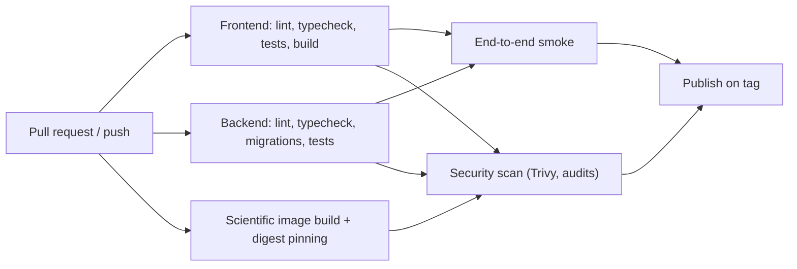

# CI/CD Pipeline

## 10. CI/CD with GitHub Actions

CI is the authoritative quality gate and the first-class deployment concern. The workflow is defined in `.github/workflows/ci.yml` and triggers on pull requests and pushes to `master`, with concurrency cancellation (`cancel-in-progress: true`). Global environment pins are `UV_PYTHON: '3.15.0'` and `NODE_VERSION_FILE: packages/frontend/.nvmrc`.

### 10.1 Jobs and gates

| Job                | Name                     | Runs on        | Depends on                         | Purpose                                                                 |
| ------------------ | ------------------------ | -------------- | ---------------------------------- | ----------------------------------------------------------------------- |
| `backend`          | `CI - Backend`           | `ubuntu-latest`| —                                  | Ruff format/lint, mypy, migrations, pytest with coverage, `pip-audit`   |
| `frontend`         | `CI - Frontend`          | `ubuntu-latest`| —                                  | pnpm install, lint, format check, typecheck, unit tests, build, audit  |
| `scientific-image` | `CI - Scientific Image`  | `ubuntu-latest`| —                                  | Build the MNE image, record and pin its digest, run numerical regression |
| `e2e`              | `End-to-End`             | `ubuntu-latest`| `frontend`, `backend`              | Playwright Chromium smoke tests of the critical workflow                |
| `security`         | `Security`               | `ubuntu-latest`| —                                  | Trivy filesystem scan (CRITICAL/HIGH/MEDIUM) uploaded to GitHub Security|
| `publish`          | `Publish Images`         | `ubuntu-latest`| `backend`, `frontend`, `scientific-image`, `e2e`, `security` | Push immutable images on version tags                 |

Backend job detail:

1. Checkout.
2. Setup `uv` with Python 3.15.0, caching against `packages/backend/uv.lock`.
3. `uv sync --all-groups`.
4. `uv run ruff format --check .`.
5. `uv run ruff check .`.
6. `uv run python -m mypy .`.
7. `uv run python -m app.db.migrations upgrade` against the pinned PostgreSQL service.
8. `uv run pytest -q --cov=app --cov-report=term-missing`.
9. `uv run pip-audit --desc --format=json --output=pip-audit.json`.
10. Upload `pip-audit.json` as an artifact (30-day retention).

Frontend job detail:

1. Checkout.
2. Enable pnpm and set up Node from `.nvmrc`; cache the pnpm store.
3. `pnpm install --frozen-lockfile`.
4. `pnpm lint && pnpm format:check`.
5. `pnpm typecheck`.
6. `pnpm test`.
7. `pnpm build`.
8. `pnpm audit --json --output=npm-audit.json`.
9. Upload `npm-audit.json` as an artifact (30-day retention).

Scientific-image job detail:

1. Checkout.
2. Build the MNE image from `packages/backend/Dockerfile.mne`.
3. Record the image digest and confirm the pinned MNE-Python, NumPy, SciPy, and Matplotlib versions.
4. Run numerical regression tests inside the image (filtering, epoching, PSD) against reference expectations.
5. Emit the digest as a job output so downstream jobs and deployments reference the exact image.

### 10.2 Pull request pipeline

Every pull request must pass backend, frontend, scientific-image, end-to-end, and security jobs. PR validation never receives production secrets, and forked pull requests do not run deployment steps.

### 10.3 Deployment pipeline

The current workflow produces validated code but does not itself deploy the Compose stack. Self-hosted release is a controlled, manual promotion from a green `master` commit:

1. Trigger only from `master` after all required checks pass.
2. Build immutable frontend, API, worker, dispatcher, and scientific images from the reviewed commit.
3. Tag images by commit SHA (and record the digest); do not rely only on a mutable `latest` tag.
4. Publish images to the self-hosted registry or transfer the saved image archive to the host.
5. Apply migrations with the one-shot `migrate` service.
6. Roll the API, worker, and dispatcher, then the frontend.
7. Execute smoke tests against the deployed origin.
8. Report deployment status.

An optional future evolution is a `deploy` job that pushes images to a registry (for example GHCR) and triggers the host over SSH. Until that job exists, document the manual promotion steps in the README.

### 10.4 Immutable artefacts

- Prefer image tags based on commit SHA or image digest.
- Keep previous immutable images available for rollback.
- Do not deploy changes directly from an unreviewed local working tree.
- Keep deployment permissions minimal and separated from PR validation.
- Never update the scientific image in place; a change to the MNE runtime is a new digest and a new pipeline-version association.

### 10.5 Husky and lint-staged

Local commits use Husky and lint-staged for fast staged-file checks: Ruff on staged backend Python and ESLint/Prettier on staged frontend source. These checks improve the feedback loop but are not the quality gate; CI is authoritative and must reject anything the local hooks miss or that a developer bypasses.

### 10.6 Deployment pipeline principles

1. Build immutable artefacts.
2. Run the automated checks above.
3. Apply migrations in a controlled, one-shot step.
4. Run smoke tests.
5. Promote only when checks succeed.

