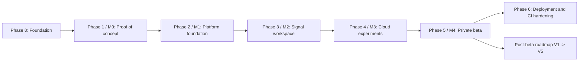

# MEG Lab — Implementation Plan

## 1. Purpose

This document defines the phased implementation plan for MEG Lab, an independent cloud-based computational electrophysiology SaaS portfolio project.

The goal is to deliver a working, self-hosted application that demonstrates:

- Full-stack TypeScript and Python development.
- Secure project-scoped multi-tenant application design.
- Ingestion, validation, and acquisition-metadata extraction for FIF, CTF `.ds`, KIT (`.sqd`/`.con`), UCL FIL OPM `.bin`, and BIDS-organised MEG recordings.
- Responsive multichannel signal visualisation with event markers and explicit time bases.
- Sensor-geometry exploration in a declared coordinate frame, including OPM arrays.
- Reproducible scientific computation using versioned OCI container images built on MNE-Python.
- Reliable asynchronous background processing with a transactional outbox.
- PostgreSQL data modelling with explicit SQL and versioned migrations.
- Private S3-compatible object storage for raw recordings, derivatives, and artifacts.
- Automated testing and continuous integration.
- Docker Compose self-hosted deployment and CI hardening.
- Production-minded engineering decisions and documented trade-offs.

The project must be implemented incrementally. Each phase produces a testable result before the next phase begins, and each phase maps to a milestone in the product specification (`docs/README.md`, section 12).

Scope references in this plan use the functional requirements `FR-001..FR-027` from the product specification and the feature priorities P0–P3.

## 2. Delivery Principles

### 2.1 Build a vertical slice first

The first objective is not to build every screen or establish the entire infrastructure. Build one complete workflow end to end:

1. Open the application.
2. Authenticate, or use an explicitly configured local development identity.
3. Create a project.
4. Upload a synthetic or appropriately licensed MEG recording, including any companion files.
5. Validate the file set and extract acquisition metadata.
6. Explore the channels, signals, and events in the Signal Viewer.
7. Submit a preprocessing or analysis operation.
8. Process it in a background worker inside a versioned container.
9. Retrieve the artifact and its experiment manifest.

This workflow proves that the major components work together before the feature set expands.

### 2.2 Prefer working software over premature abstraction

- Implement only the features required by the current milestone.
- Avoid building a generic workflow engine before two real operations exist.
- Avoid a complex permission framework before the initial roles are understood.
- Avoid a plugin system for a single signal operation.
- Avoid a universal format adapter before two real readers exist.
- Add abstractions only when repeated behaviour or a clear architectural boundary justifies them.

### 2.3 Keep scientific claims modest

The initial application performs descriptive signal processing and visualisation. It does not diagnose conditions, interpret clinical outcomes, or claim that its outputs are validated for medical use. Display transformations and navigation must be distinguished from analytical computations (`docs/05-architecture.md`). A pipeline result is a research output, not a clinical finding.

### 2.4 Protect the development feedback loop

- Run linting and type checking frequently.
- Add tests alongside features.
- Use small pull requests or commits.
- Keep the local development environment reproducible through Docker Compose and pinned dependency locks.
- Treat a broken `master` branch as a delivery problem.

### 2.5 Separation of interactive and scientific workload

Computation must never run inside a web request handler. The API validates, authorises, and returns a run identifier promptly; the worker performs signal processing inside an isolated OCI container. This rule is non-negotiable (`docs/08-tech-stack.md`). Interactive viewing is served from bounded, cached signal windows, while analysis runs asynchronously.

### 2.6 Treat OPM ingestion as a first-class path

OPM-MEG is not simply ordinary MEG with different sensor names. Its file variants, companion metadata, sensor geometry, and preprocessing assumptions differ from conventional SQUID-MEG. OPM ingestion and metadata validation are therefore explicit deliverables from Milestone 0 onward, not a late enhancement. This is called out here because it materially increases delivery effort compared with a SQUID-only product (`docs/README.md`, section 14).

## 3. Milestone Overview

The plan follows the delivery milestones in `docs/README.md` section 12. Each phase below reproduces the corresponding milestone as its backbone and expands it with tasks, dependencies, exit criteria, and risks.

| Phase | Milestone                                | Product spec milestone | Priority | Expected outcome                                                          |
| ----- | ---------------------------------------- | ---------------------- | -------- | ------------------------------------------------------------------------- |
| 0     | Project foundation                       | Pre-milestone          | —        | Workspace, tooling, Compose services, and CI skeleton                     |
| 1     | Scientific proof of concept              | Milestone 0            | P0       | Validated ingestion and signal rendering, including a tested OPM path     |
| 2     | Platform foundation                      | Milestone 1            | P0       | Secure project creation and supported-recording upload                    |
| 3     | Signal workspace                         | Milestone 2            | P0       | A user can explore a recording without manually setting up Python         |
| 4     | Cloud experiments                        | Milestone 3            | P0       | A user can run an analysis and retrieve a traceable output                |
| 5     | Private beta                             | Milestone 4            | P1       | External users complete the core workflow without developer intervention  |
| 6     | Deployment and CI hardening              | Post-beta              | —        | Reproducible self-hosted deployment and authoritative quality gates       |

A milestone is complete only when its exit criteria are met. The mapping above aligns the phases with the product milestones in `docs/README.md` section 12 and the priority levels in section 3.

## 4. Phase 0 — Project Foundation

### 4.1 Objective

Establish a reproducible development environment and repository structure before any scientific feature work begins.

### 4.2 Deliverables

- A pnpm workspace rooted at `@meg-lab/workspace` with `packages/frontend` (`@meg-lab/web`) and `packages/backend`.
- Tooling, conventions, and documentation scaffolding.
- Docker Compose definitions for PostgreSQL, Redis, and MinIO.
- An initial GitHub Actions workflow.

### 4.3 Tasks

- [x] Create the repository and initial README.
- [x] Add `AGENTS.md` with coding and repository conventions.
- [x] Add the core project documentation files under `docs/`.
- [x] Configure the `@meg-lab/workspace` root package and `pnpm-workspace.yaml` (`packages/*`).
- [x] Add the `@meg-lab/web` frontend package and the `packages/backend` Python package.
- [x] Configure `uv` and the pinned Python version (3.12, matching the MNE scientific runtime).
- [x] Configure pnpm and the pinned Node.js version (`.nvmrc`).
- [x] Add Ruff, ESLint, Prettier, and mypy configuration.
- [x] Configure Husky and lint-staged for staged-source checks before commit.
- [x] Add `.editorconfig`.
- [x] Add environment variable examples (`.env.example` with placeholders only).
- [x] Add a root-level `Makefile` task runner.
- [x] Define `docker-compose.yaml` services for PostgreSQL, Redis, and MinIO.
- [x] Configure GitHub Actions for the initial checks.
- [x] Add a `.gitignore` covering secrets, local data, build outputs, and generated scientific files (FIF, CTF `.ds`, KIT, OPM `.bin`, and BIDS derivatives).
- [ ] Write the initial Architecture Decision Records required by the architecture document.

### 4.4 Suggested repository structure

```text
meg-lab/
├── packages/
│   ├── frontend/            # @meg-lab/web (Next.js + signal/sensor viewer)
│   └── backend/             # FastAPI API, workers, migrations
├── infra/
│   └── terraform/           # deferred (cloud only)
├── scripts/                 # fixture generation, sample-data download
├── docs/
│   └── decisions/
├── .github/
│   └── workflows/
├── docker-compose.yaml
├── pnpm-workspace.yaml
├── Makefile
├── AGENTS.md
├── README.md
└── .gitignore
```

### 4.5 Dependencies

- None. This is the first phase.

### 4.6 Exit criteria

- A new developer can follow the setup guide and start the workspace.
- The frontend and backend start locally, and Compose brings up PostgreSQL, Redis, and MinIO.
- Formatting and linting commands run for both packages.
- Husky installs its pre-commit hook after dependency installation and checks staged files.
- CI executes the initial checks.
- No credentials or real participant data are committed.
- Small synthetic signal fixtures are generated reproducibly by a documented script.
- Project documentation reflects the actual chosen tools.

### 4.7 Risks

| Risk                                       | Mitigation                                                                |
| ------------------------------------------ | ------------------------------------------------------------------------- |
| Tooling churn delays the first feature     | Pin versions early and treat tooling changes as deliberate pull requests  |
| Local environment drift between developers | Docker Compose for services and committed lockfiles                       |
| Documentation diverges from implementation | Update docs in the same pull request as the change                        |
| MNE wheel/platform friction on install     | Pin the scientific runtime to the versioned container and test locally    |

## 5. Phase 1 — Milestone 0: Scientific Proof of Concept

### 5.1 Objective

Prove that MEG Lab can ingest supported recordings and render their signals, including a representative OPM path, before investing in platform infrastructure.

**Priority:** P0 — **Week:** 1

### 5.2 Milestone definition (product specification, section 12)

- Load one supported conventional MEG recording.
- Render multichannel signals and event markers.
- Validate metadata extraction.
- Execute a small MNE processing operation.
- Load one representative OPM recording and verify its ingestion path.

Exit criterion: validated ingestion and signal rendering, including a tested OPM path.

### 5.3 Tasks

- [x] Build a minimal ingestion interface that identifies a recording format and validates its required file set.
- [x] Implement a FIF reader and verify it can open a bundled sample recording.
- [x] Implement a CTF `.ds` reader that treats the directory as a coherent file set.
- [x] Implement a KIT reader covering the supported `.sqd`/`.con` variants chosen for the release.
- [x] Implement a UCL FIL OPM `.bin` reader that also loads its companion metadata.
- [x] Extract sampling frequency, duration, channel count, channel names, channel types, and units.
- [x] Distinguish SQUID magnetometers (`mag`), planar gradiometers (`grad`), auxiliary channels (EEG/EOG/ECG/STIM), and OPM channels.
- [x] Report unknown metadata as unknown rather than fabricating a value.
- [x] Render a static multichannel plot (server-side or minimal client) to prove signal access.
- [x] Overlay event markers on the same explicit time base as the signal.
- [x] Run one small MNE-Python operation (for example a band-pass filter) and inspect its output.
- [x] Load one representative OPM recording and confirm the ingestion path, including sensor units and coordinate frame where available.
- [x] Record SHA-256 checksums for every ingested source file.
- [x] Add a small regression fixture set with independently verified metadata.

### 5.4 Initial format set

Support should be verified against the exact file variants and companion files intended for acceptance. Do not claim support for a format until its reader, validation, and tests are implemented. BIDS is an organisation and validation layer over supported recordings, not an acquisition format (`docs/08-tech-stack.md`).

| Format         | Shape                | Initial handling                                            |
| -------------- | -------------------- | ----------------------------------------------------------- |
| FIF            | Single file          | MNE-native reader                                           |
| CTF `.ds`      | Directory            | Directory treated as a validated file set                   |
| KIT `.sqd`/`.con` | Single file       | Supported variants only                                     |
| UCL FIL OPM `.bin` | File + companions | Reader plus companion-metadata ingestion                   |
| BIDS           | Directory tree       | Deferred to the research-platform roadmap (V4)              |

### 5.5 Dependencies

- Phase 0.

### 5.6 Exit criteria

- One conventional recording loads end to end and its metadata matches verified reference values.
- Multichannel signals and event markers render against a shared time base.
- One small MNE processing operation produces a checked output.
- One OPM recording loads through the same ingestion interface and exposes its sensor metadata path.
- Every ingested file has a recorded checksum.
- No raw signal arrays are stored in relational rows.

### 5.7 Risks

| Risk                                        | Mitigation                                                                        |
| ------------------------------------------- | --------------------------------------------------------------------------------- |
| OPM file variants and companions diverge    | Verify against the exact target dataset early; keep the OPM reader behind an adapter |
| Metadata misread for exotic channels        | Report unknown rather than fabricate; test against verified fixtures               |
| Format detection loads full signal data     | Use bounded header parsing during detection                                       |
| Premature universal-format ambition         | Ship the documented format set; add adapters incrementally                        |

### 5.8 FR mapping

Milestone 0 begins FR-004 (format detection), FR-005 (metadata inspection), and the ingestion portion of FR-003 (recording upload).

## 6. Phase 2 — Milestone 1: Platform Foundation

### 6.1 Objective

Deliver secure identity, project tenancy, and upload infrastructure before exposing real recording workflows.

**Priority:** P0 — **Weeks:** 2–3

### 6.2 Milestone definition (product specification, section 12)

- Authentication and project management.
- Object storage, upload sessions, checksums, and metadata records.
- Dataset validation and access control.
- Initial resource limits and audit events.

Exit criterion: users can securely create projects and upload supported recordings.

### 6.3 Tasks

#### Authentication and identity (FR-001)

- [x] Choose and document the authentication approach, including a local development mechanism for CI.
- [x] Implement token or session validation and map authenticated identities to local `users` records.
- [x] Support sign up, sign in, sign out, and account recovery.
- [x] Ensure unauthenticated requests to protected endpoints receive a consistent error without internal detail.

#### Projects and membership (FR-002)

- [x] Implement project create, rename, archive, and delete.
- [x] Persist membership in `project_members` with the caller recorded as owner on creation.
- [x] Implement role-based permission checks (`owner`, `researcher`, `viewer`).
- [x] Enforce the last-owner invariant and prevent self-granted permissions.
- [x] Add project-scoped query helpers that never trust a client-supplied project ID.
- [x] Add pagination with deterministic ordering and search by name.

#### Upload and dataset records (FR-003, FR-004, FR-005)

- [x] Configure private S3-compatible object storage (MinIO locally).
- [x] Create an upload-session API returning short-lived, scoped upload instructions.
- [x] Implement resumable transfer with safe retries.
- [x] Implement idempotent upload finalisation.
- [x] Verify object existence and expected size on completion.
- [x] Calculate and record a SHA-256 checksum per file asset.
- [x] Model `datasets`, `dataset_versions`, `recordings`, `file_assets`, `channels`, and `sensor_configurations`.
- [x] Treat directory-based and companion-file recordings as a coherent validated set.

#### Access control, limits, and audit (FR-014, FR-015)

- [x] Enforce project membership on every project-scoped endpoint.
- [x] Add initial upload, storage, and concurrency limits.
- [x] Add `audit_events` for membership changes and sensitive operations, persisted in the same transaction.
- [x] Add failed-upload recovery and abandoned-session cleanup.
- [x] Test unauthenticated access, role restrictions, and cross-project access attempts.

#### Backend and frontend foundation

- [x] Create the FastAPI application and configuration management with validated settings.
- [x] Configure PostgreSQL connectivity using Psycopg 3 (async) with a bounded pool.
- [x] Configure versioned SQL migrations and a runner.
- [x] Add `/health` (liveness) and `/ready` (readiness) endpoints.
- [x] Create the Next.js application shell, design tokens, and routing.
- [x] Add project creation and recording upload forms with progress and validation feedback.

### 6.4 Required roles

| Capability                       | Owner | Researcher | Viewer |
| -------------------------------- | ----- | ---------- | ------ |
| View permitted projects          | Yes   | Yes        | Yes    |
| Create and edit projects         | Yes   | Yes        | No     |
| Archive or delete projects       | Yes   | No         | No     |
| Upload and manage recordings     | Yes   | Yes        | No     |
| View recordings and results      | Yes   | Yes        | Yes    |
| Submit experiment runs           | Yes   | Yes        | No     |
| Create and edit pipelines        | Yes   | Yes        | No     |
| Manage project members and roles | Yes   | No         | No     |
| Create scoped shares             | Yes   | Yes        | No     |

Project membership is the tenancy boundary. Do not introduce multi-organisation or institutional tenancy for the MVP.

### 6.5 Upload and validation invariants

- The user must be authorised to upload into the target project.
- Storage is private; possession of an object key is not authorisation.
- The server validates the file set independently of browser checks.
- A recording is not `ready` before validation succeeds.
- Finalisation confirms every expected object exists, matches its declared size, and has the expected checksum.
- Never load an unbounded recording into API memory; serve viewer data through bounded ranges or derived summaries.
- Never load untrusted data with pickle enabled.
- A database failure after object upload must not create an indefinitely invisible object.

### 6.6 Dependencies

- Phases 0 and 1 (the ingestion interface is required to validate a file set).

### 6.7 Exit criteria

- An authorised user can create a project and upload a supported recording set, see `ready`, and view correct acquisition metadata.
- Invalid or incomplete recording sets are `rejected` with safe, actionable messages identifying the missing file set.
- No raw MEG signal arrays are stored in relational rows.
- Every accepted file asset has a recorded checksum.
- A dataset version is immutable once `ready`; further changes create a new version.
- A viewer cannot submit runs or modify datasets.
- A user cannot access another project's resources by changing a URL identifier.
- Abandoned uploads are cleaned up and do not leave stuck sessions.

### 6.8 Risks

| Risk                                          | Mitigation                                                           |
| --------------------------------------------- | -------------------------------------------------------------------- |
| Tenant isolation bug                          | Centralised permission checks, composite FKs, negative tests         |
| Object exists but database finalisation fails | Reconciliation task for abandoned sessions and unreferenced objects  |
| Interrupted large uploads                     | Resumable transfer and integrity checks                              |
| Local auth leaking into production            | Isolate development auth and fail fast outside `APP_ENV=development` |
| Directory/companion-set inconsistency         | Validate the whole set as a unit before accepting                    |

### 6.9 FR mapping

Milestone 1 completes FR-001, FR-002, FR-003, FR-004, FR-005, FR-014, and FR-015.

## 7. Phase 3 — Milestone 2: Signal Workspace

### 7.1 Objective

Deliver the interactive Signal Viewer and metadata panels that let users explore a recording without setting up Python.

**Priority:** P0 — **Weeks:** 4–5

### 7.2 Milestone definition (product specification, section 12)

- Channel browser and responsive signal viewer.
- Time navigation, scaling, and event inspection.
- Sensor and acquisition metadata panels.
- Save and restore viewer state.

Exit criterion: a user can explore a recording without manually setting up Python.

### 7.3 Tasks

#### Channel browser (FR-006)

- [x] Group channels by type (`mag`, `grad`, EEG, EOG, ECG, STIM, OPM).
- [x] Implement search matching channel names and types.
- [x] Support channel selection and visibility persistence per recording version.
- [x] Virtualise or paginate large channel inventories.

#### Signal viewer (FR-007, FR-008, FR-009)

- [x] Render multiple selected channels against time.
- [x] Support per-channel and global amplitude scaling, with reset.
- [x] Display channel labels, units, and the current scale.
- [x] Fetch only bounded signal windows; never download the whole recording to render a section.
- [x] Implement a configurable, bounded visible time window and jump-to-time navigation.
- [x] Keep navigation consistent with the event timeline.
- [x] Render event markers and event channels alongside the traces on an explicit time base.
- [x] Meet the signal-navigation latency target for cached, bounded windows (NFR-001).
- [x] Precompute multiresolution signal summaries for responsive plotting.

#### Metadata panels (FR-005, FR-023 partial)

- [x] Display recording and acquisition metadata alongside the viewer.
- [x] Display channel type, units, and coordinate frame where present.
- [x] Prototype a sensor-geometry panel in a declared coordinate frame.

#### Viewer state and sample workspace (FR-016 partial)

- [x] Save and restore viewer state (channel selection, time window, scaling) without treating display settings as analytical parameters.
- [x] Add viewer loading, partial, error, and empty states with retry.
- [x] Bundle the MNE sample AEF dataset (CC BY 4.0) with licence and citation display.
- [x] Allow exploration of the sample recording without uploading data.

### 7.4 Viewer requirements

- The viewer is an exploration tool, not a clinical interpretation system.
- Display transforms (scaling, windowing, grouping) must not modify source data.
- The client requests only the data needed for display; the server enforces a maximum response size.
- Event times must identify the relevant recording time base and sample conventions.
- A recording without usable geometry degrades gracefully rather than displaying fabricated sensor positions.

### 7.5 Dependencies

- Phase 2 (datasets, channels, and metadata records).

### 7.6 Exit criteria

- An authorised user can open a ready recording and navigate multiple linked channels against a timeline.
- Event markers align with the corresponding sample or time in the trace according to the declared time base.
- Display changes update within the latency target and leave the source recording unchanged.
- The complete recording is never loaded into the browser by default.
- A new user can inspect the bundled sample project without uploading data.
- Rendering failures show a safe, retryable state.

### 7.7 Risks

| Risk                                        | Mitigation                                                       |
| ------------------------------------------- | ---------------------------------------------------------------- |
| Browser memory exhaustion on large recordings | Derived, downsampled summaries and bounded fetches              |
| Event misalignment                          | Test against known markers and an explicit time base             |
| Incorrect channel typing or grouping        | Verified fixtures; group by MNE channel type                     |
| Viewer library incompatible with SSR        | Render the signal/sensor canvas only in client components        |

### 7.8 FR mapping

Milestone 2 completes FR-006, FR-007, FR-008, FR-009, and the viewer-state and sample portions of FR-005, FR-016, and FR-023.

## 8. Phase 4 — Milestone 3: Cloud Experiments

### 8.1 Objective

Implement durable asynchronous signal processing with versioned pipelines, logs, artifacts, and experiment manifests.

**Priority:** P0 — **Weeks:** 6–8

### 8.2 Milestone definition (product specification, section 12)

- Queue and isolated worker.
- Filtering and basic spectral analysis.
- Job status, logs, failure handling, and cancellation.
- Artifact storage and experiment manifests.

Exit criterion: users can run an analysis and retrieve a traceable output.

### 8.3 Initial operations

Implement a small set of well-tested operations (`docs/04-features.md`):

- Band-pass and notch filtering with explicit high/low cutoffs in hertz.
- Channel selection and re-referencing where appropriate for the channel type.
- Resampling to a target sampling frequency.
- Bad-channel detection producing a marked channel set.
- Power spectral density estimation (PSD) with configurable window and overlap.

Operations must preserve source metadata such as sampling frequency, channel identity, units, and coordinate frame unless the operation explicitly and visibly changes it.

### 8.4 Tasks

#### Pipeline definitions (FR-024)

- [x] Define pipeline and parameter schemas with explicit types, units, and validation.
- [x] Pin each pipeline version to a container `image_digest`.
- [x] Validate a pipeline definition before it can run; reject unsupported parameters.
- [x] Make published versions immutable; editing creates a new version.

#### Queue and isolated worker (FR-011)

- [x] Configure Redis and Celery with a separate worker process.
- [x] Implement run submission that validates permissions, parameters, and dataset state.
- [x] Implement idempotency for run submission using `idempotency_keys`.
- [x] Persist the run record and an `outbox_events` row in one transaction.
- [x] Implement the outbox dispatcher with `FOR UPDATE SKIP LOCKED` claiming.
- [x] Implement the worker that launches the pinned OCI image by `image_digest`.
- [x] Load run inputs from private object storage through a controlled, read-only mechanism.
- [x] Validate worker input independently; do not trust the request payload.
- [x] Apply CPU, memory, disk, and wall-clock limits, and restrict egress.

#### Job lifecycle (FR-010, FR-011)

- [x] Implement the states `queued`, `running`, `succeeded`, `failed`, and `cancelled`.
- [x] Implement run status polling and structured run logs.
- [x] Implement bounded retry handling with backoff and jitter.
- [x] Implement stale-run recovery using a lease or heartbeat.
- [x] Implement cooperative cancellation for `queued` and `running` runs.

#### Artifacts and provenance (FR-012, FR-013)

- [x] Compute the operation and validate the output before persisting.
- [x] Persist artifacts with SHA-256 checksums and media types.
- [x] Write the machine-readable experiment manifest (schema version, inputs, pipeline, parameters, environment, sensor configuration, outputs, status).
- [x] Mark the run successful only after artifacts and manifest are persisted and validated.
- [x] Record resource consumption per run in `usage_records`.
- [x] Add worker integration tests, idempotency tests, and scientific-correctness tests against reference recordings.

### 8.5 Required run states

| State       | Meaning                                                      |
| ----------- | ------------------------------------------------------------ |
| `queued`    | Accepted but not yet executing                               |
| `running`   | A worker is processing the run                               |
| `succeeded` | Computation, artifact persistence, and manifest writing done |
| `failed`    | Processing failed and will not be retried automatically      |
| `cancelled` | Processing was cancelled according to documented rules       |

State transitions must be validated, persisted, and enforced at the database boundary. A cancelled or successful run must not be silently reopened by a duplicate worker message.

### 8.6 Dependencies

- Phases 2 and 3 (inputs and result inspection).

### 8.7 Exit criteria

- Submitting a run returns a run identifier promptly, independent of processing time.
- Run state persists across API and worker restarts.
- Duplicate submissions do not create duplicate logical runs; duplicate worker delivery does not corrupt results.
- A failed run returns no fabricated results and exposes a safe failure reason.
- Every successful run produces validated artifacts, checksums, and a machine-readable manifest.
- Cancel is honoured and recorded.
- Worker crashes are observable and recoverable without restarting live work.

### 8.8 Risks

| Risk                                    | Mitigation                                                             |
| --------------------------------------- | ---------------------------------------------------------------------- |
| Lost queue messages                     | Transactional outbox and idempotent workers                            |
| Duplicate delivery corrupts results     | Conditional state transitions and leases                               |
| Container escapes or overuses resources | Isolated runtime, no default secrets, explicit limits and egress rules |
| Manifest write fails after compute      | A run is not `succeeded` until artifacts and manifest persist          |
| Scientific regression on parameter change | Versioned pipelines and numerical regression tests against fixtures   |

### 8.9 FR mapping

Milestone 3 completes FR-010, FR-011, FR-012, FR-013, FR-014, FR-024, and begins FR-019 (basic spectral analysis).

## 9. Phase 5 — Milestone 4: Private Beta

### 9.1 Objective

Complete the analysis toolkit, formalise OPM workflows, and make the platform usable by external computational neuroscience users.

**Priority:** P1 — **Weeks:** 9–12

### 9.2 Milestone definition (product specification, section 12)

- Event-related epochs and evoked responses.
- OPM sensor metadata validation and a documented preprocessing template.
- Sample projects, onboarding, and exports.
- Security, load, and scientific regression tests.
- Feedback from computational neuroscience users.

Exit criterion: external users can complete the core workflow without developer intervention.

### 9.3 Tasks

#### Event-related analysis (FR-017, FR-018, FR-019)

- [x] Implement epoching with configurable `tmin`, `tmax`, baseline, and rejection criteria.
- [x] Validate windows and reject overlapping, out-of-range, or too-short epochs with an actionable message.
- [x] Reference the exact recording version and event set for every epoch.
- [x] Average compatible epochs and display evoked waveforms with channel selection and scaling.
- [x] Record accepted and rejected epoch counts; refuse to average incompatible epochs.
- [x] Complete PSD estimation with configurable frequency range, per-channel and aggregated display.

#### Sensor-level analysis, OPM, and geometry (FR-020, FR-021, FR-022, FR-023)

- [x] Plot sensor-level topographies using valid sensor positions; reject recordings without usable geometry.
- [x] State units and coordinate frame on every topography.
- [x] Persist bad-channel marks per recording version and show them in the viewer.
- [x] Offer correction methods only where their channel and data prerequisites are met, and record their application.
- [x] Identify OPM recordings from channel types and acquisition metadata.
- [x] Validate OPM sensor metadata (types, units, positions, orientations, frames).
- [x] Publish a documented OPM preprocessing template that declares its assumptions and prerequisites, following the MNE-Python OPM guidance.
- [x] Render sensor positions and orientations in an interactive 3D view with an explicit frame.
- [x] Support variable and time-varying OPM geometry where movement-tracking data exists.

#### Comparison, export, and sample experience (FR-016, FR-025, FR-026)

- [x] Compare raw and processed signals, epochs, or spectral outputs with a linked timeline or axis where bases allow.
- [x] Report a mismatch in time base, sampling frequency, or channels rather than silently misaligning.
- [x] Build the public sample project with licence and citation display and allow unauthenticated viewer access.
- [x] Add guided onboarding that can be dismissed without blocking the workflow.
- [x] Export plots (with the research disclaimer), selected data, and manifests.
- [x] Implement scoped, revocable sharing links with read-only shared pages.

#### Hardening and validation

- [x] Run security, load, and scientific regression tests across the full workflow.
- [x] Collect structured feedback from computational neuroscience users.
- [x] Document known limitations and the scientific limitations statement.

### 9.4 Reproducibility requirements

- Source recordings must not be silently overwritten; preprocessing produces derived artifacts.
- Algorithm changes are reflected in the version identifier; results from different versions must not be silently merged.
- A rerun resolves to the same inputs, pipeline version, parameters, and environment.
- Numerical-equivalence checks define an explicit tolerance where bitwise identity is unrealistic.
- Every completed run has a machine-readable manifest with traceable inputs, parameters, environment, and outputs.

### 9.5 Dependencies

- Phase 4.

### 9.6 Exit criteria

- An external user can complete the core workflow — upload, explore, analyse, inspect, export — without developer intervention.
- An OPM recording flows through metadata validation and a compatible preprocessing template with assumptions recorded.
- Sensor geometry is visualised in a declared frame and degrades gracefully when absent.
- A user can compare an input and a derived result with synchronised navigation when comparable.
- Private resources are never public unless explicitly shared; sharing links are scoped, revocable, and permission-checked.
- Security, load, and scientific regression tests pass.
- Feedback from computational neuroscience users has been collected and triaged.

### 9.7 Risks

| Risk                                    | Mitigation                                                           |
| --------------------------------------- | -------------------------------------------------------------------- |
| OPM treated as ordinary MEG             | Explicit sensor metadata, compatible pipeline requirements, OPM validation |
| Scientific misinterpretation            | Explicit units, coordinate frames, provenance, limitations statement |
| Slow or unusable onboarding             | Sample project and guided tutorial verified with real beta users     |
| Sharing leaks private data              | Private-by-default, explicit scope, server-side permission checks    |
| Numerical regressions slip through      | A regression fixture suite with reference outputs and tolerances     |

### 9.8 FR mapping

Milestone 4 completes FR-016, FR-017, FR-018, FR-019, FR-020, FR-021, FR-022, FR-023, FR-024, FR-025, and FR-026.

## 10. Post-Beta Roadmap

After the private beta, releases follow the roadmap in `docs/README.md` section 12. Each release is only started once the previous one is stable, with a clear user need, documented acceptance criteria, and a test strategy.

| Release | Focus               | Deliverables                                                     |
| ------- | ------------------- | ---------------------------------------------------------------- |
| V1      | Core analysis       | Epoching, evoked responses, PSD, channel quality tools           |
| V1.5    | OPM workflows       | Sensor geometry, relevant diagnostics, specialised preprocessing |
| V2      | Developer workbench | Hosted notebooks, Python SDK, reusable pipelines                 |
| V3      | Source analysis     | Forward modelling, source estimation, anatomical visualisation   |
| V4      | Research platform   | BIDS workflows, collaboration, public experiments, plugins       |
| V5      | Multimodal research | Optional integration with MRI and EEG projects                   |

The milestone order should follow technical dependencies and user feedback. Build foundations for advanced source analysis early without exposing a half-finished source-localisation interface in the beta.

### 10.1 Post-beta task outline

- [ ] V1: finish channel-quality tooling and consolidate the analysis result views.
- [ ] V1.5: expand OPM diagnostics, background-field handling, and sensor-movement workflows where tracking data exists.
- [ ] V2: add isolated hosted notebooks, a Python SDK, and reusable pipeline packages.
- [ ] V3: add forward modelling, source estimation, and anatomical visualisation with compatible MRI data.
- [ ] V4: add BIDS import and validation (FR-027), collaboration, public experiments, and a plugin surface.
- [ ] V5: integrate with MRI and EEG projects behind the same project and experiment model.

## 11. Functional Requirement Mapping

The table maps each functional requirement to the milestone where it is delivered or first substantially implemented.

| FR     | Title                | Priority | Milestone                     |
| ------ | -------------------- | -------- | ----------------------------- |
| FR-001 | Authentication       | P0       | Milestone 1                   |
| FR-002 | Projects             | P0       | Milestone 1                   |
| FR-003 | Recording upload     | P0       | Milestone 0 (partial), 1      |
| FR-004 | Format detection     | P0       | Milestone 0                   |
| FR-005 | Metadata inspection  | P0       | Milestone 0 (partial), 1, 2   |
| FR-006 | Channel browser      | P0       | Milestone 2                   |
| FR-007 | Raw signal viewer    | P0       | Milestone 2                   |
| FR-008 | Navigation           | P0       | Milestone 2                   |
| FR-009 | Event inspection     | P0       | Milestone 2                   |
| FR-010 | Basic processing     | P0       | Milestone 3                   |
| FR-011 | Cloud jobs           | P0       | Milestone 3                   |
| FR-012 | Artifacts            | P0       | Milestone 3                   |
| FR-013 | Provenance           | P0       | Milestone 3 (partial), 4      |
| FR-014 | Resource controls    | P0       | Milestone 1 (partial), 3      |
| FR-015 | Security             | P0       | Milestone 1 (partial), 4      |
| FR-016 | Sample workspace     | P0       | Milestone 2 (partial), 4      |
| FR-017 | Epoching             | P1       | Milestone 4                   |
| FR-018 | Evoked responses     | P1       | Milestone 4                   |
| FR-019 | Spectral analysis    | P1       | Milestone 3 (partial), 4      |
| FR-020 | Sensor topographies  | P1       | Milestone 4                   |
| FR-021 | Artifact inspection  | P1       | Milestone 4                   |
| FR-022 | OPM support          | P1       | Milestone 0 (partial), 4      |
| FR-023 | Sensor geometry      | P1       | Milestone 2 (partial), 4      |
| FR-024 | Pipeline templates   | P1       | Milestone 3                   |
| FR-025 | Comparison           | P1       | Milestone 4                   |
| FR-026 | Export               | P1       | Milestone 4                   |
| FR-027 | BIDS import          | P1       | Post-beta (V4)                |

FR-027 is P1 in the product specification but is scheduled with the research-platform release (V4) because BIDS is an organisation and validation layer that depends on the ingestion, metadata, and pipeline foundations being stable first.

## 12. Dependency Ordering

The phase order is driven by technical dependency and risk, not visual appeal.



Ordering notes:

- The ingestion interface (Phase 1) must exist before upload validation (Phase 2), because validation is format-aware.
- Metadata and channel records (Phase 2) must exist before the Signal Viewer (Phase 3) can render anything meaningful.
- The viewer and result inspection (Phase 3) must exist before artifact review (Phase 4) is useful.
- Provenance and reproducibility (Phase 4) must be established before epoching and evoked results (Phase 5) can be described as reproducible.
- **OPM ingestion adds substantial work**: it spans format detection, companion metadata, sensor-geometry validation, and a distinct preprocessing template. Budget for it independently rather than treating it as a format-adapter variant.
- **Notebook isolation adds substantial work**: hosted Python execution requires an isolated runtime, restricted network egress, and least-privilege data access. It is deliberately deferred to the developer-workbench release (V2), not the beta, precisely because it is a security-sensitive subsystem.
- The private beta (Phase 5) is not complete until security, load, and scientific regression tests pass.

## 13. Continuous Integration and Engineering Quality Gates

Every pull request runs the checks relevant to the changed code. CI remains the authoritative quality gate; Husky and lint-staged only pre-check staged files locally.

### 13.1 Frontend

- Formatting (`pnpm format:check`).
- Linting (`pnpm lint`).
- Type checking (`pnpm typecheck`).
- Unit tests (`pnpm test`).
- Production build (`pnpm build`).
- Selected browser tests.

### 13.2 Backend

- Formatting (`ruff format --check`).
- Linting (`ruff check`).
- Type checking (`mypy`).
- Unit tests and API tests.
- PostgreSQL integration tests against a pinned PostgreSQL service.
- Migration checks applied to a fresh database.
- Dependency audit (`pip-audit`).

### 13.3 Worker

- Formatting and linting.
- Unit tests.
- Scientific-correctness tests against reference recordings and expected outputs.
- Job lifecycle, retry, duplicate-delivery, and cancellation tests.

### 13.4 Scientific container

- Build the MNE-Python scientific image and record its digest.
- Verify the pinned digests of MNE-Python, NumPy, SciPy, and Matplotlib.
- Run numerical regression tests inside the image for filtering, epoching, and PSD.

### 13.5 End-to-end and security

- Playwright Chromium smoke test of the critical workflow.
- Trivy filesystem scan with SARIF upload to GitHub Security.
- Negative cross-project access tests.

Build and test containers using pinned or otherwise controlled dependency versions.

## 14. Suggested Weekly Execution Strategy

Prioritise work by dependency and risk, not visual appeal. This sequence assumes roughly one experienced full-stack developer and matches the 8–12 week private-beta estimate in `docs/README.md` section 12.

| Week | Focus                                                            | Phase |
| ---- | ---------------------------------------------------------------- | ----- |
| 1    | Foundation, ingestion proof, signal rendering, OPM path          | 0–1   |
| 2–3  | Authentication, projects, uploads, validation, access control    | 2     |
| 4–5  | Channel browser, signal viewer, event inspection, metadata panels | 3     |
| 6–8  | Queue, worker, pipelines, runs, artifacts, manifests             | 4     |
| 9–12 | Epoching, evoked, OPM template, sharing, hardening, beta         | 5     |
| 12+  | Deployment, CI hardening, portfolio polish, roadmap              | 6     |

Priority ordering:

| Priority | Work                                                                  |
| -------- | --------------------------------------------------------------------- |
| P0       | Repository, database, API, authentication, tenant isolation          |
| P1       | Ingestion, uploads, validation, metadata                              |
| P2       | Signal viewer, pipelines, worker reliability, artifacts, manifests    |
| P3       | Epoching, evoked, spectral, OPM workflows, sensor geometry            |
| P4       | Reliability, security, quotas, end-to-end workflow, regression tests  |
| P5       | Portfolio polish and self-hosted deployment                           |

A small, working deployment is more valuable than a large unfinished feature set. If time is limited, defer hosted notebooks, the visual pipeline builder, BIDS ingestion, source analysis, and multimodal workflows.

## 15. Risk Register

| Risk                                             | Impact                           | Mitigation                                                                                        |
| ------------------------------------------------ | -------------------------------- | ------------------------------------------------------------------------------------------------- |
| Scope expansion                                  | Delayed delivery                 | Ship one complete MEG workflow before supporting every format; keep the first operations small    |
| OPM ingestion underestimated                     | Delayed OPM support              | Treat OPM ingestion and metadata validation as explicit deliverables from Milestone 0            |
| Tenant isolation bug                             | Data exposure                    | Centralised permission checks, composite foreign keys, and negative integration tests             |
| Unsafe or malformed recording parsing            | Security and reliability issues  | Bounded header parsing, decompression limits, strict validation, and resource limits              |
| Signal rendering becomes slow                    | Poor usability                   | Bounded queries, multiresolution summaries, caching, and efficient rendering                      |
| Duplicate job delivery                           | Inconsistent results             | Idempotent workers, leases, and database state checks                                             |
| Lost queue messages                              | Stuck runs                       | Transactional outbox and dispatcher with recovery                                                 |
| Artifact persisted before manifest               | False success                    | Persist artifacts and manifest, then mark the run successful in one flow                          |
| Incorrect metadata, units, or coordinate frame   | Scientifically incorrect results | Persist and test sampling frequency, channel types, units, and frames against verified fixtures   |
| OPM workflows treated as ordinary MEG            | Misleading results               | Explicit sensor metadata, compatible pipeline requirements, OPM-specific validation               |
| Untrusted notebook code compromises infrastructure | Infrastructure breach          | Isolated runtimes, restricted egress, least privilege; defer notebooks until V2                   |
| Excessive self-hosting cost                      | Unexpected expense               | Quotas, resource limits, per-run accounting, and documented teardown                              |
| Arbitrary code compromises infrastructure        | Infrastructure breach            | Isolated OCI runtimes, restricted egress, least privilege, no shared secrets                      |
| Scientific misinterpretation                     | Misleading claims                | Explicit units, coordinate frames, provenance, and a limitations statement                        |
| Large recordings exhaust browser or API memory   | Poor usability                   | Bounded range requests, derived downsampled summaries, and bounded responses                       |
| Complex infrastructure too early                 | Slow development                 | Prove the local Docker Compose vertical slice first; keep cloud deferred                          |
| Inconsistent API types                           | Integration defects              | Generate or synchronise client types from OpenAPI                                                 |
| Insufficient test realism                        | Hidden database bugs             | Use real PostgreSQL integration tests and reference recordings from both SQUID and OPM sources    |

## 16. Definition of Project Completion

The MVP is complete when:

1. A user can sign in and access a project they are a member of.
2. A user can create, rename, archive, and delete a project according to their role.
3. A user can upload or open a supported MEG recording and see its validation status and acquisition metadata.
4. An invalid or incomplete recording set is rejected with a safe, actionable message, and no raw signal arrays are stored in the database.
5. The Signal Viewer renders multiple channels against a navigable timeline with event markers that stay aligned to the declared time base.
6. An OPM recording flows through metadata validation and a compatible, documented preprocessing template with its assumptions recorded.
7. Sensor geometry is visualised in a declared coordinate frame and degrades gracefully when absent.
8. A versioned pipeline can be submitted as a background run and progresses through `queued`, `running`, `succeeded`, `failed`, or `cancelled`.
9. Each successful run produces validated artifacts, checksums, and a machine-readable experiment manifest.
10. Epoching, evoked responses, and spectral analysis produce traceable results that can be rerun from their recorded configuration.
11. Comparisons, export, scoped sharing, and the public sample project function within their documented scope.
12. Quotas, usage records, and audit events are enforced and recorded, and health endpoints operate without leaking secrets.
13. Project and role permissions are enforced with automated negative tests for cross-project access.
14. Every primary screen implements the required loading, empty, error, partial-success, disabled, and permission-denied states.
15. Automated checks pass in CI, including scientific-correctness and end-to-end tests.
16. A self-hosted Docker Compose deployment can be reproduced from documented instructions and passes smoke tests.
17. The README explains setup, architecture, testing, limitations, and the deferred cloud evolution.

A feature is not complete merely because its primary happy path works. Validation, failure handling, permission checks, and observability must also be addressed.

## 17. Post-MVP Opportunities

Only consider these after the MVP is stable, and only with a clear user need, documented acceptance criteria, and a test strategy:

- BIDS ingestion and validation as an organisation layer (FR-027).
- Additional, well-tested signal operations and artifact-correction methods.
- Hosted Python notebooks with controlled access to project recordings, in isolated runtimes.
- A visual pipeline editor with parameter forms and intermediate outputs.
- Time-frequency analysis and event-related spectral changes.
- Independent component analysis (ICA) and signal-space projection (SSP) workflows with channel prerequisites.
- Forward models and source estimation with compatible anatomical MRI data.
- Functional connectivity analysis.
- OPM-specific background-field handling and sensor-movement workflows.
- API keys, a Python SDK, and programmatic job submission.
- Public analysis galleries, community pipelines, and a plugin SDK.
- Optional integration with MRI and EEG projects through the same project and experiment model.
- Re-evaluate cloud infrastructure and Terraform only if self-hosting is proven and demand justifies the operational cost.

Do not wait until a late release to build the data model for provenance and versioning. The foundation is established early even when the initial interface exposes only a subset of it.
