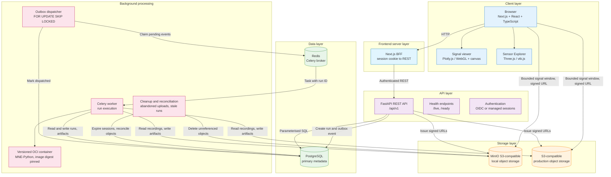
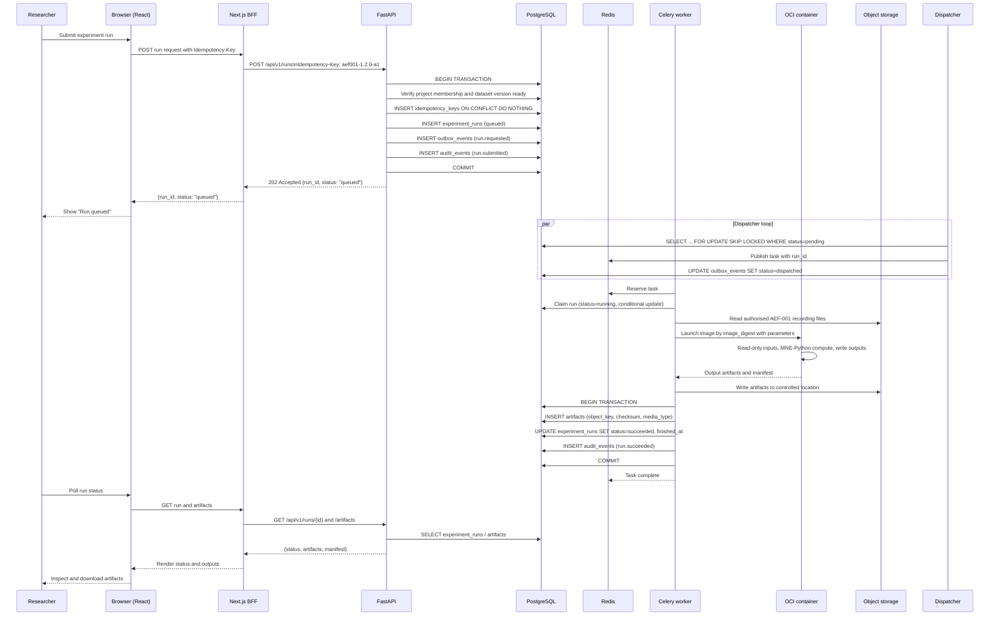
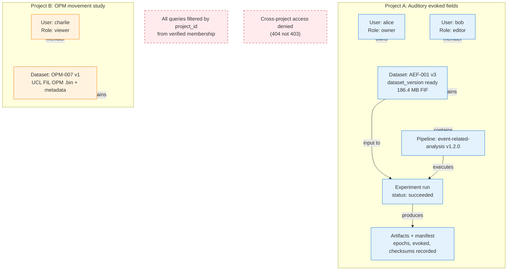
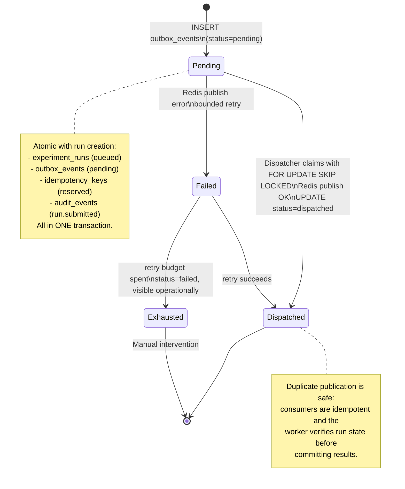
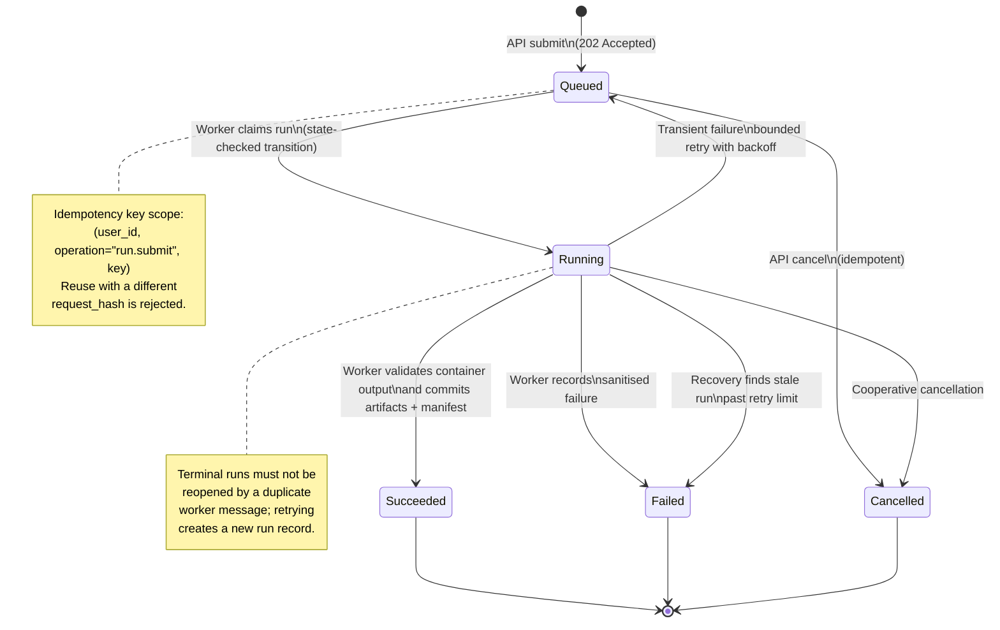
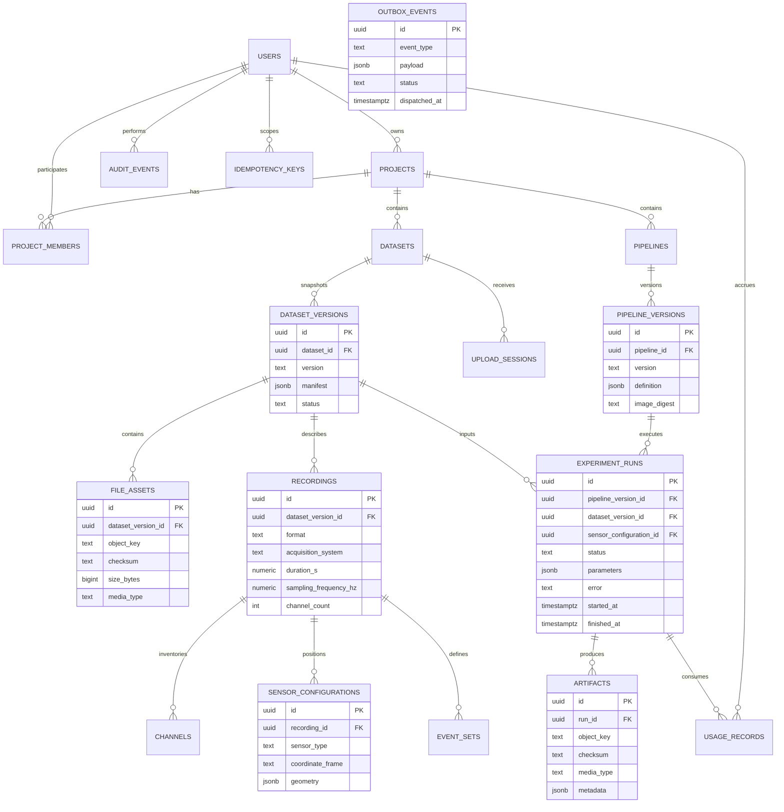
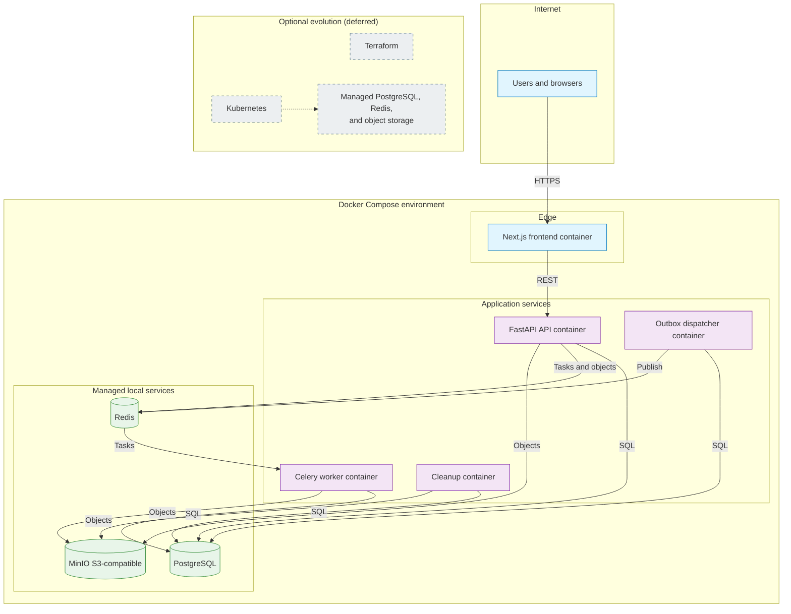

# Comprehensive Architecture and Data-Flow Diagrams

This document collects the Mermaid diagrams that describe MEG Lab's
architecture end to end. Render them with any Markdown viewer that supports
Mermaid (GitHub, GitLab, VS Code with an extension, and similar).

The canonical rule throughout is that interactive web requests are separated
from scientific computation: MEG signal processing never runs inside a request
handler. A second rule specific to this product is that the API serves bounded
signal windows and precomputed multiresolution summaries rather than streaming
whole recordings through its own memory.

## 1. High-level system architecture



## 2. Request lifecycle (experiment run submission)

The browser never calls FastAPI directly: it calls the Next.js BFF route
handlers, which forward authenticated REST requests. The API creates a durable
run and its outbox event in one transaction, then returns promptly. The run
references a dataset version such as AEF-001 v3 and a pipeline version such as
`event-related-analysis` v1.2.0.



## 3. Signal viewer data path (bounded windows and summaries)

The viewer is the central workspace. It never downloads a whole recording.
Instead the API authorises the request and returns either a bounded signal
window or a precomputed multiresolution summary, delivered through a
short-lived, single-object signed URL with explicit byte ranges. Sensor
geometry is fetched separately for the Sensor Explorer.

```mermaid
sequenceDiagram
    participant User as Researcher
    participant Viewer as Signal viewer
    participant BFF as Next.js BFF
    participant API as FastAPI
    participant PG as PostgreSQL
    participant Storage as Object storage

    User->>Viewer: Open recording AEF-001 v3, select channels
    Viewer->>BFF: GET /recordings/{id}/signals?channels&tmin&tmax&resolution
    BFF->>API: Authorised signal-window request
    API->>PG: Verify membership; resolve channel and time parameters
    alt Cached multiresolution summary hits
        API->>PG: Read summary artifact reference (checksum + config)
        API-->>BFF: Summary metadata + short-lived signed URL
    else Bounded window not cached
        API->>Storage: Sign a single-object read URL with byte range
        API-->>BFF: Bounded window descriptor + signed URL
    end
    BFF-->>Viewer: Descriptor + signed URL
    Viewer->>Storage: Fetch bounded window / summary bytes
    Storage-->>Viewer: Peak-decimated (or full) signal bytes
    Viewer-->>User: Render traces, timeline, event markers

    User->>Viewer: Open Sensor Explorer
    Viewer->>BFF: GET /recordings/{id}/sensors
    BFF->>API: Authorised sensor-geometry request
    API->>PG: Read sensor_configuration (type, frame, units)
    API-->>BFF: Sensor positions, orientations, coordinate_frame
    BFF-->>Viewer: Geometry payload
    Viewer-->>User: Render 3D sensors in declared frame

    Note over Viewer,Storage: Display transforms (scale, offset) never\nbecome analytical inputs to a run
```

## 4. Project isolation model

Project isolation is a security boundary enforced in the API, in project-scoped
SQL, and through composite foreign keys. Object-key possession is never
authorisation, and possession of a signed URL never grants listing or overwrite
rights.



## 5. Transactional outbox (reliable dispatch)

The API never publishes a queue message in a way that can diverge from committed
database state. Run creation and its outbox event are committed together, so an
accepted run stays visible in PostgreSQL even when Redis is briefly unavailable.



## 6. Experiment run state machine



## 7. Data model relationships

The canonical schema is defined by versioned migrations under
`packages/backend/app/db/migrations/`. The full column-level definition lives in
[`../06-data-model.md`](../06-data-model.md). Channels, sensor geometry, and
event arrays may be normalised or compactly stored rather than held as large
JSON blobs.



## 8. Deployment architecture

Initial deployment is a single environment defined by `docker-compose.yaml`.
Cloud infrastructure (GCP or AWS, Terraform, Kubernetes) is explicitly deferred
and must not be required to build, test, or run the platform.



---

_Diagrams rendered with Mermaid. For interactive viewing, open in GitHub,
GitLab, or VS Code with a Mermaid extension._

## Related documents

- [MEG Lab overview](../01-overview.md)
- [MEG Lab architecture](../05-architecture.md)
- [MEG Lab data model](../06-data-model.md)
- [MEG Lab API specification](../07-api-spec.md)
- [MEG Lab deployment](../12-deployment.md)
- [MEG Lab documentation index](../README.md)
