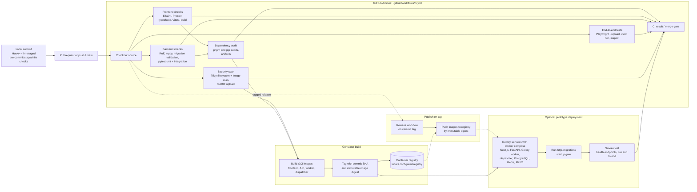

# CI/CD Pipeline

This diagram describes the GitHub Actions quality gate for MEG Lab. The workflow
runs on pull requests and pushes to `main`; CI remains the authoritative full
validation while local Husky and lint-staged hooks apply fast formatting and
lint checks to staged files before commit. Successful builds produce container
images pinned by immutable digest, which are published on tag and used by the
optional Docker Compose prototype deployment.

## Quality gate stages

| Stage               | Checks                                                                                 |
| ------------------- | -------------------------------------------------------------------------------------- |
| Local (Husky)       | lint-staged formatting and lint on staged frontend and backend source files            |
| Frontend gate       | ESLint, Prettier, TypeScript typecheck, Vitest, production build                       |
| Backend gate        | Ruff, mypy, migration validation, pytest unit and integration tests                    |
| End-to-end          | Playwright: upload, validate, view, run, inspect, export                               |
| Security            | Trivy filesystem and image scan with SARIF upload                                      |
| Dependency audit    | pnpm and pip audits, result artifacts                                                  |
| Container build     | Build frontend, API, worker, and dispatcher images; pin immutable digest               |
| Publish on tag      | Release workflow pushes digested images to the registry on a version tag               |
| Prototype deploy    | Optional docker compose deploy with migrations as a startup gate and end-to-end smoke  |

## Separation of concerns

Husky and lint-staged provide fast, staged-file feedback locally, but they are a
convenience rather than a gate. The GitHub Actions workflow validates the change,
builds versioned images, and records their digests; it is the authoritative full
validation. Image publication is a separate, tag-triggered step so that release
artifacts are built from already-validated source. The optional prototype
deployment uses `docker compose` to start the whole stack from the freshly built
images, applies migrations as a startup gate, and runs a smoke test covering the
health endpoints and one end-to-end run. Cloud deployment remains deferred and is
not part of this pipeline.

## Related documents

- [MEG Lab overview](../01-overview.md)
- [MEG Lab architecture](../05-architecture.md)
- [MEG Lab data model](../06-data-model.md)
- [MEG Lab API specification](../07-api-spec.md)
- [MEG Lab deployment](../12-deployment.md)
- [MEG Lab documentation index](../README.md)
