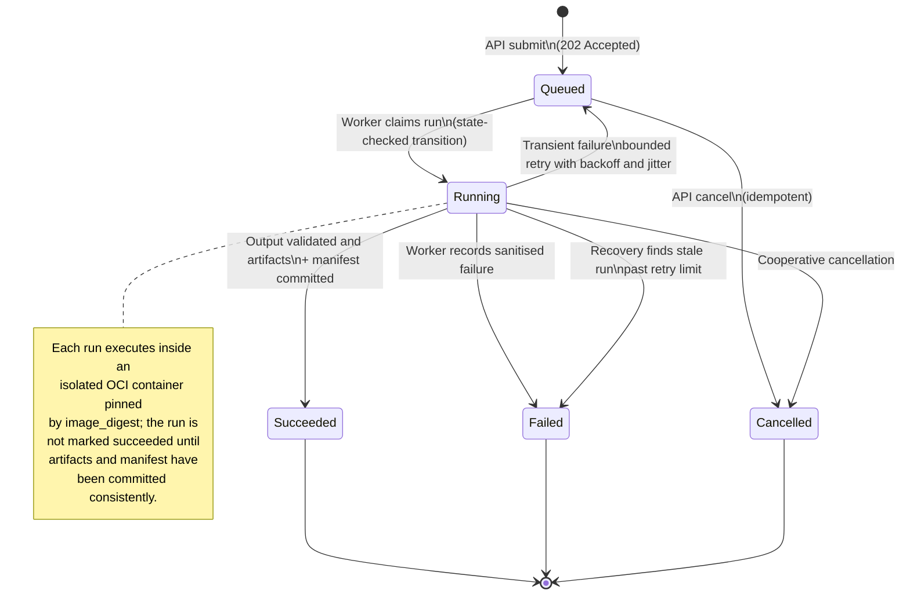

# Experiment Pipeline Data Flow

Run submission records the run and its outbox event atomically. The dispatcher
publishes only a run identifier; the worker reloads authoritative run, dataset,
sensor-configuration, and pipeline-version state from PostgreSQL before
launching the versioned OCI container pinned by `image_digest`. Artifacts and the
experiment manifest are persisted only after the container output is validated,
and run logs are captured separately and authorised like other project
resources.

```mermaid
flowchart TD
    User[Researcher]

    subgraph Client["Browser and frontend"]
        Web[Next.js application\nBFF route handlers]
    end

    subgraph API["API trust boundary"]
        APIProcess[FastAPI]
        Auth[Authenticate and verify project role]
        Submit[Validate parameters and ready dataset version]
        Transaction[Single PostgreSQL transaction]
    end

    subgraph Durable["Durable state"]
        DB[(PostgreSQL\nIdempotency key, experiment run,\noutbox event, pipeline version,\nsensor configuration, audit, artifacts, usage)]
        Objects[(Private S3-compatible storage\nRecording AEF-001 v3 file set)]
        ObjOut[(Private S3-compatible storage\nArtifacts and manifests)]
    end

    subgraph Queue["Background processing"]
        Dispatcher[Outbox dispatcher\nand stale-run recovery]
        Redis[(Redis task broker)]
        Worker[Celery worker]
        Container[Versioned OCI container\nimage_digest pinned\nCPU, memory, disk, time limits]
        Compute[Re-validate input\nrun MNE-Python pipeline]
        Logs[Run log capture\nsanitised, project-scoped]
    end

    User -->|Run request + Idempotency-Key| Web
    Web -->|POST /api/v1/runs| APIProcess
    APIProcess --> Auth
    Auth --> Submit
    Submit -->|Ensure dataset version belongs to project\nand is ready; resolve pipeline version| DB
    Submit --> Transaction
    Transaction -->|Reserve idempotency key,\ncreate run and outbox event,\nrecord audit event| DB
    Transaction -->|Accepted run response (202)| APIProcess
    APIProcess --> Web

    Dispatcher -->|Claim pending events with row locks| DB
    Dispatcher -->|Publish run ID| Redis
    Dispatcher -->|Mark event dispatched / retry failure| DB
    Redis -->|Task containing run ID| Worker
    Worker -->|Load and atomically claim queued run| DB
    Worker -->|Read dataset version, pipeline version,\nimage digest, validated parameters,\nand sensor_configuration_id| DB
    Worker -->|Read authorised recording files| Objects
    Worker --> Container
    Container -->|Read-only mounts of inputs| Compute
    Compute -->|Epochs, evoked, spectra, plots,\nand manifest| Container
    Container -->|Validate output arrays, channel counts,\ntime base, and coordinate conventions| Worker
    Worker -->|Write artifacts to controlled object keys| ObjOut
    Worker -->|Persist artifacts, manifest, usage,\nand succeed run atomically| DB
    Worker -->|Classified failure, bounded retry,\nor terminal failure| DB
    Worker -->|Structured logs| Logs
    Logs --> DB

    Web -->|Poll run status / list artifacts| APIProcess
    APIProcess --> Auth
    Auth -->|Project-scoped run and artifact lookup| DB
    DB -->|Status or artifact metadata| APIProcess
    APIProcess --> Web
    Web -->|Progress or artifacts + manifest| User
```

## Run lifecycle

A run is one of `queued`, `running`, `succeeded`, `failed`, or `cancelled`.
Terminal runs are never reopened by a duplicate worker message; a retry creates a
new run record.



## Experiment manifest schema

Every successful run produces a machine-readable manifest alongside its
artifacts. For the sample run (dataset AEF-001 v3, pipeline
`event-related-analysis` v1.2.0), the manifest records:

- `schema_version` — manifest schema version.
- `run_id` — stable identifier for the run.
- `inputs` — the exact input snapshots, each with a `dataset_version_id` and a
  content `checksum` (for example AEF-001 v3, covering `AEF-001_meg.fif`,
  `AEF-001_events.fif`, and `AEF-001_meg.json`).
- `pipeline` — `name`, `version`, and `image_digest` of the container that
  implements the pipeline (for example `event-related-analysis`, `1.2.0`).
- `parameters` — validated parameters such as filter settings (low-pass 40 Hz),
  epoch window (`tmin` −0.2 s, `tmax` 0.5 s), baseline, event type (`STI 014`),
  time-base and sample conventions, coordinate conventions, and any random seeds.
- `environment` — recorded `python_version` and `mne_version` from the runtime.
- `sensor_configuration_id` — the sensor configuration used where geometry
  matters (SQUID or OPM, with coordinate frame `head`, `device`, or `opm`).
- `outputs` — artifact references with checksums (epochs, evoked responses,
  spectra, topographies, plots, result tables).
- `status` — the terminal run status (`succeeded`, `failed`, or `cancelled`).

## Flow explanation

The `Idempotency-Key` replays the original run for an identical request and
rejects reuse for a different request. Redis is at-least-once transport, not
authoritative state: duplicate task delivery is safe because the worker claims
only `queued` runs and verifies state in PostgreSQL. A run is marked `succeeded`
only after the container output is validated and artifacts plus the manifest are
committed to both object storage and PostgreSQL; a failure to persist artifacts
never leaves the run appearing successful. Retries are bounded with exponential
backoff and jitter, and stale runs left in `running` after a worker crash are
recovered through a lease or heartbeat. Logs are captured separately, are
authorised like other project resources, and never contain secrets, signed URLs,
or raw signal data.

## Related documents

- [MEG Lab overview](../01-overview.md)
- [MEG Lab architecture](../05-architecture.md)
- [MEG Lab data model](../06-data-model.md)
- [MEG Lab API specification](../07-api-spec.md)
- [MEG Lab deployment](../12-deployment.md)
- [MEG Lab documentation index](../README.md)
